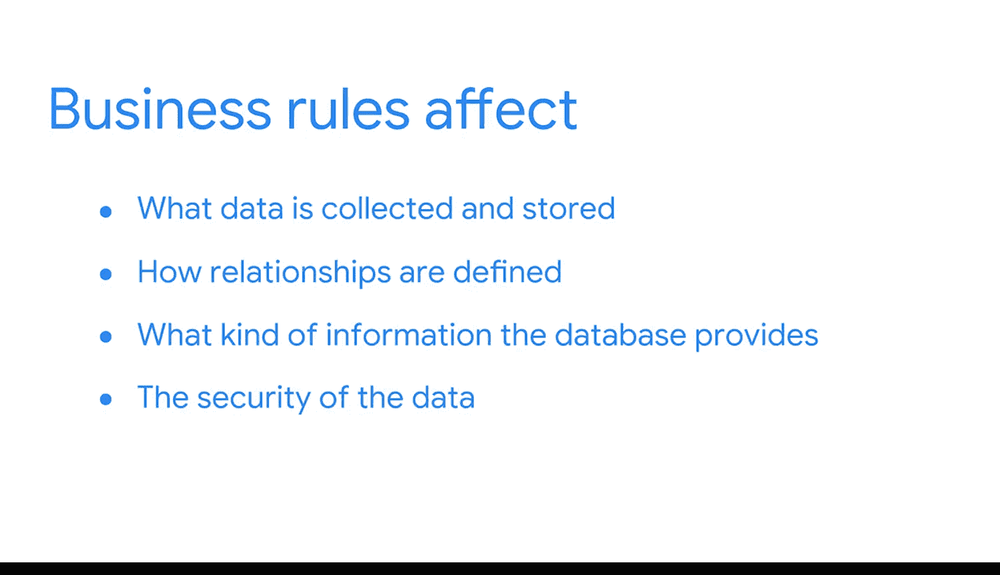

# 谷歌《谷歌商业智能（BI基础、洞察路线：模型和pipelines、决策：数据看板）｜Google Business Intelligence》 p70 31_03_01_验证业务规则.zh_en -BV1yJ4m1V7W9_p70-

So far， we've learned a lot about database performance， quality testing。

 and schema validation and how these checks ensure the database and pipeline system continue to work as expected。

Now we're going to explore another important check。

Making sure that the systems and processes you have created actually meet business needs。

This is essential for ensuring that those systems continue to be relevant to your stakeholders。

To do this， BI professionals verify business rules NI。

 a business rule is a statement that creates a restriction on specific parts of a database。

For example， a shipping database might impose a business rule that states shipping dates can't come before order dates。

This prevents order dates and shipping dates from being mixed up and causing errors within the system。

Business rules are created according to the way a particular organization uses its data。

In a previous video， we discovered how important it can be to observe how a business uses data before building a database system or ETL process。

Understanding the actual needs guides design， and this is true for business rules， too。

The business rules you create will affect a lot of a database's design。

What data is collected and stored， how relationships are defined。

 What kind of information the database provides and the security of the data。

 This helps ensure the database is performing as intended。

Business rules are different at every organization because the way organizations interact with their data is always different。

Plus， business rules are also always changing， which is why keeping a record of what rules exist and why is critical。

Here's another example。Consider a library database。

The primary need of the users who are librarians in this case is to check out books and maintain information about patrons。

Because of this， there are a few business rules this library might impose on the database to regulate the system。

One rule could be that library patrons could not check out more than five books at a time。

The database won't let a user check out a sixth book。

Or the database could have a rule that the same book cannot be checked out by two people at the same time。

 If someone tries， the librarians would be alerted that there is a redundancy。

Another business rule could be that specific information must be entered into the system for a new book to be added to the library inventory。

Basically， verification involves ensuring that data imported into the target database complies with business rules。

 On top of that， these rules are important pieces of knowledge that help a BI professional understand how a business and its processes function。

This helps a BI professional become a subject matter expert and trusted advisor。

As you're probably noticing， this process is very similar to schemeche of validation。

In schema validation， you take the target database schema and compare incoming data to it。

Data that fails this check is not ingested into the destination database。Similarly。

 you will compare incoming data to the business rules before loading it into the database。

In our library example， if a patron puts in a request for a book。

 but they already have more than five books from the library。

 then this incoming data doesn't comply with the preet business rule。

 and it prevents them from checking out the book。And that's the basics about verifying business rules。

 These checks are important because they ensure that databases do their jobs as intended。

And because business rules are so integral to the way databases function。

 verifying that they're working correctly is very important。Coming up。

 you'll get a chance to explore business rules in more detail。

