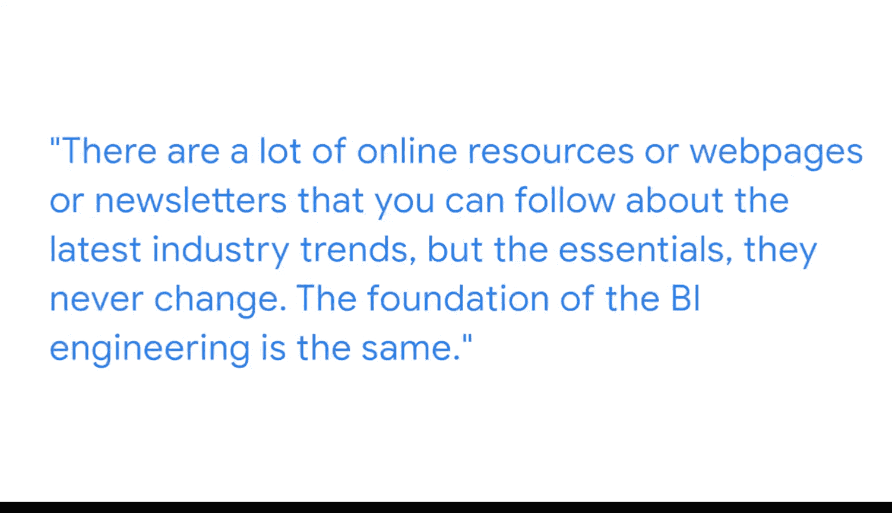

# 谷歌《谷歌商业智能（BI基础、洞察路线：模型和pipelines、决策：数据看板）｜Google Business Intelligence》 p71 32_03_05_布拉克：技术演进趋势.zh_en -BV1yJ4m1V7W9_p71-

My name is Barak， I'm a BI Engine Google， what a BI engineer does is actually collecting。

 storing and analyzing data with a lot of infrastructure involved。

I moved to states five years ago as a fresh immigrant。

 so it was very difficult to get the first job for me， even though I have a degree。

 I still needed to do a lot of training and get ready for the domestic needs of the market。

 I started teaching myself what a B the engineer does what are the essential technical skills that I need to learn and I did a lot of online research。

 I find a lot of free stuff。 I found a couple of paid subscriptions and I started learning all these technical skills that I need to learn to get my first job BI technology evolved a lot over the last 10 years。

 I can say spreadhe is very thin10 years ago， but nobody uses spreades anymore in terms of data analysis。

 I mean it's still being used for quick analysis but now everything has involved in cloud technologies more sophisticated languages。

 more powerful visual tools to help everyone So personally I have to add up changing environments and new languages and new infrastructures in order to keep up with the technology。

You actually need to do a little bit research and understand how the industry is actually evolving。

 There are a lot of online resources or web pages or newsletters that you can follow about the latest industry trends but the essentials they never change the foundation of the BI engineering is the same if you learn a SQL language whatever organization you work for is going to be a different SQL language is going to be different dial so you still need to catch up with but the amount of time that you need to learn is going to be drastically less than the amount of time you first start because there is gonna be in transferable skills my number one piece advice will be dedication if you really love working with data and if you would like to work in this field dedication is one of the key requirements because there is a lot of technical skills that you need to learn and it needs time Therefore I recommend to identify which area of BI engineering that you actually want to focus on because there are several parts that you can。

You can build infrastructures， or you can design systems， or you can analyze data。

 or you can do some visualization tools depending on which area you would like to focus on the technical skills you need to learn will vary。

