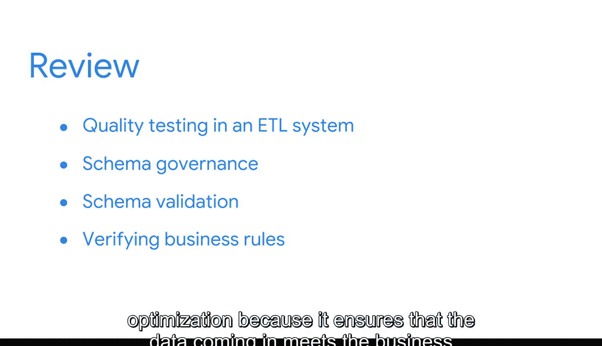

# 谷歌《谷歌商业智能（BI基础、洞察路线：模型和pipelines、决策：数据看板）｜Google Business Intelligence》 p72 33_03_01_总结回顾_3.zh_en -BV1yJ4m1V7W9_p72-

As a BI professional， your job doesn't end once you've built the database systems and pipeline tools for your organization。

It's also important that you ensure they continue to work as intended and handle potential errors before they become problems。

In order to address those ongoing needs， you've been learning a lot。 First。

 you explored the importance of quality testing in an ETL system。

 This involves checking incoming data for completeness， consistency， conformity， accuracy。

 redundancy， integrity， and timeliness。You also investigated schema governance and how schema validation can prevent incoming data from causing errors in the system by making sure it conforms to the schema properties of the destination database。

After that， you discovered why verifying business rules is an important step in optimization。

 because it ensures that the data coming in meets the business needs of the organization using it。

Maintaining the storage systems that users interact with is an important part of ensuring that your system is meeting the business's needs。

This is why database optimization is so important。But it's just as important to ensure that the systems that move data from place to place are as efficient as possible。

And that's where optimizing pipelines and ETL systems comes in。Coming up。

 you have another assessment， I know you can do this。And just as a reminder。

 you can review any of the material as you get ready， as well as the latest glossary。

 So feel free to revisit any videos or readings to get a refresher before the assessment。😊。

After that， you'll have the chance to put everything you've been learning into practice by developing BI tools and processes yourself。

You're making excellent progress toward a career MB BI。

