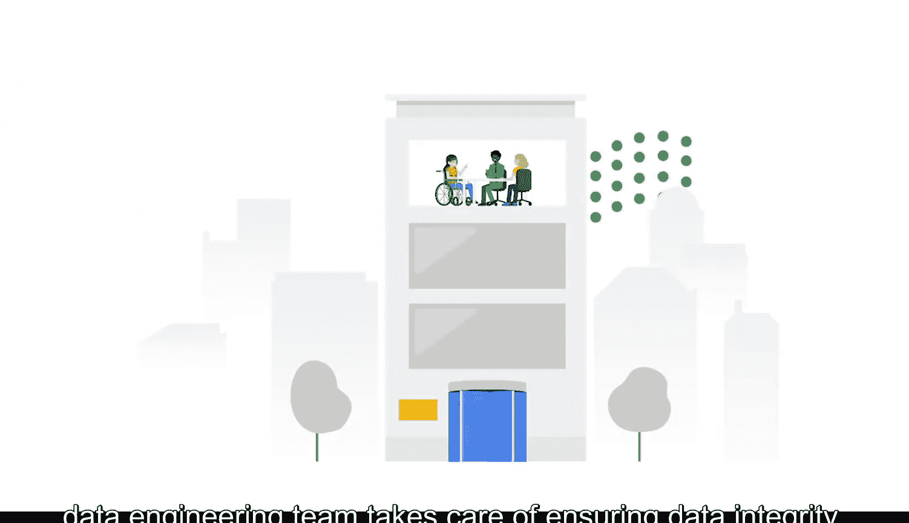

# 谷歌《谷歌商业智能（BI基础、洞察路线：模型和pipelines、决策：数据看板）｜Google Business Intelligence》 p73 34_03_01_可选复习：谷歌数据分析证书-数据完整性相关内容.zh_en -BV1yJ4m1V7W9_p73-

Welcome back In this video， we're going to discuss data integrity and some risk you might run into as a data analyst。

 A strong analysis depends on the integrity of the data。

 If the data you're using is compromised in any way。

 Your analysis won't be as strong as it should be。 Data integrity is the accuracy， completeness。

 consistency and trustworthiness of data throughout its life cycle。

 That might sound like a lot of qualities for the data to live up to， but trust me。

 it's worth it to check for them all before proceeding with your analysis。 Otherwise。

 your analysis could be wrong。😊，Not because you did something wrong。

 but because the data you were working with was wrong to begin with。When data integrity is low。

 in can cause anything from the loss of a single pixel in an image to an incorrect medical decision。

 In some cases， one missing piece can make all of your data useless。

 Data integrity can be compromised in lots of different ways。

 There's a chance data can be compromised every time it's replicated。

 transferred or manipulated in any way。 Data replication is the process of storing data in multiple locations。

 If you're replicating data at different times in different places。

 there's a chance your data will be out of sync。😊，This data lacks integrity because different people might not be using the same data for their findings。

 which can cause inconsistencies， there's also the issue of data transfer。

 which is the process of copying data from a storage device to memory or from one computer to another。

If your data transfer is interrupted， you might end up with an incomplete data set。

 which might not be useful for your needs。 the data manipulation process involves changing the data to make it more organized and easier to read。

Data manipulation is meant to make the data analysis process more efficient。

 but an error during the process can compromise that efficiency。 Finally。

 data can also be compromised through human error， viruses， malware， hacking and system failures。

 which can all lead to even more headaches。I'll stop there。 That's enough。

 potentially bad news to digest。Let's move on to some potentially good news。In a lot of companies。

 the data warehouse or data engineering team takes care of ensuring data integrity Coming up。

 we'll learn about checking data integrity as a data analyst。😊。

But verse assured， someone else will usually have your back， too。

 after you found out what kind of data you're working with。

 it's important to double check that your data is complete and valid before analysis。

This will help ensure that your analysis and eventual conclusions are accurate。

Checking data integrity is a vital step in processing your data to get it ready for analysis。

 whether you or someone else at your company is doing it。Coming up。

 you'll learn even more about data integrity。 See you soon。

