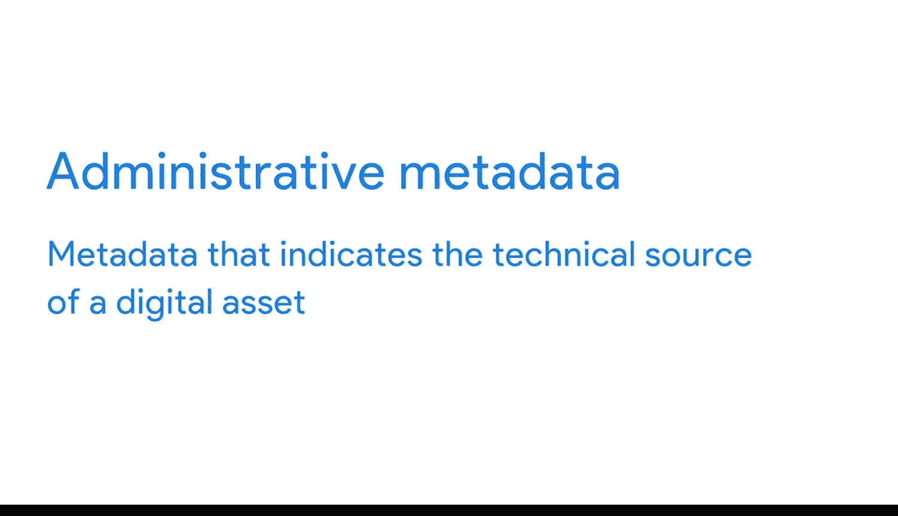

# 谷歌《谷歌商业智能（BI基础、洞察路线：模型和pipelines、决策：数据看板）｜Google Business Intelligence》 p74 35_03_02_可选复习：谷歌数据分析证书-元数据相关内容.zh_en -BV1yJ4m1V7W9_p74-

Now that you understand the different ways to organize data in a database。

 let's talk about how you can describe that data in this video， we'll start exploring metadata。

 which is a very important aspect of database management。

 metadata is kind of an abstract concept though so let's kick things off with a simple everyday example Did you know that every time a photo is taken with a smartphone data is automatically collected and stored within that photo。

 Take a look。 Choose any photo on your computer。 Here's a cute shot of my friend's dogs。

 Rudy and Matilda。On your photo， right click on get Info or Properties。

This will give you the photoss metadata， which may tell you the type of file it is。

 the date and time it was taken， the geolocation， or where it was taken。

 what kind of device was used to take the photo and much more pretty amazing right here's another example every time you send or receive an email metadata is sent right along with that message。

You can find it by clicking on show original or View message details。

An email message metadata includes its subject， who it's from， who it's to。

 and the date and time it was sent， the metadata even knows how quickly it was delivered after the sender press send。

Okay so metadata is information that's used to describe the data that's contained in something like a photo or an email keep in mind that metadata is not the data itself instead it's data about the data in data analytics metadata helps data analysts interpret the contents of the data within a database that's why metadata is so important when working with databases it tells an analyst what the data is all about that makes it possible to put the data to work solving problems and making data-driven decisions As a data analyst there are three common types of metadata that you'll come across descriptive。

 structural and administrative。Descriptive metadata is metadata that describes a piece of data and can be used to identify it at a later point in time。

For instance， the descriptive metadata of a book in a library would include the code you see on its spine。

 known as a unique international standard book number， also called the ISBN。

It would also include the book's author and title。Next is structural metadata。

 which is metadata that indicates how a piece of data is organized and whether it's part of one or more than one data collection。

 let's head back to the library， an example of structural data would be how the pages of a book are put together to create different chapters。

It's important to note that structural metadata also keeps track of the relationship between two things。

 For example， it can show us that the digital document of a book manuscript was actually the original version of a now printed book。

Finally we have administrative metadata administrative metadata is metadata that indicates the technical source of a digital asset When we looked at the metadata inside the photo that was administrative metadata it showed you the type of file it was the date and time it was taken and much more here's one final thought to help you understand metadata if you're on your way to the library to pick out a book you could research a book's title。

 author length a number of chapters that's all metadata and it can tell you a lot about the book but you have to actually read the book to know what it's all about Likewise you can read about data analytics but you have to take this course to earn the Google data analytics certificate so keep moving forward to gain that new perspective。

