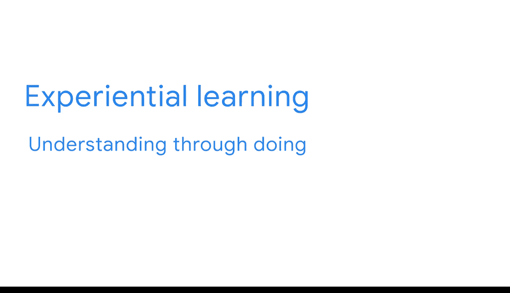

# 谷歌《谷歌商业智能（BI基础、洞察路线：模型和pipelines、决策：数据看板）｜Google Business Intelligence》 p75 36_04_01_欢迎来到模块4.zh_en -BV1yJ4m1V7W9_p75-

Hi， it's great to be with you again。 I'm Anita， a senior business intelligence analyst at Google。

 and I am back to discuss the next part of your end of course project and how you can use it in your job search。

 Are you ready to start job searching in the V I field。

 The first step is to create a portfolio and resume that exhibit your skills。😊。

Your portfolio will be a collection of materials that you can use to showcase those skills and your approach to solving B problems。

 One way you can build up your portfolio is by completing projects that demonstrate what you've learned like this program's end。

 of course project。 This end， of course， project is also a really valuable opportunity to develop your interview skills as potential employers assess you as a candidate。

 They might ask for specific examples of how you have tackled challenges in the past。

You can use your portfolio as a way to discuss real problems that you have solved。 Additionally。

 some employers might ask you to complete another case study for an interview。Getting some practice。

 creating your own case studies means that you'll be much more prepared for those interviews。

 You've already explored experiential learning or the idea of understanding through doing。😊。

This end of course project is also a great opportunity to really discover how organizations are using B I every day。

 Pra your new skills and really show off your B I knowledge in order to complete the end of course project。

 you'll be presented with more details about the business case。😊。

Then you'll use the key BI documents you completed to create a pipeline system that delivers data to reporting tables。

Later on， you can use these tables to design dashboards to share insights with stakeholders。

By the time you complete this project， you'll have a finished case study。

 you can add to your portfolio。 You'll also have documentation of the steps you took along the way。

 which you can use to explain your work to future hiring managers。 At this point。

 you've probably already completed one part of the end of course project。 Now。

 you're almost finished with the next course of this program， which means。

 you know everything you need to tackle the next phase。 Ready， then let's get started。😊。

