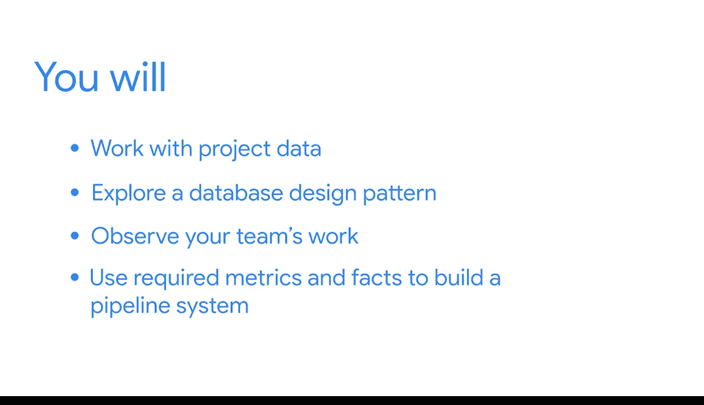

# 谷歌《谷歌商业智能（BI基础、洞察路线：模型和pipelines、决策：数据看板）｜Google Business Intelligence》 p76 37_04_02_继续您的课程期末项目.zh_en -BV1yJ4m1V7W9_p76-

In this course， you've been learning about how database systems are designed。

 how to build B I tools such as pipelines and E T L systems。

 and how to optimize them to maximize performance。 Now， it's time for an exciting next step。

 Pu all of this to work for your end of course project In the previous course。

 you were introduced to the project scenario and important details about the case。long the way。

 you developed stakeholder requirements。😊，Project requirements。And strategy documents。

Now that you have these important elements of the project laid out。

 it's time to start thinking about the data in this part of the course。

 you'll begin working with a database in order to create B tools that automate key processes such as moving and transforming data before reading it into your target tables for reporting coming up you're going to access the project data explore the design pattern for your database system observe your team's work to determine their needs and use required metrics and facts to build a pipeline that meets those needs these processes will enable your team to focus their time on other aspects of their day-to-day jobs and will move and transform your data for immediate use in reports and dashboards。

 these reports and dashboards will give your stakeholders updated insights and empower them to get their own answers from the data This part of the end-of course project is a great opportunity to demonstrate to potential employers that you can do exactly that and remember developing these tools is an iterative process so you can。

😊。

Continue to build and improve them as you have new ideas or learn new things。

