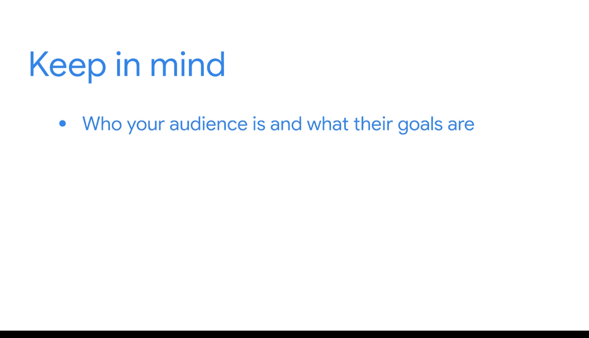

# 谷歌《谷歌商业智能（BI基础、洞察路线：模型和pipelines、决策：数据看板）｜Google Business Intelligence》 p77 38_04_01_课程期末项目持续成功技巧.zh_en -BV1yJ4m1V7W9_p77-

At this point in your end of course project， you've done a lot of work already。

 You've collaborated with stakeholders to determine their needs and create important project planning documents。

 Then you use those to explore the project data and build systems to deliver the data as you continue to work on your end of course project。

 you will want to consider how you can highlight your process and explain what you've done to potential employers and hiring managers。

 First， it's important to recognize that as a B professional。

 you may be asked to learn and adapt to new tools。 There are a lot of great solutions out there and different businesses use different B tools depending on their needs。

 Keep in mind that you have learned a lot of transferable skills that can be applied across different tools。

 you've also learn the importance of understanding and observing how stakeholders can use data in order to better meet their data needs。

 You recognize the different types of databases and storage systems and how they can be useful in a larger database system and you understand the logic behind pipelines that。

😊，Ingest， transform， and deliver data。These are all skills worth highlighting in job interviews。

 no matter what tools the position requires。 In addition， always be sure to consider your audience。

 as you have been learning throughout these courses。

 you will often work with different kinds of stakeholders who have different levels of technical know how。

 when you communicate with them。 Keep in mind who they are and what their goals are and what they already know and what they need to know。

😊。

This is just as true when you' are discussing your end of course project with interviewers often there will be people conducting or joining your interview who aren't necessarily BI professionals。

 For example， hiring managers may not have the same detailed understanding of BI processes as you do。

😊，In order to keep your presentation relevant to them。

 try to remember those key questions about your audience。

 Your interviewers have a business challenge， just like stakeholders on a BI project。

 They have an open job position to fill Think about what they need to know about you that makes a decision that solves that。

 Com up， you're going to learn all about presenting B insights to your stakeholders and providing them with access to relevant data they can use to make decisions by the end of these courses。

 you'll wrap up your end of course project by creating dashboards and presentations。

 In no time you'll have a complete case study for your portfolio。😊。

