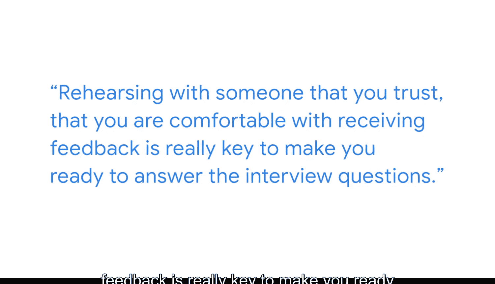

# 谷歌《谷歌商业智能（BI基础、洞察路线：模型和pipelines、决策：数据看板）｜Google Business Intelligence》 p78 39_04_02_路易斯：面试准备建议.zh_en -BV1yJ4m1V7W9_p78-

My name is Luish and I'm a data and analytics manager at Google When I'm preparing for an interview。

 I like to prepare a document where I describe what is the role。

 what are the typical questions and the typical type of interviews that this company does what is the team or the organization。

 this role I'm applying for， what are the projects that help this team to grow and to excel and also to prepare the technical side of it So prepare the portfolio。

 understand the impact that I want to showcase， what is aligned with with the company strategy and really take the time at least two weeks to really be ready for a first interview a portfolio is a collection of your past experience and the past projects that you think are useful to showcase to someone that is interviewing you。

Basically， your brand。 And you need to make sure that the project showcase the value of your brand。

 The common mistake。That I usually see is the lack of showcasing impact on the technical side。

 ensure that you understand why you created a data solution， what was the outcome。

 what is the impact， how did you measure that on top of that make sure that you also are capable of explaining why you apply a certain solution instead of others and also make sure that you define and you are able to explain the next steps。

 what can be done on top of this solution when you are preparing for an interview。

 make sure that you rehearse the interview with someone else。

 It's important that you make sure that you are able to tell the right message that you focus on impact that you are able to sell yourself the best way you can so you need to be really prepared for the interview and rehearsing with someone that that you trust that you are comfortable with receiving feedback is really key to make you ready。

To answer the interview questions if BI is really the path that you want to pursue。

 this is the very good first step to take into a but， you should not stop here。

 go out and talk with people there are multiple meetups that happen around data around BI so don't feel that you are alone on this road。

 There are multiple people that can help you increase your network， make connections。

 you'll be able to share and you'll also receive knowledge from others。

