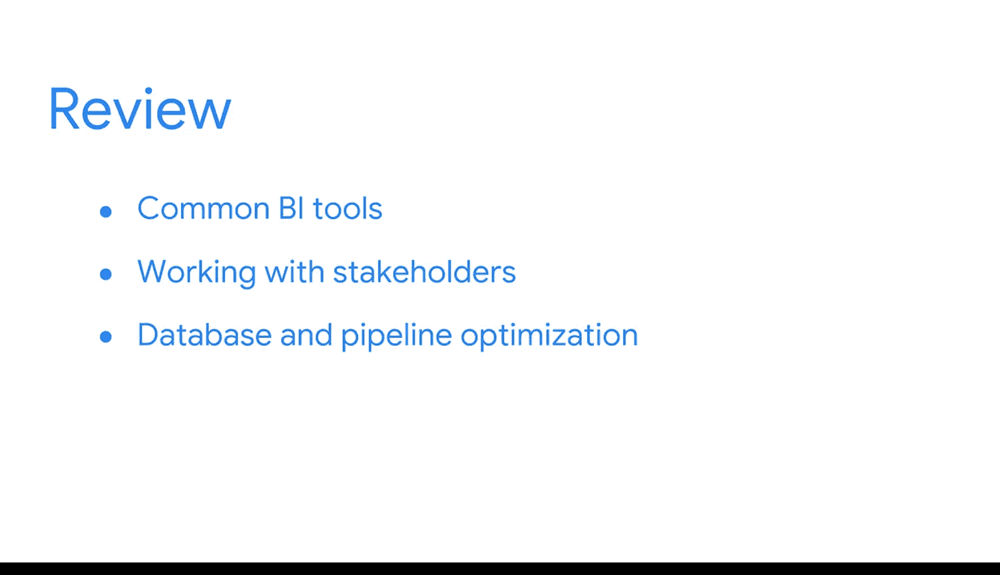

# 谷歌《谷歌商业智能（BI基础、洞察路线：模型和pipelines、决策：数据看板）｜Google Business Intelligence》 p79 40_04_02_课程总结.zh_en -BV1yJ4m1V7W9_p79-

Congratulations on completing another course。 You're that much closer to finishing this program and receiving your certificate。

😊，You've learned a lot already， so take a moment to consider everything we've covered in this course and celebrate。

For example， you learned about database modeling， design patterns。

 and how to use database schema to describe those design patterns。

You also discovered many kinds of databases and how they have different uses within a database system。

Next， you explore data pipelines and how ETL and ELT processes help get data where it needs to go and transform it to be useful during that process。

You also learned about different data storage systems that you might use in a pipeline。Additionally。

 you explored more common B I tools and how to interact with stakeholders effectively。

 You even had a chance to create your own pipeline。

 Then by exploring database and pipeline optimization。

 you were able to consider how B I processes and systems are often iterative。😊。

Coming up， you have even more exciting discoveries to make。

Now that you understand how to create systems to deliver data to stakeholders。

 it's time to start thinking about how to present that data and make it accessible and useful for decision making。

In the next course， you're going to learn more about how to design visualizations and dashboards for BI and present those insights。

 Great work so far。