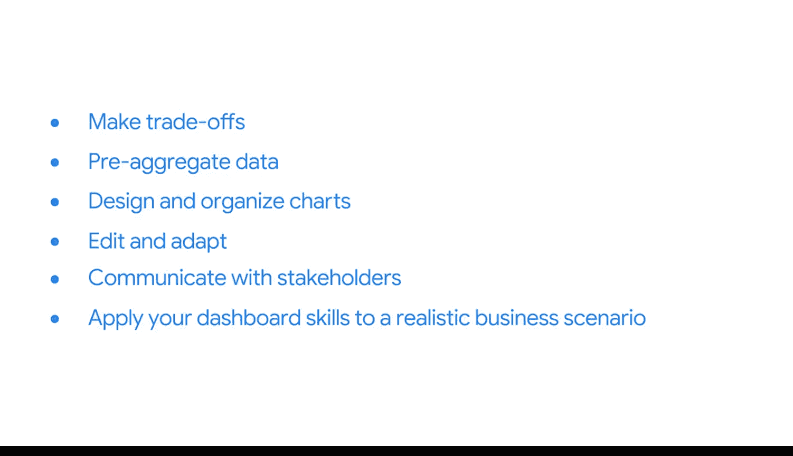

# 谷歌《谷歌商业智能（BI基础、洞察路线：模型和pipelines、决策：数据看板）｜Google Business Intelligence》 p80 01_01_01_课程介绍-3.zh_en -BV1yJ4m1V7W9_p80-

When a business intelligence professional works on a project， they have to juggle many tasks。

 They apply effective B I practices and tools in order to make a positive impact。

 They engage with stakeholders and manage their expectations。 They extract data。

 transform it and load it。 They optimize and maintain databases。

 Then they get to begin the next exciting part of a B I professionalss role。 Mon and reporting。

 These activities bring together all aspects of B I to produce a usable tool。

 Vily represented data that can be shared with and understood by others。 After all。

 sharing data is what makes it powerful。 It's one of the key ways in which information becomes intelligence。

 Hello， Welcome to the final course of the Google business intelligence certificate。😊。

I'm your instructor， Ternce， and I'm a business intelligence analyst here at Google。

I'm excited to work with you as we explore data monitoring and reporting。As a BI analyst at Google。

 I'm responsible for developing a deep understanding of the problems that my stakeholders are trying to solve and further leveraging our data to provide solutions to those problems。

Sometimes these solutions are simple data queries or grids of numbers in a report。

 but the best solutions are often dashboards with interactive visualizations that can immediately draw attention to the most important trends and insights。

 This can save hours of work for your team。As we work together through this course。

 we'll focus on building visualizations and reporting to stakeholders To do this。

 BI professionals create visualizations and dashboards that monitor data over time and continuously answer business questions。

Then they present these dashboards to their stakeholders and improve on them as time goes on。

This enables businesses to make quick informed decisions using specially built monitoring tools as a reminder。

 a dashboard is an interactive visualization tool that monitors live incoming data。

You can create a dashboard for a variety of purposes。

 but BI professionals mainly use them to display the data they've collected， analyzed。

 and tracked for a specific business purpose。In this course， you'll learn to design dashboards。

 communicate about their scope， then improve on the visualizations as business needs evolve。First。

 you'll discover what kinds of information you need to know about a project in order to prepare the right kind of dashboard。

 You'll explore how to empower stakeholders by designing interactivity into the dashboard。

You'll also gain key tools and techniques to design dashboards yourself。First。

 you'll make a plan to create dashboard mockups。 Then you'll explore Tableau。

 a commonly used data visualization tool， which will enable you to design your own dashboards and presentations in upcoming exercises。

You'll learn to make appropriate design tradeoffs and whether to pre aggregategregate your data in SQL。

Then you'll move on to designing charts and organizing them into simple and effective dashboards。

You'll refine your visualizations to adapt to evolving business needs。In addition。

 you'll gain some great strategies for presenting to and communicating with stakeholders。

Having clear conversations with users about business needs and project scope prepares you to create the best tools for your stakeholder。

 client， or user。And you'll definitely use these communication skills to share your work and launch your career as a BI professional。

Once you learn each of these skills， you'll have the chance to apply them in a realistic business scenario。

 You'll evaluate your stakeholders' needs and decide how best to plan。

 build and iterate on a dashboard。 So let's get going。

 I can't wait to share the exciting world of B I with you。😊。

