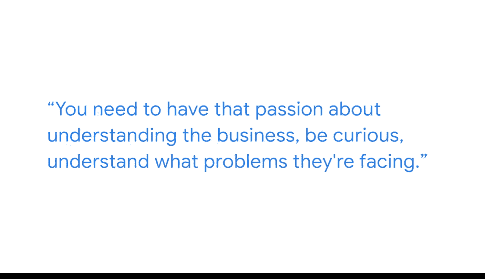

# 谷歌《谷歌商业智能（BI基础、洞察路线：模型和pipelines、决策：数据看板）｜Google Business Intelligence》 p81 02_01_03_特伦斯-作为商业智能分析师的一天.zh_en -BV1yJ4m1V7W9_p81-

Ii， I'm Terrence， and I'm a BI analyst at Google。 So my team at Google。

 we're a central data and analytics team in the finance organization。 So we help make decisions。

 you know， related to headcount， how we're investing Google's money， how you know， basic sales。

 revenue is doing profitability， all of those sort of metrics to help make。

 you know decisions within the finance work。 So with business intelligence。

 I didn't have any formal training in school or anything like that。

 I started my career as a more of a traditional financial analyst。 Now I found myself being drawn to。

You know， writingri SQL， creating pipelines that then took that data and made it powerful for everyone。

 The kind of B role was kind of coming into its own。 And I found myself really drawn to that。

 So in my day to day when it comes to B tools， I'm on more of the project management side。

 It's really about having a really good familiarity with with the tools that we use that ultimately our data engineers will be using to construct the pipelines。

 whether that's Google Cloud platform and Big query or you know all the way to dashboarding。

 So I have my hands in all of these things as I see projects all the way through from you conceptualization。

 understand where the data is coming from is this and even a feasible project。

 does the data exist in a way that we can ingested and transform it one of my biggest learnings is that the simple solutions are often the most powerful。

 the only way to really understand what those solutions are is to you sit and really understand from your stakeholders。

 your users what they're trying to solve。For you have to have a curiosity。

 You have to have a burning passion to go out there and want to understand。 Hey， how does。

 how does your business work， Like， what are the problems you're facing。

 What questions are you trying to answer， What's your day to day like， You have to have that really。

 you know， base understanding and then deep understanding to really go and take that the data that may be available to you and take at that additional mile。

 really pull out important insights， Allow them to make decisions on data that they didn't even know existed before。

 You need to have that passion about understanding the business， Be curious。

 understand what problems they're facing。 and ultimately。

 that's what I find really fun about this field， Being able to have that opportunity being able to be empowered to go understand the problems that the business is facing and come up with really creative solutions to those problems with data。

