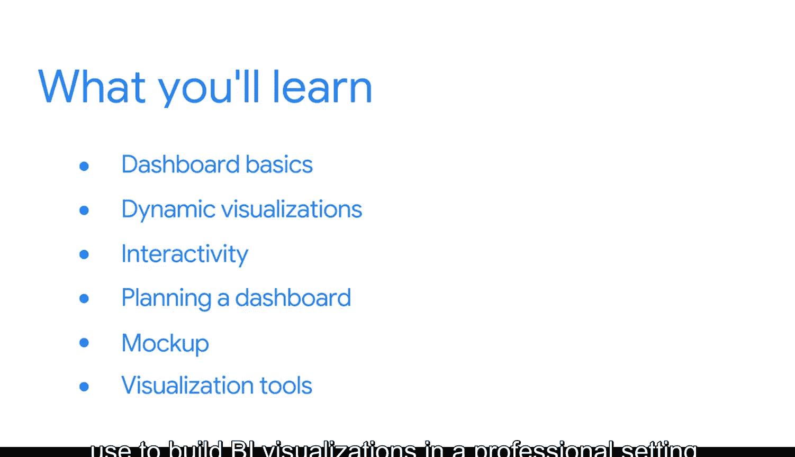

# 谷歌《谷歌商业智能（BI基础、洞察路线：模型和pipelines、决策：数据看板）｜Google Business Intelligence》 p82 03_01_05_欢迎来到模块1.zh_en -BV1yJ4m1V7W9_p82-

Hello again， Wecom to the first section of this course In the next few lessons。

 we'll be exploring the foundations of BI dashboards and how they're different from some other kinds of data analytics dashboards。

We'll also discover many reasons why dynamic visualizations are an excellent way to answer business questions。

 especially when the answers to those questions change over time。

You'll learn how a dashboard's interactivity empowers the stakeholders who you're building it for。

Also， we'll get into the specific steps to take while planning a dashboard to do this。

 you'll even get to create your own mockup， an essential step in dashboard building。And finally。

 you'll cover the kinds of tools you might use to build BI visualizations in a professional setting。

 If you haven't already， you'll get set up with Tableau。

 the visualization tool you'll be using in this course。

The next few lessons will lay the foundation for your dashboard journey。

 I hope you're as excited as I am to get started。

