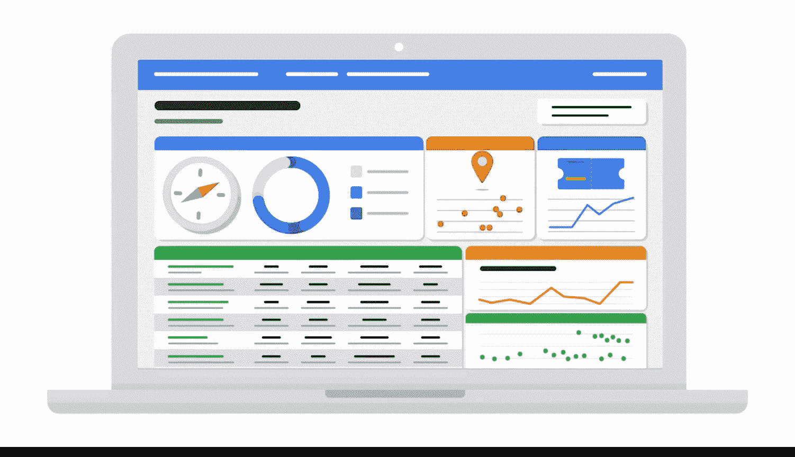

# 谷歌《谷歌商业智能（BI基础、洞察路线：模型和pipelines、决策：数据看板）｜Google Business Intelligence》 p83 04_01_06_商业智能中的数据可视化.zh_en -BV1yJ4m1V7W9_p83-

You probably know that data visualization is the graphical representation of data。

 Maybe you've even had some experience creating charts。

 graphs and other types of data visualizations。 If you've earned your Google data analyticstic certificate。

 you explored many key data Viz concepts， including accessibility and design thinking。If you'd like。

 feel free to spend some time going over these lessons again before moving forward。

 So you have some familiarity with data visualization。

 But did you know that data analytics visualizations are not exactly the same as business intelligence visualizations。

 In many ways， they're pretty similar。 Both are visual representations of data that communicate insights to the people who interpret them。

 They aim to share data in a clear and easy to digest manner。However， they differ in context。

 A DA visualization aims to answer a business question such as how is our company revenue trending this year？

This chart uses only existing data。 A BI visualization， On the other hand。

 Sees to answer that question in the long term。 So BI professionals might ask。

 how is revenue trending year over year and what other metrics related to revenue might indicate an upcoming change in revenue trends。

A B， I visualization tracks or monitors data that is relevant to an ongoing business question。

 This means that sometimes it's built for data that doesn't even exist yet。 In addition。

 the insights that come from a D A visualization would typically be used to make an important business decision。

However， BI visualizations are used to make one decision now。

 but then another decision in the future is the track data updates in LN's new insights。In this way。

 B visualizations are generally more dynamic than static。

 which means they are interactive or change over time。 when creating a dashboard。

 a B professional takes a different approach than a data analyst would。

 This is because their work goes beyond building and designing the dashboard to also maintaining it as time goes on。

 Here's an example。 say a B professional at an airline designed a dashboard for stakeholders who want to monitor new airplane demand over the next 10 years。

 They include six different chart types So the users can easily identify important metrics and Kpis related to consumers' travel frequency。

 The useful product lifecycl of airplanes， demand for new crafts and lots more。

 but perhaps something in the industry changes。 The stakeholders might ask for new Kpis。

  different arrangement of visual elements or similar updates。

 It's the B professionals's job to interpret their requests determine if their reasonable and feasible and implement them into the dash in this。

The dashboard keeps informing decisions， solving problems and answering key questions for the long term As you've learned。

 the ability to proactively respond to change and remain continuously useful is an essential part of BI。

Next time， we'll go deeper into empowering stakeholders with data visualizations。

