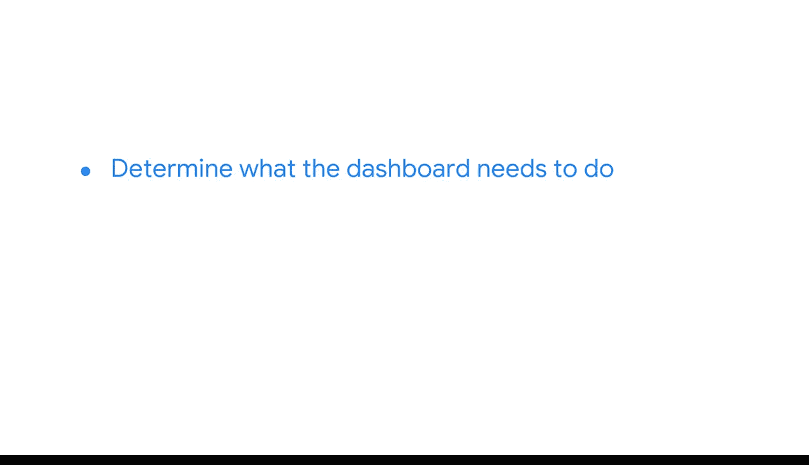

# 谷歌《谷歌商业智能（BI基础、洞察路线：模型和pipelines、决策：数据看板）｜Google Business Intelligence》 p84 05_01_07_赋能利益相关者.zh_en -BV1yJ4m1V7W9_p84-

As a B I professional， you will build tools that monitor and showcase important business data。

 As you're learning， the main purpose of tracking this data and building it into a dashboard is to enable stakeholders to answer their own data questions at its core。

 A dashboard is a tool。 For example， a dashboard that tracks annual revenue can tell you a story about how a small business went viral overnight。

 or a dashboard monitoring the global marketplace can tell you that competition has increased in a particular market。

😊，The stories told by dashboards provide important information about what's currently happening with the company's data。

 Then these stories provide opportunities for action。

Maybe a company facing new competition now knows that it needs to introduce a new product line or improve an existing one。

 and visualizations are more helpful than just raw data because they help make the data insights far more clear and understandable。

 Sometimes， a significant trend might be nearly impossible to identify without a visualization。

 For example， in this spreadsheet about a company's international sales。 All of the data is here。

 but its meaning is not immediately apparent。On the other hand。

 a dashboard about this data can much more clearly represent what's going on。 After all。

 the primary purpose of a dashboard isn't just to be aesthetically pleasing。

 It's to answer a question or solve a problem。Imagine that you need to find a company's total sales for the year 2019。

This chart from a dashboard answers that question very simply。

You can easily find the data point for the total of 2019 sales。Dashboards are also interactive。

 making them extremely flexible tools that put the power in the user's hands。

A dashboard doesn't answer one question and then lose its usefulness。 Instead。

 it can answer multiple questions based on what the user is searching for and how it's being used。

 So going back to our example。Maybe a stakeholder wants to use the dashboard to find out which country has the greatest total sales across all years。

They can simply change the setting from within the dashboard environment to focus on different data or the same data in a different way。

By creating and maintaining a multifunction tool， BI professionals can reduce the amount of work people need to do instead of building 10 separate charts to answer 10 questions。

 just one interactive dashboard does the job。As you know。

 your stakeholders use the tools you build to make informed business decisions。

 So your role as a B I professional will rarely involve interpreting the data that your dashboard displays。

 Instead， you'll create a dash that empowers users to interpret the data on their own。

 So you'll determine what the dashboard needs to do。

 build the appropriate tool and maintain and improve on it over time。

Coming up， we'll investigate more about stakeholder goals and create a mockup from a dashboard plan。

You'll soon be on your way to planning for the perfect dash。

