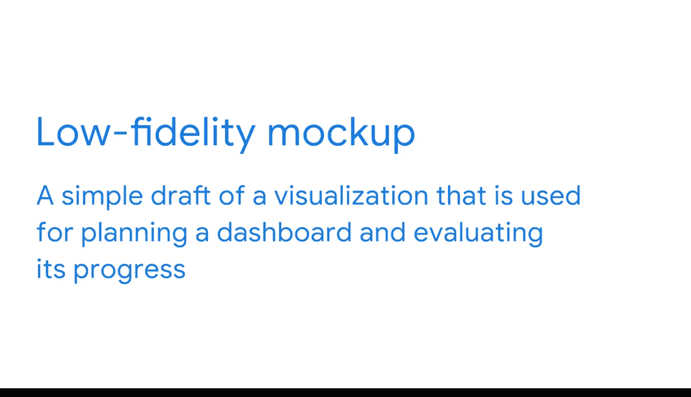

# 谷歌《谷歌商业智能（BI基础、洞察路线：模型和pipelines、决策：数据看板）｜Google Business Intelligence》 p85 06_01_01_使用线框图规划仪表板.zh_en -BV1yJ4m1V7W9_p85-

Like any important professional endeavor， dashboards require a lot of planning to get right。

 They also require a lot of collaboration。 You've already worked on many aspects of BI planning。

 including a stakeholder requirements document， a project requirements document and a strategy document In this video。

 we're going to learn more about planning and gains some strategies for dashboard specifically。

 Typically， a BI professional works with their stakeholders to figure out what needs to be included in the dash。

 The process usually begins with a stakeholder describing their needs。For example。

 a sales or marketing executive may want a dashboard that tracks customer spending habits。

 They could ask for visualizations that demonstrate how often customers buy the same product again or how much revenue increases at peak shopping times。

 such as during certain holidays。After stakeholders explain their needs。

 a B I professional follows up with their own questions。

 This helps determine the level of detail involved。 Some questions I like to ask are。

 what's the dashboard supposed to do and what K P's and dimensions I it tracking。

 It's helpful to also ask who the dashboard is being built for。

 Is it someone who needs the most specific level of detail or someone who just needs high level insights。

Lastly， the BI professional must consider where to find the necessary data in the timeline it should represent。

Of course， there are a limitless number of questions that can help shed light about any given project as you continue to gain context。

 you might identify some gaps in your understanding or find some pain points that you and even the stakeholders weren't expecting。

 Following up on these new discoveries will help you ensure you address your stakeholders needs more directly and create an effective tool for them to use。

In addition to asking questions， many BI professionals will observe their stakeholders at work；

 this can be actually sitting alongside them at their workstations or sharing their screens in order to demonstrate a particular workflow。

This is extremely helpful because often a stakeholder is so close to their own processes that they won't notice where or how a dashboard can help them。

This exercise requires time， but it yields a ton of great insights。 Likewise。

 it's valuable to iterate alongside your stakeholders。

We talk about iteration a lot in BI as a refresher。

 this just means repeating a procedure over and over again in order to keep getting closer to the desired result。

And as you've learned， desired results are always changing。

 which is why BI professionals iterate all the time。

The first step of the dashboard iteration process is to create a low fidelity mockup。

 a low fidelity mockup is a simple draft of a visualization that is used for planning a dashboard and evaluating its progress。

It may be a pen and paper model of how it's organized or a dashboard with a very limited amount of data。

 The stakeholder provides feedback， which you act on。

Sharing a low fidelity mockup is an excellent way to include your stakeholders and make the most of your collaboration。

Also， it's very effective at avoiding potential errors。

If you make an assumption that turns out to be incorrect。

 the mockup can help you and your users identify it and implement the necessary fixes。Soon。

 we'll explore even more about dashboard planning。 After all。

 the best way to reach a goal is with a clear and thoughtful plan。

