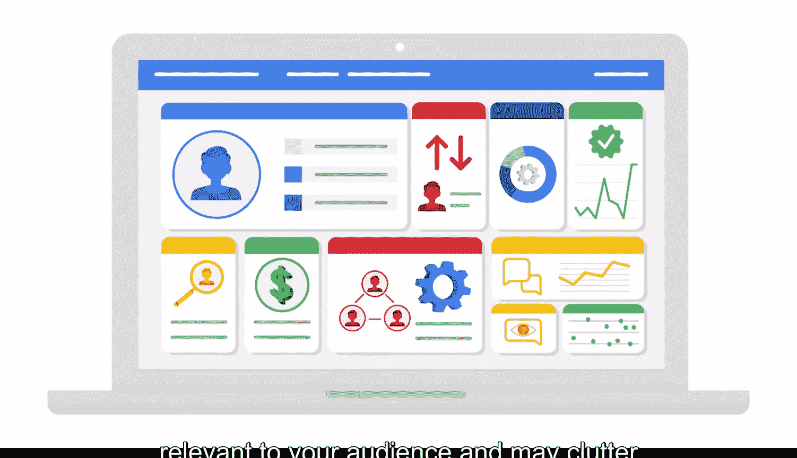

# 谷歌《谷歌商业智能（BI基础、洞察路线：模型和pipelines、决策：数据看板）｜Google Business Intelligence》 p86 07_01_02_仪表板常见误区及规避方法.zh_en -BV1yJ4m1V7W9_p86-

If you don't properly plan before creating a dashboard。

 it's only common sense that you might make mistakes。

But what kinds of problems can occur in this video。

 we will explore some of the most common consequences of not adequately planning for a dashboard。

There are three main types of dashboard issues that BI professionals encounter put simply。

 they are data problems， tool problems and audience problems。

 Let's consider each of these more closely。First， when it comes to a BI dashboard。

 a data problem is an issue caused by the data being used that's in the dashboard。

Maybe you've included more data than you need， just as you've discovered with pipelines。

 this can cause dashboards to run slowly。On the other hand， if you don't include enough data。

 you might be missing crucial information that your stakeholders could really benefit from having。

Perhaps you incorporated incorrect data sets or data from the wrong time period。

This can cause your stakeholders to come to inaccurate conclusions。

And if you don't understand what data is actually available。

 you might waste time and resources trying to obtain data that isn't there。

Avoiding data problems requires you to be very specific before you begin building any BI tool。

 Some key points to consider include making sure you know what data should be displayed and where that data should come from。

Also， set up a plan for how you will access the data and import it into your dashboard and confirm that you have permission to access the data and you know what file type you'll use。

Now， let's explore tool problems。These are dashboard issues involving the hardware or software being used。

 The most basic type of tool problem is simply selecting the wrong tool。 As you know。

 each company uses particular coding languages and data visualization programs。And in most cases。

 the BI professional must use their organization's preferred tools。As you've been learning。

 many of the skills you apply to one tool easily transfers to another。

 but you still need to understand how these tools are different so you can navigate them effectively。

Other tool problems relate to processing limitations。

 Some programs or servers may become overwhelmed if they're tracking too many Kpis。

Sometimes they can even crash if too many people are making edits to the same visualization。

 If you run into a hardware limitation during your building phase。

 you may need to reduce the project scope or find a more creative solution。

 which you will learn more about later on in this course。Okay， finally， we have audience problems。

These are dashboard issues caused by failing to adequately consider the needs of the user。

For instance， imagine your task with creating a dashboard for a company's human resources team。

 The tool needs to keep track of how many employees the company has hired or will hire and how many have resigned。

 If your dashboard also includes financial and operational metrics。

 These won't be relevant to your audience and may clutter the dash， causing complexity or confusion。

 which means your tool won't be as helpful to stakeholders as it could be。

 Another kind of audience problem concerns privacy and permissions。

 It's your responsibility to ensure that your dashboard only includes information that the users are permitted to access。

 rather than something sensitive or private， It's especially important to consider the needs of different audiences when your building a single dashboard for multiple users。

For example， say you're creating a dash to be used by a company's marketing team across Africa。

 Asia and Europe， as well as by the chief marketing officer。

The CMO would need data about all regions， where the regional teams may only require access to their own data。

 In this case， you would configure the privacy settings to account for multiple permissions。Later on。

 you'll learn more about how privacy permissions work， but for now。

 you've explored some of the most common problems that occur when building dashboards。

More importantly， you understand how to avoid them。

 and being proactive is an essential skill for any BI professional。

