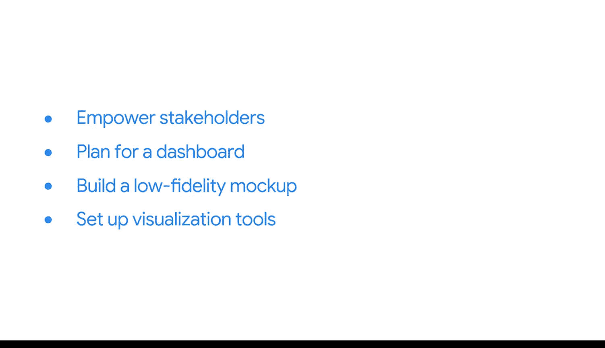

# 谷歌《谷歌商业智能（BI基础、洞察路线：模型和pipelines、决策：数据看板）｜Google Business Intelligence》 p88 09_01_01_总结回顾_1.zh_en -BV1yJ4m1V7W9_p88-

Throughout this course， you've been discovering so much about the world of B I。

 You now know how interactive B I visualizations empower stakeholders to make decisions。

 You've explored how to effectively plan for a dashboard。

 as well as how to build a low fidelity mock up。 You've also set up the tools you will use to build dynamic visualizations。

😊。

Once you're in a professional setting， youll be able to use these experiences to plan for excellent dashboards。

 but for now it's time to turn your attention to the next assessment。As a reminder。

 these challenges are here to help you evaluate your learning and progress throughout the course。

 Think of them as an essential measurement of your professional growth。

Take some time to review any material you like， including the latest glossary。

 which is full of new vocabulary definitions and concepts。 Good luck。 You're going to do great。😊。

