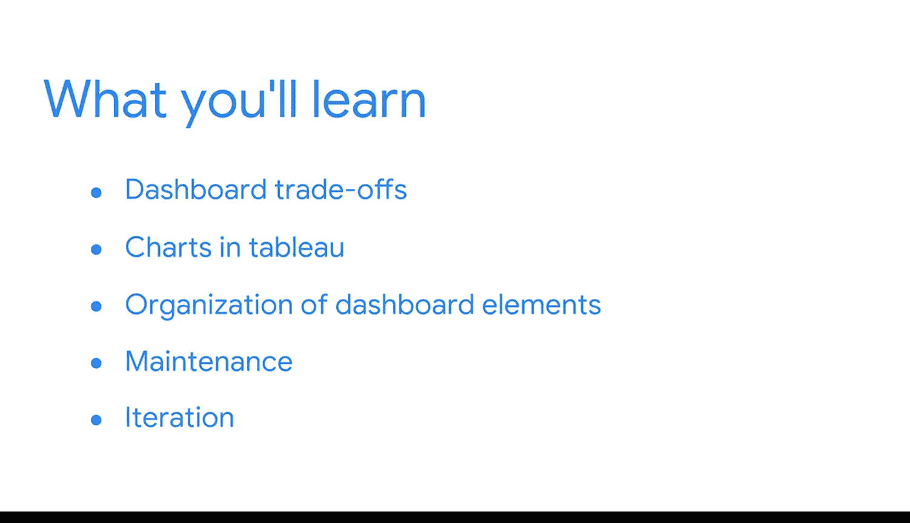

# 谷歌《谷歌商业智能（BI基础、洞察路线：模型和pipelines、决策：数据看板）｜Google Business Intelligence》 p90 11_02_01_欢迎来到模块2.zh_en -BV1yJ4m1V7W9_p90-

Imagine you're building a dashboard。 You know what questions you need to answer for your users。

 and you've built a low fidelity mock up that outlines your plans for what charts you'll make。 Plus。

 you've identified the appropriate tools to use。 Now。

 it's time for the next step designing the visualizations in upcoming lessons。

 you're going to have the opportunity to practice creating charts and dashboards yourself。

 You'll start by delving deeper into the trade offs you must consider while building B I visualizations。

Then you'll apply design best practices and your BI knowledge to create a chart in Tableau。

Once you complete your chart， you'll explore effective ways to organize elements within a dashboard。

 You'll use your design skills yet again， but on a larger scale。

 And because a major part of the B I role includes maintenance and iteration。

 you'll learn how to make changes as the business needs evolve。

This is the order that we'll use to learn about dashboard design during this section。

 but it isn't the only way You might prefer to plan high level dashboard organization before getting specific with charts。

 That's okay。 Everyone's design process is different。 Personal。

 I've learned that you rarely design the perfect dashboard on the first try。

 Sha your ideas with stakeholders as soon as possible is a great way to get feedback。

 Conue learning about the B I goal and ensure you don't waste effort。 focusing on the wrong problems。

 The next few lessons will help prepare you to apply what you're learning to a realistic business situation。

 which you'll do later in this course。 I hope you're as excited as I am to start building dashboards。

 Let's do it。😊。

