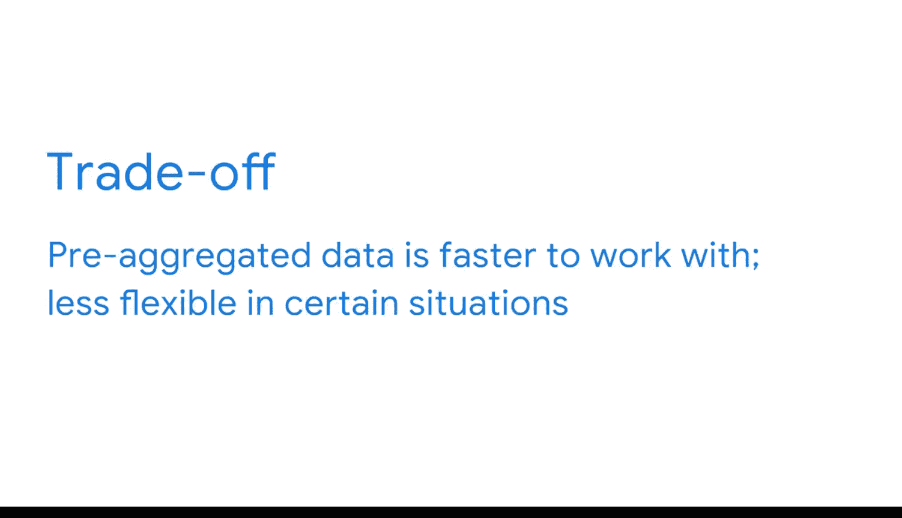

# 谷歌《谷歌商业智能（BI基础、洞察路线：模型和pipelines、决策：数据看板）｜Google Business Intelligence》 p91 12_02_02_构建仪表板时的设计权衡.zh_en -BV1yJ4m1V7W9_p91-

When planning a dashboard， an essential part of your job as a BI analyst is determining how to represent data in the most effective way。

Along the way， you will often have to make some tough decisions。

Many of these take the form of trade offs in B， I， a trade off involves balancing various factors。

 often by prioritizing one element， while sacrificing another in order to arrive at the best possible result。

 You witness an example of this in the international sales chart from a previous lesson。

In this view of the chart， the data is set at a yearly time scale。 Each column represents a year。

 and the height of the bars represent the total sales for that year。

 but dashboards are flexible and can be changed to present the same data in different ways。

For example， you can modify the filter setting to a quarterly time scale。Now。

 there are several additional bars displaying more information on a single screen。

Notice that a yearly time scale is more condensed， so it's more difficult to interpret what happens throughout the year。

But the data that is available is simple and easy to follow because it isn't as dense， either way。

 selecting appropriate trade offs depends on the ultimate business goals。For example。

 if stakeholders want to know the company's total yearly sales in a specific region for 2019。

 the yearly time scale chart provides the clearest answer。However。

 if their question involves identifying which quarter achieved the highest sales over the last few years。

 then the quarterly time scale chart is best。 Sometimes a trade off can be more complex。

Suppose your stakeholder wants to separate the data by country again。

 but they also mention that the dashboard is updating too slowly。In this scenario。

 the trade off in question is that the user wants the dashboard to do more faster。

 something that's challenging， if not impossible， to arrive at the best possible solution。

 you might consider speeding up the dashboard by pre agregating your data with SQL。

As you have learned from the Google data Analytic Cert。

 aggregation is the process of collecting or gathering many separate pieces into a hole。

 So pre agregation is a term B professionals use to describe the process of performing calculations on the data while it's still in the database。

 This means reducing the number of rows or the size of the data set before it's used in analysis or a dashboard。

 Think of it this way。 If you pre aggregate the data。

 It will be in a state that's closer to what you ultimately need。

 This is because some of the necessary calculations will happen before the data is aggregated in the database and sent to the data visualization tool。

And that's the trade off。 your pipeline will involve more steps。

 but your users will get to the information they need more quickly。On the other hand。

 if you choose to calculate all of the data once it's in the data Viz tool。

 this eliminates aggregation from the build process。

 The trade off here is that your pipeline will involve fewer steps。

 But your users may experience slower results。 It's also possible to pre aggregate only some of the data。

 then calculate the remainder after it's imported to the data Viz platform。 Again。

 it's all about considering the stakeholder needs than balancing the different factors in choosing which element to prioritize。

Also， note that pre aggregation comes with another cost。 Pre aggregateated data is less flexible。

 Imaginem that another stakeholder wants to represent sales data by store size。

If you had already used pre aggregation to combine the data by region。

 thereby putting all stores together no matter their size， you'd have a problem。

How you go about solving this problem will once again depend on the situation。

 If the speed issue can be solved with other methods or you're completely sure flexibility won't be necessary。

 you can make the trade off and prioritize either speed or flexibility。

 The best solution isn't always clear。 Sometimes you'll need to get creative。

 That's one of the most exciting parts of being a B I professional。

 Finding a creative solution to a difficult problem。

