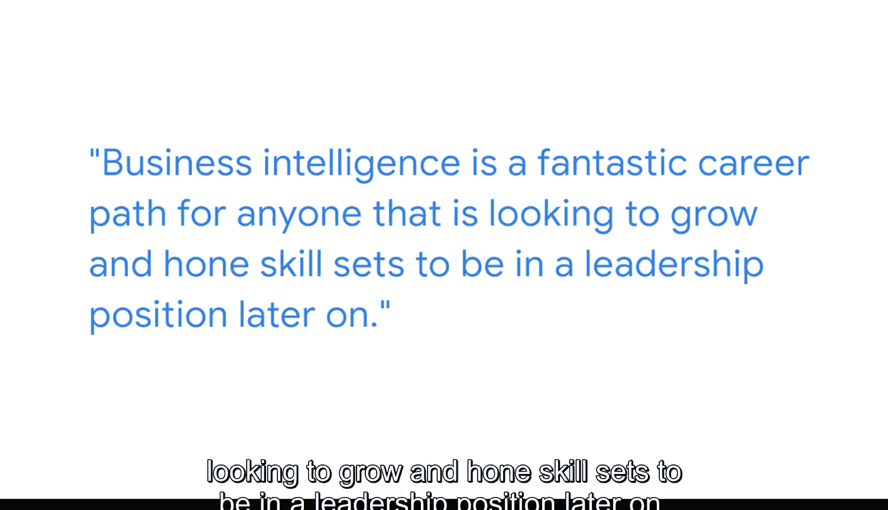

# 谷歌《谷歌商业智能（BI基础、洞察路线：模型和pipelines、决策：数据看板）｜Google Business Intelligence》 p92 13_02_04_迪安德烈亚-实战中的商业智能.zh_en -BV1yJ4m1V7W9_p92-

My name is Deanda and I'm a product operations and strategy lead for Google Wall。

 I support the product management organization in launching payments products for Google。

 I specifically work on the Google Wall app which allows users to store their credit cards。

 loyalty cards， driver's license and other items on Android devices。

Bsiness intelligence used to drive key decisions in an organization and my current role within payments。

 business intelligence has allowed us to identify what are key markets where we should continue to grow and spread Google Wall we look at a lot of different information to try to understand is a market ready for a payment solution so what's the kind of adoption of devices that would be compatible with the Google Wall do stores have kind of offline payments set up where they can accept contactless and so we use that data in that business intelligence information to figure out if a market is ready for something like Google Wall or is there more work to do on the partnership side to ensure that consumers would have the opportunities at their disposal if they had a Google wallet to actually pay contactless in store anytime you recommend something people are gonna to ask to see the data they want to know why what you're saying make sense and there's no way to do that without business intelligence without understanding kind of what is。

Feding the opinion or recommendation and why that idea is the best one to go with in a previous role I ran a survey where we asked all of our advertising customers kind of like what do you think about your relationship with Google is a serving your needs or your sales rep serving your needs what can we do differently what can we do better how can we best support and enable your business so after we ran the survey we got a ton of data back and so we have lots of different use points that we need to figure out a way to kind of like aggregate and pull out what's the story So using different data tools to draw kind of like what's the summary of the different qualitative responses that we're getting。

 Are they positive or negative and helping to summarize that at a high level I think if you just have raw data it's kind of not feasible to expect anyone to kind of read through absolutely everything so business intelligence and different data tools and data specialists and dashboards we're used to upleve the information to make it easier to filter on specific teams or specific clients and also view the numbers and aggregate at a country。

RegB intelligence is a fantastic career path for anyone that's looking to grow in home skill sets to be in a leadership position later on。

 stick with it， always have an open mind， always continue to learn and grow and I'm excited to maybe see you all one day and work with you all on business intelligence。

