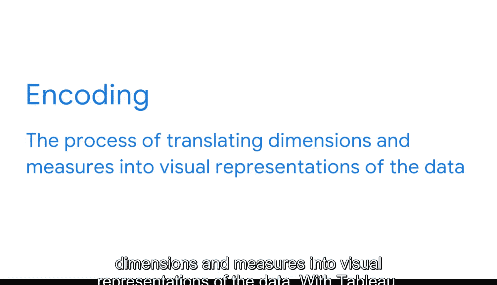
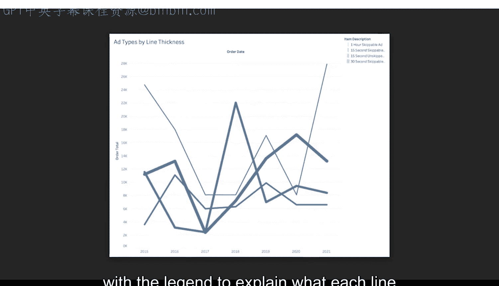
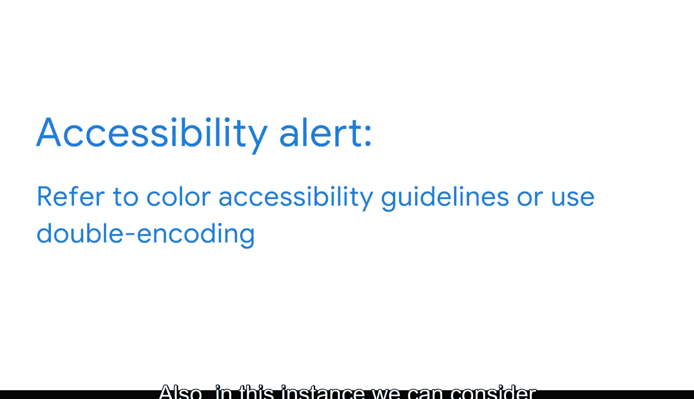
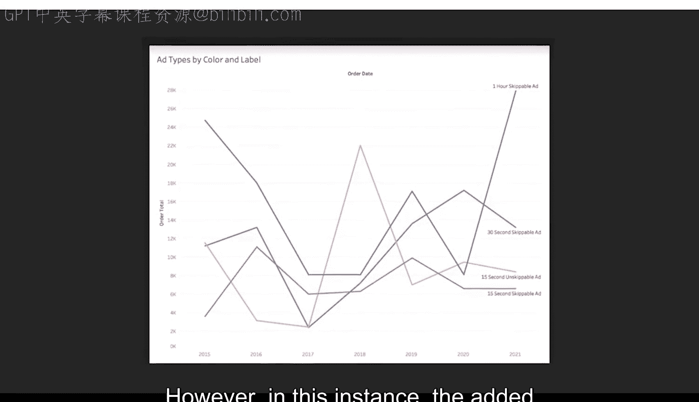

# 谷歌《谷歌商业智能（BI基础、洞察路线：模型和pipelines、决策：数据看板）｜Google Business Intelligence》 p93 14_02_06_开始创建图表.zh_en -BV1yJ4m1V7W9_p93-

In this lesson， we're going to start creating a B I chart。

 If you'd like open tableau desktop or public to follow along with these steps。

 This is completely optional， but it will help you get used to the interface。

 will begin by going to sheet one of the workbook and accessing the chart building interface。

 Then we'll navigate to the dimensions and measures of your data。

 dimensions in data visualization are qualitative data types that can be used to categorize data。

 Some examples of dimensions include names such as customer names， product names or locations。

Measures are quantitative data types that can be either discrete or continuous in the Google Data Analytic certificate。

 discretereet and continuous data types are explained in detail。

 If you'd like to review those lessons， go ahead and do so as a quick refresher。

 discretereet data has a limited number of values。 and continuous data can have almost any numeric value。

For instance， the number of students in a class is discrete data。

 This is because the class roster is finite， and it's impossible to have the value of， say，1。

5 students。 But measures of continuous data have an infinite set of values that contain intervals within each value。

 Temperature is continuous data because it could potentially be infinite and it can have any numeric value。

In Data Viz， dimensions and measures are the important trackable elements to be represented。

 one of the many decisions you'll make as a BI professional is how to encode these dimensions and measures。

In BI， encoding describes the process of translating dimensions and measures into visual representations of the data。

With Tableau， we can drag a dimension or measure of a data set to one of the encoding types in the marks dropdown。

Using the previous example， our ad type dimension might be encoded with color。

 This means that lines for each type of ad， such as a 15 second skippable ad。

 will be represented by a different color。 If we encode this dimension in a different way。

 It will change how the chart is interpreted。 Here's the same dimension encoded with line thickness instead of color。

 Even with the legend to explain what each line represents。 It isn't as easy to understand the data。

 Encoding brings up another situation where you might have to make a trade off。

 color is a commonly used type of encoding。 For many people。

 it's an easy way to distinguish information。 However。

 people with color blindness may not find certain types of color encoding very helpful。

 B professionals often refer to guidelines that explain accessible palettes。 Also， in this instance。

 we can consider double encoding the ad type dimension。 For example。

 we can encode it with color and labels。 The labels also specify the ad types。

 making our visualization。

Cler and more accessible。 But this creates yet another trade off。

 because we're using labels to represent a type。 We have more visual elements in the chart。

 If you have too many visual elements， the chart might be difficult to understand。 However。

 in this instance， the added visual elements don't create too much clutter。

This is a smart trade off to make because accessibility is such a crucial part of building an effective visualization。

Making a trade off that prioritizes accessibility is a design best practice。

You might have to make other kinds of trade offs while you encode the data in your visualizations。

When this happens， always refer back to your business question and stakeholder needs with these building blocks。

 you can now represent all sorts of B data in a chart So， we'll expand on chart basics。

 and you'll build your own chart from B I data。 Stay tuned。

