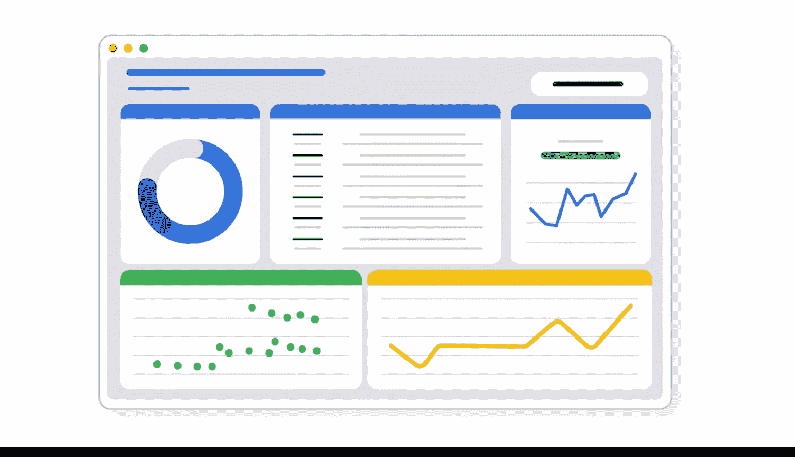

# 谷歌《谷歌商业智能（BI基础、洞察路线：模型和pipelines、决策：数据看板）｜Google Business Intelligence》 p94 15_02_01_组织仪表板元素.zh_en -BV1yJ4m1V7W9_p94-

Recently， you've been learning how to design charts in Tableau。 Now， it's time for the next step。

 organizing a dashboard。In this video， you'll shift your focus from the details of a single chart to design approaches for an entire dashboard。

 You'll learn many of the same design principles， but on a larger scale。😊，In Tableau。

 organizing your charts， sometimes called worksheets into a dashboard is fairly simple。

 Let's check it out。To create a new dash will' drag the relevant charts to the center dashboard design interface。

 Once the charts are placed onto the dashboard， we'll rearrange them in a configuration that best suits the stakeholder needs。

Suppose that stakeholders at a university want to expand the course offerings to cater to the demand of prospective students。

 So the administration asks for a dashboard tracking the most popular courses each term。

We want to place the chart that tracks popular courses at the top because it's the most important chart and the most relevant。

 But we might also want to include a chart that displays more general admissions data。

 as well as one that shows the popularity of courses from other nearby universities。

This will enable us to monitor the education landscape。Where might we put these charts。

 Some of these placement decisions may have already been made during the mock up planning stage。

 Make sure to reference the low fidelity drafts when building visualizations。 Also。

 consider previous discussions with stakeholders about their needs and relevant metrics and K Ps。

Okay， now there are many other elements that can be includedccluded in a dashboard， such as titles。

 labels， a legend， and a navigation bar to help direct users。

The Google Data Analytics Cer has lots of lessons about this， so feel free to do a quick review。

We can also include links to web pages or internal documents that a stakeholder may want to reference。

Once we have an idea of the dashboard elements， it's time to apply design best practices。

You've already reviewed several of them earlier in this section。

While we should make sure to use each of the best design practices at our disposal。

 a few of them will be particularly helpful for building B dashboards that don't overwhelm the audience。

 One of these practices is prioritization in hierarchy。

 If we have a visualization tracking data that is highly relevant to the stakeholders's question。

 we can emphasize it visually。 Do this by increasing its size compared to other visualizations。

 A larger chart naturally draws more attention than a smaller one。 Also。

 use color and negative space to highlight important elements。

 Colors with more contrast are more likely to get noticed。

 and negative space can emphasize an element within empty surroundings。

 Grouping objects that share a topic or tell a story helps ensure that our dashboard has a logical flow。

 For example， we might keep financial data in a single place rather than dispersed throughout the dash。

 Then we can put time related data in another area。😊，Another helpful design tip is to hide objects。

 It might sound counterintuitive to create a visualization and then hide it。

 but we can organize visualizations on multiple pages or place them within drop down menus that hide parts of the dashboard from the main screen。

😊。

By hiding some elements， we can spotlight others， avoid clutter without deleting content。

 and even increase processing speed。 you'll learn more about that soon。One final point。

 don't group objects based on chart type。 Pu all of the bar charts together simply because their bar charts isn't a useful practice。

 Instead， organized by topic or metric。 So， you'll get an opportunity to apply these design practices and build your own dashboards。

 Can't wait。😊。