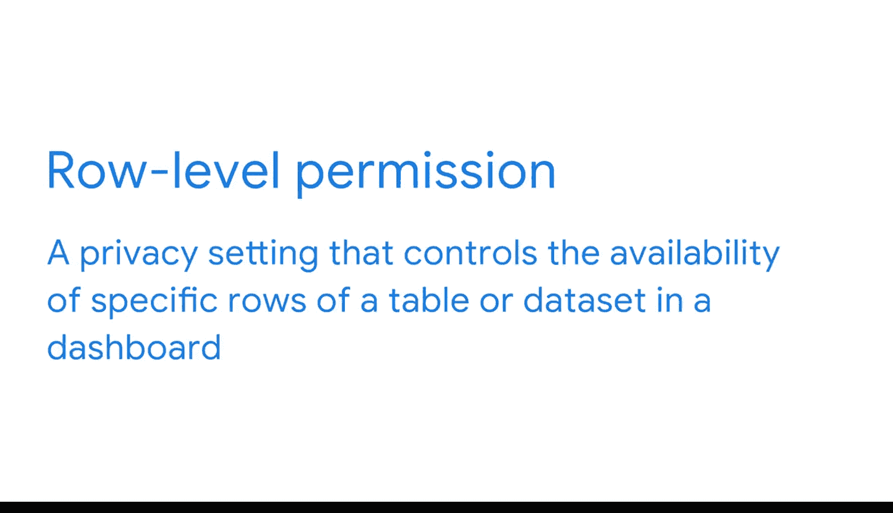

# 谷歌《谷歌商业智能（BI基础、洞察路线：模型和pipelines、决策：数据看板）｜Google Business Intelligence》 p95 16_02_03_处理速度与隐私设置.zh_en -BV1yJ4m1V7W9_p95-

As you know， delivering a dashboard to your clients is not the end of your role in a project。 B。

 I involves a lot of iteration， often based on stakeholder feedback in order to get closer and closer to the ideal end state。

 Use might share comments about your aesthetic choices or your design approach。

 Or as we've explored in many examples。 Clients may have feedback about access and privacy。

 as well as processing speed。 Sp is critical in B I。

 So let's begin by identifying some common causes of slow processing speed and learn how to fix them。

 You've probably figured out that processing speed describes how quickly a program can update and load a specific amount of data。

 If the load is too high， then processing speeds will be slow。 and the tool might even crash。

 This can make it difficult or frustrating to work with a dashboard。Of course。

 the greatest contributors to high loads and slow processing speeds are the volume of data and the number of measures and dimensions included。

 Natural， the more data， the greater the volume of information being processed and visualize at a given moment。

 Also， the number of tabs in a dash can affect processing speed。

 If there are several tabs you can better organize your visualizations。 However。

 having too many tabs may slow things down。 Yet another B trade off。

 Be considering how to reduce load and increased processing speed at the start of your planning。

 As a rule， you should begin broadly than narrow your scope。 In other words。

 identify the priority Kpis then consider and refine supporting information。long the way。

 you might find that a metric you were originally asked to track is no longer relevant to your stakeholders' business question。

 In this case， you can remove it from your dashboard， which will help things move more quickly。😊。

In addition， you can optimize processing speeds by changing calculations in your database。

 This enhances dashboard efficiency because back end servers are more powerful than front end servers and can process more data faster。

 However， if a calculation is dependent on the filters applied in its dashboard。

 then it can only be completed within the dashboard itself。

 This is an uncommon situation for entry level BI professionals。

 but one that's important to be aware of。Configuring the amount of data that is preloaded in the dashboard can also be a good solution。

 Preload less data， and there will be less strain on the dash。

 But keep in mind that preloading may mean that the insights aren't as current as they could be。

 Other strategies for speeding up your dash include filtering data early on and pre agregation。

 You learned about that earlier in the section。Okay。

 now let's turn our attention to another important part of the dashboard iteration process。 privacy。

 As you know， a dashboard may be used by many stakeholders within a company。 Often。

 certain data is available to some people， but others don't have permission to access it as a B I professional。

 configuring privacy settings is a crucial part of building and maintaining dashboards。

There are several types of privacy permissions， but we're going to focus on three main levels。

 public availability， object level permission， and row level permission。

If your dashboard is publicly available， it's accessible to anyone use this unrestricted setting to share a dashboard with the general public。

The next is object level permission。 This privacy setting controls the availability of a single item such as a table。

 data set or single visualization。 You'll probably employ object level permissions the most。

 due to their simplicity。If you give a user access to an object。

 Revoking that access is as easy as removing their permission。

 The third permission type is row level。 row level permission is a privacy setting that controls the availability of specific rows of a table or data set。

 This type of privacy setting is a bit more complex because it must be set up in the database rather than the visualization tool。

 Configuring complex permissions， where data from several sources is selectively available to different groups is something that even some experienced professionals find difficult。

 You likely won't need to understand every detail about permissions when starting out in B。

 You may even be on a team with a data engineer who will work with you to configure permissions。

For now， you've learned some important fundamentals about iterating dashboards based on stakeholder feedback。

 Next， you'll get the opportunity to continue applying this knowledge to your own dashboards。

 I hope you're as excited as I am。😊。

