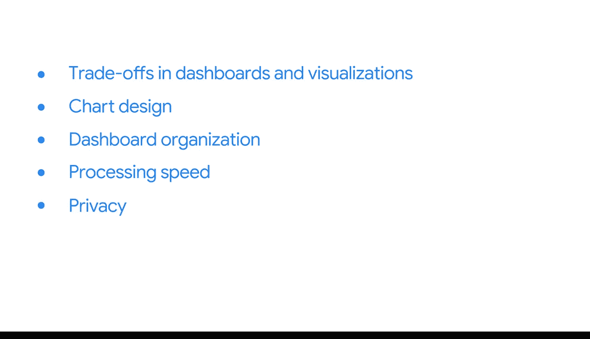

# 谷歌《谷歌商业智能（BI基础、洞察路线：模型和pipelines、决策：数据看板）｜Google Business Intelligence》 p96 17_02_01_总结回顾_2.zh_en -BV1yJ4m1V7W9_p96-

Congrats on completing this section。 You're really making excellent progress。

 You've learned more about the trade offs involved in building a dashboard and how they affect data visualization。

 by understanding these trade offs and making the right decisions about them。

 You can answer your stakeholders questions more efficiently。

 You also explored how to design a B I chart。 This lesson expanded on your prior data Viz experience by focusing on flexibility and interactivity。

 Once again， you learned about the kinds of trade offs you might make while encoding your data's dimensions and measures。

😊，Next， you organized charts and other B Viz elements into a dashboard。

 you considered how to apply these design best practices to make clear and concise dashboards that effectively answer business questions。

 and you delve into the impact of processing speed and how it contributes to usability and responsiveness。

 you also investigated the different privacy permissions which affect how you work with your data and share it with stakeholders。

Coming up， you'll get more practice， creating dashboards and apply your design skills in B experience to a realistic business scenario。

 But before that， you have another challenge。 This was a hefty chapter with a lot of material to cover。

 but not to worry if you need more time to review。 you can always return to the videos， readings。

 activities and practice quizzes。 And， of course， be sure to check out new entries from the latest glossary。

😊，When you're ready， proceed to the graded assessment。 Good luck。

