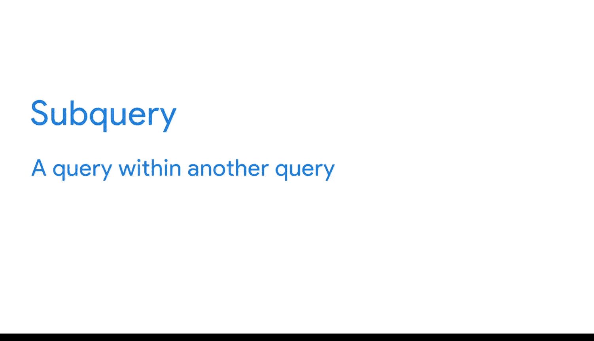

# 谷歌《谷歌商业智能（BI基础、洞察路线：模型和pipelines、决策：数据看板）｜Google Business Intelligence》 p97 18_02_01_可选复习-谷歌数据分析证书关于数据聚合的内容.zh_en -BV1yJ4m1V7W9_p97-

Welcome back。In the next few videos we'll explore something called data aggregation Aggregation means collecting or gathering many separate pieces into a hole For example。

 the Milky Way Galaxy is an aggregation of stars， dust and gases。

So data aggregation is the process of gathering data from multiple sources in order to combine it into a single summarized collection。

In data analytics， a summarize collection or summary describes identifying the data you need and gathering it all together in one place。

For example， let's say you have a cabinet full of different puzzles。 One day。

 a shelf breaks and all the boxes topple over， Scing the puzzle pieces everywhere to get each puzzle organized again。

 you need to identify the pieces that correspond to each particular puzzle。

 Ga them together and put them back into their correct boxes。

 Only then can you work with these pieces and create a complete picture。 So in data。

 the puzzle pieces represent the data that lives in different separate data sets。😊。

Getting them organized is the aggregation process。 Then the piles of pieces that complete a single puzzle become your summary。

 And finally， putting those pieces back together is like analyzing them to gain important insights。

 Data aggregation helps data analysts identify trends make comparisons and gain insights that wouldn't be possible if each of the data elements were analyzed on its own。

😊，For instance， data on high school graduations for individual students can be aggregated into a single graduation rate for an entire class data can also be aggregated over a given time period to provide statistics such as averages。

 minimums， maximums and sums。For example， that same yearly graduation rate data can be aggregated once again into a summary that shows us graduation rates for districts。

 states and countries。 Here's another example。🎼Let's say you had data on real estate sales in a particular neighborhood for each of the past 10 years。

 If you aggregated all of that data， you'd be able to discover the average price of a home in that area and how values have increased or decreased over time。

 Funs are a big help in making data aggregation possible。

 You'll learn how to use some of the most common ones to create your summary soon。 In addition。

 we'll talk about aggregating data using something called a subquery。 You've seen SQL in action。

 and you understand that a query is a request for information from a database。

 So a subque also called an inner or nested query is a query within another query。

 After the next several videos， you'll know how to aggregate data and understand the tools you'll be using along the way。

😊。

Let's get started。