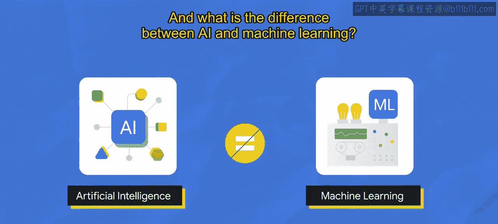
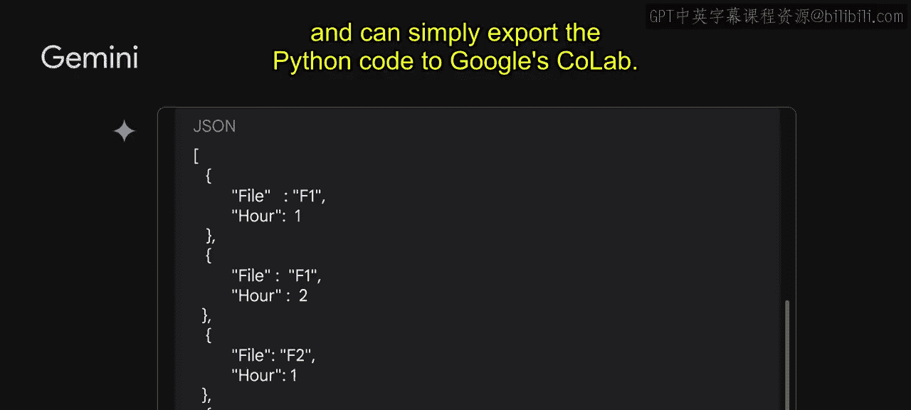
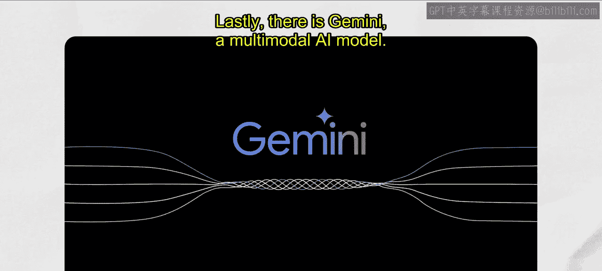
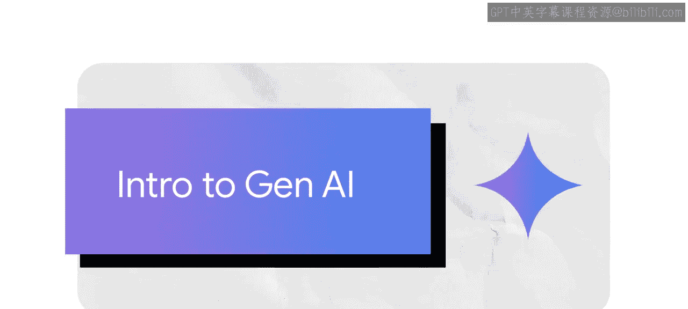

# 谷歌云《生成式AI学习路径（简介、LLM、负责的AI、应用）｜Introduction to Generative AI Learning Path》中英字幕 p01 0_生成式AI简介.zh_en -BV1GM4m1m7xm_p1-

🎼Yeah。🎼。

Hi and welcome to Introuctions to Generative AI。Don't know what that is。

 then you're in the perfect place。I'm Roger Martinez and I am a developer relations engineer at Google Cloud。

 and it's my job to help developers learn to use Google Cloud。In this course。

 I'll teach you four things。How to define generative AI explain how generative AI works？

Describe generative AI model types， describe generative AI applications。

But let's not get swept away with all of that yet let's start by defining what generative AI is first generative AI has become a buzzword。

 but what is it？Generative AI is a type of artificial intelligence technology that can produce various types of content。

 including text， imagery， audio， and synthetic data。But what is artificial intelligence？

Since we are going to explore generative artificial intelligence， let's provide a bit of context。

Two very common questions asked are what is artificial intelligence and what is the difference between AI and machine learning？

Let's get into it， so one way to think about it is that AI is a discipline。

 like how physics is a discipline of science。AI is a branch of computer science that deals with the creation of intelligent agents and are systems that can reason。

 learn， and act autonomously。Are you with me so far。

 essentially AI has to do with the theory and methods to build machines that think and act like humans？

Pretty simple， right， now let's talk about machine learning。Machine learning is a subfield of AI。

It is a program or system that trains a model from input data。

The train model can make useful predictions from new。

 never before seen data drawn from the same one used to train the model。

This means that machine learning gives a computer the ability to learn without explicit programming。

So what do these machine learning models look like？

Two of the most common classes of machine learning models are unsupervised and supervised ML models。

The key difference between the two is that with supervised models， we have labels。

Labeled data is data that comes with a tag like a name， a type， or a number。

Unlabeled data is data that comes with no tag。So what can you do with supervised and unassupervised models？

This graph is an example of the sort of problem a supervised model might try to solve For example。

 let's say you're the owner of a restaurant What type of food do they serve。Let's say， pizza。

Or dumplings。No， let's say pizza， I like pizza anyway。

 you have historical data of a bill amount and how much different people tipped based on the order type。

 pickup or delivery。In supervised learning， the model learns from past examples to predict future values。

Here， the model uses a total bill amount data to predict the future tip amount based on whether an order was picked up or delivered。

Also， people tip your delivery drivers， they work really hard。

This is an example of the sort of problem that an unsupervised model might try to solve。

Here you want to look at tenure in income and then group or cluster employees to see whether someone is on the fast track。

Nice work， Bo shirt。Unsupervised problems are all about discovery。

 about looking at the raw data and seeing if it naturally falls into groups。This is a good start。

 but let's go a little deeper to show this difference graphically because understanding these concepts is the foundation for your understanding of generative AI。

In supervised learning， testing data values， X our input into the model。

 the model outputs a prediction and compares it to the training data used to train the model。

If the predicted test data values and actual training data values are far apart。

 that is called error。The model tries to reduce this error until the predicted and actual values are closer together。

 this is the classic optimization problem。So let's check in so far we've explored differences between artificial intelligence and machine learning and supervised and unsupervised learning that's a good start。

 but what's next。Let's briefly explore where deep learning fits as a subset of machine learning methods。

 and then I promise we'll start talking about GenAI。

While machine learning is a broad field that encompasses many different techniques。

 deep learning is a type of machine learning that uses artificial neural networks allowing them to process more complex patterns than machine learning。

Artificial neural networks are inspired by the human brain， pretty cool huh？Like your brain。

 they are made up of many interconnected nodes or neurons that can learn to perform tests by processing data and making predictions。

Deep learning models typically have many layers of neurons。

 which allows them to learn more complex patterns in traditional machine learning models。

Neural networks can use both labeled and unlabeled data。This is called semi supervised learninging。

In semi supervised learning， a neural network is trained on a small amount of labeled data and a large amount of unlabeled data。

The label data helps the neural network to learn the basic concepts of the tasks。

 while the unlabeled data helps the neural network to generalize to new examples。

Now we finally get to where generative AI fits into this AI discipline。

Gen AI is a subset of deep learning， which means it uses artificial neural networks can process both labeled and unlabeled data using supervised。

 unsupervised， and semisupervised methods。Large language models are also a subset of deep learning。

See， I told you I'd bring it all back to GenI， Good job me。

Deep learning models or machine learning models in general can be divided into two types geneative。

And discriminative。A discriminative model is a type of model that is used to classify or predict labels for data points。

Disriminative models are typically trained on the data set of labeled data points。

 and they learn the relationship between the features of the data points and the labels。

Once a discrimininated model is trained， it can be used to predict the label for new data points。

A generative model generates new data instances based on a learned probability distribution of existing data。

Generative models generate new contents。Take this example。Here。

 the discriminative model learns the conditional probability distribution or the probability of y。

 our output given X， our input， that this is a dog and classifies it as a dog and not a cat。

 which is great because I'm allergic to cats the generative model learns the joint probability distribution or the probability of X and Y P of X。

 Y and predicts the conditional probability that this is a dog and can then generate a picture of a dog。

Good boy。I'm going to name him Fred。To summarize， generative models can generate new data instances and discriminative models discriminate between different kinds of data instances。

One more quick example。The top image shows a traditional machine learning model which attempts to learn the relationship between the data and the label or what you want to predict。

The bottom image shows a generative AI model which attempts to learn patterns on content so that it can generate new content。

So what if someone challenges you to a game of is it Jen AI or not？I've got you back。

This illustration shows a good way to distinguish between what is GAI and what is not。

It is not GenAI when the output or y or label is a number or a class， for example。

 spam or not spam or a probability。It is GenAI when the output is natural language like speech or text。

 audio or an image like Fred from affo， for example。

Let's get a little mathy to really show the difference。

Visualizing this mathematically would look like this， if you haven't seen this for a while。

 the y equals F of x equation calculates the dependent pen output of a process given different inputs。

The Y stands for the model output， the F em bodies of function used in the calculation or model。

 and the x represents the input or inputs used for the formula。As a reminder。

 inputs are the data like comma separated value files， text files， audio files。

 or image files like Fred。So the model output is a function of all the inputs。

If the Y is a number like predicted sales， it is not generative AI if y is a sentence like define sales。

 it is generative。As the question would elicit a text response？

The response we based on all the massive large data the model was already trained on。

So the traditional ML supervised learning process takes training code and label data to build a model。

Depending on the use case or problem， the model can give you a prediction， classify something。

 or cluster something。Now let's check out how much more robust the generative AI process is in comparison。

The generative AI process can take training code， labeled data and unlabeled data of all data types。

 and build a foundation model。The foundation model can then generate new content。

It can generate text， code， images， audio， video， and more。

We've come a long way from traditional programming to neural networks， to generative models。

In traditional programming， we used to have to hard code the rules for distinguishing a cat。

Type animal， legs， four ears， two， fur， yes， lights， yarn， catinip。D likes， Fred。

In the wave of neural networks， we could give the networks pictures of cats and dogs and ask。

 is this a cat and it would predict a cat or not a cat？"。

What's really cool is that in the generative wave， we as users can generate our own content。

 whether it be text， images， audio， video， or more。For example。

 models like Palmm or Paways La model or Lambda， language model or dialogue applications ingest very。

 very large data from multiple sources across the internet and build foundation language models we can use simply by asking a question。

 whether typing it into a prompt or verbally talking into the prompt itself。So when you ask it。

 what's a cat， it can give you everything that's learned about a cat。Now。

 let's make things a little more formal with an official definition。What is generative AI？

GenAI is a type of artificial intelligence that creates new content based on what it has learned from existing content。

The process of learning from existing content is called training and results in the creation of a statistical model。

When given a prompt， GenAI uses a statistical model to predict what an expected response might be。

 and this generates new contents。It learns the underlying structure of the data and can then generate new samples that are similar to the data it was trained on。

Like I mentioned earlier， a generative language model can take away as learned from the examples it's been shown and create something entirely new based on that information。

That's why we use the word generative。But large language models which generate novel combinations of text in the form of natural sounding language are only one type of generative AI。

A generative image model takes an image's input and can output text， another image or video。

For example， under the output text， you can get visual question and answering。

While under output image， an image completion is generated and under output video。

 animation is generated。A generative language model takes text as input and can output more text。

 an image， audio， or decisions。For example， under the output text。

 question and answering is generated and under output image a video is generated。

I mentioned that generative language models learn about patterns in language through training data。

Check out this example。Based on things learned from its training data。

 it offers predictions of how to complete this sentence。I'm making a sandwich with peanut butter and。

Jelly， pretty simple， right？So given some text， it can predict what comes next。Thus。

 generative language models are pattern matching systems。

They learn about patterns based on the data that you provide。Here is the same example using Gemini。

 which is trained on a massive amount of text data and is able to communicate and generate humanlike text in response to a wide range of prompts and questions。

 See how detailed the response can be。Here is another example that's just a little more complicated than peanut butter and jelly sandwiches。

The meaning of life is。And even with a more ambiguous question。

 Gemini gives you a contextual answer and then shows the highest probability response。

The power of generative AI comes from the use of transformers。

Transformers produced the 2018 revolution in natural language processing。At a high level。

 a transformer model consists of an encoder and a decoder。

The encoder encodes the input sequence and passes it to the decoder。

 which learns how to decode the representations for a relevant task。

Sometimes transformers run into issues， though。Hallucinations are words or phrases that are generated by the model that are often nonsensical or grammatically incorrect。

 see， not great。Hallucinations can be caused by a number of factors。

 like when the model is not trained on enough data。

Is trained on noisy or dirty data is not given enough context or is not given enough constraints。

Collucinations can be a problem for transformers because they can make the output text difficult to understand。

They can also make the model more likely to generate incorrect or misleading information。

 so put simply， hallucinations are bad。Let's pivot slightly and talk about prompts。

A prompt is a short piece of text that is given to a large language model or LLM as input。

 and it can be used to control the output of the model in a variety of ways。

Prompt design is the process of creating a prompt that will generate desired output from an LLM。

Like I mentioned earlier， generative AI depends a lot on the training data that you have fed into it。

It analyzes the patterns and structures of the input data and thus learns。

Both access to a browser based prompt， you， the user， can generate your own content。

So let's talk a little bit about the model types available to us when text is our input and how they can be helpful in solving problems。

 like never being able to understand my friends when they talk about soccer。

The first is text to text。Text to text models take a natural language input and produce text output。

These models are trained to learn the mapping between a pair of texts， for example。

 translating from one language to others。Next， we have text to imagem。

Text to image models are trained on a large set of images。

 each captioned with a short text description。Diffusion is one method used to achieve this。

There's also text to video and text to 3D。Text to video models aim to generate a video representation from text input。

The input text can be anything from a single sentence to a full script。

 and the output is a video that corresponds to the input text。Similarly。

 T of 3D models generate three dimensional objects that correspond to a user's text description for use in games or other 3D worlds。

And finally， there's text to task。Text to task models are trained to perform a defined task or action based on text input。

This task can be a wide range of actions， such as answering a question， performing a search。

 making a prediction， or taking some sort of action。For example。

 a text to attacks model could be trained to navigate a web user interface or make changes to a doc through a graphical user interface。

See， with these models， I can actually understand what my friends are talking about when the game is on。

Another model that's larger than those I mentioned is a foundation model。

 which is a large AI model pretrained on a vast quantity of data designed to be adapted or fine tuned to a wide range of downstream tasks。

 such as sentiment analysis， image captioning and object recognition。

Foundation models have the potential to revolutionize many industries， including healthcare， finance。

 and customer service。They can even be used to detect fraud and provide personalized customer support。

If you're looking for foundation models， Vertex AI offers a model garden that includes foundation models。

The languagen Foundation models include P API for chat and text。

The Vision Foundation models include stable diffusion。

 which have been shown to be effective at generating high quality images from text descriptions。

Let's say you have a use case where you need to gather sentiments about how your customers feel about your product or service。

 you can use the classification task sentiment analysis task model。Same for vision tasks。

If you need to perform occupancy analytics， there is a task specific model for your use case。

So those are some examples of foundation models we can use。

 but can GenAI help with code for your apps， absolutely， shown here are generative AI applications。

 you can see there's quite a lot。Let's look at an example of code generation shown in the second block under the code at the top。

In this example， I've input a code file conversion problem， converting from Python to JSO。

I use Gemini and insert into the prompt box， I have a pandas data frame with two columns。

 one with a file name and one with the hour in which it is generated。

I am trying to convert it into a JSON file in the format shown on screen Gemini returns the steps I need to do this and here my output is in a JSON format。

Pretty cool， huh。We'll get ready， it gets even better。

I happen to be using Google's free browser based Jupyter notebook and can simply export the Python code to Google's coab。

So to summarize， Geminite Code generation can help you debug your lines of source code。

Explain your code to you line by line。Craft SQL queries for your database。

 translate code from one language to another。Generate documentation and tutorials for source code。

I'm going to tell you about three other ways Google Cloud can help you get more out of generative AI。

The first is Vertex AI Studio。Vertex AI Studio lets you quickly explore and customize generative AI models that you can leverage in your applications on Google Cloud。

Vertex AI Studio helps developers create and deploy generative AI models by providing a variety of tools and resources that make it easy to get started。

For example， there is a library of pre trained models， tool for fine tu models。

 tool for deploying models production。And community forum for developers to share ideas and collaborate。

Next， we have Vertex AI， which is particularly helpful for all of you who don't have much coding experience。

You can build generative AI search and conversations for customers and employees with Vertex's AI Search and conversation。

 formerly GenAI@ Builder。Build with little or no coding and no prior machine learning experience。

Vertex AI can help you create your own chatbots， digital assistance。Custom search engines。

 knowledge bases， training applications， and more。And lastly， we have Palm API。

Palm API lets you test and experiment with Google's large language models and GenAI tools to make prototyping quick and more accessible。

 developers can integrate PM API with Maker Suet and use it to access the API using graphicphal user interface。

The suite includes a number of different tools， such as a model training tool。

 a model deployment tool， and a model monitoring tool。And what these tools do， I'm so glad you asked。

The model training tool helps developers train ML models on their data using different algorithms。

The model deployment tool helps developers deploy ML models to production with a number of different deployment options。

The model monitoring tool helps developers monitor the performance of their ML models in production using a dashboard and a number of different metrics。

Lastly， there is Gemini， a multimodal AI model。

Unlike traditional language models， it's not limited to understanding text alone。

 it can analyze images， understand the nuances of audio， and even interpret programming code。

This allows Gemini to perform complex tasks that were previously impossible for AI。

Due to its advanced architecture， Gemini is incredibly adaptable and scalable。

 making it suitable for diverse applications。Model garden is continuously updated to include new models。

And now you know absolutely everything about generative AI。Okay， maybe you don't know everything。

 but you definitely know the basics。Thank you for watching our course and make sure to check out our other videos if you want to learn more about how you can use AI。

