# 谷歌云《生成式AI学习路径（简介、LLM、负责的AI、应用）｜Introduction to Generative AI Learning Path》中英字幕 p04 0_课程介绍.zh_en -BV1GM4m1m7xm_p4-

Hi there。 and welcome to App AI principles with Google Cloud。

 a course focused on the practice of responsible AI。My name is Marcuscus， and I'm Caitlin。

 We'll be your narrators throughout this course。Many of us already have daily interactions with artificial intelligence or AI。

 from predictions for traffic and weather to recommendations of TV shows you might like to watch next。

As AI， especially generative AI， becomes more common。

 many technologies that aren't AI enabled may start to seem inadequate。And such powerful。

 far reaching technology raises equally powerful questions about its development and use。

Historically， AI was not accessible to ordinary people。

The vast majority of those trained in capable of developing AI were specialty engineers who were scarce in number and expensive to hire。

 but the barriers to entry are being lowered， allowing more people to build AI。

 even those without AI expertise。

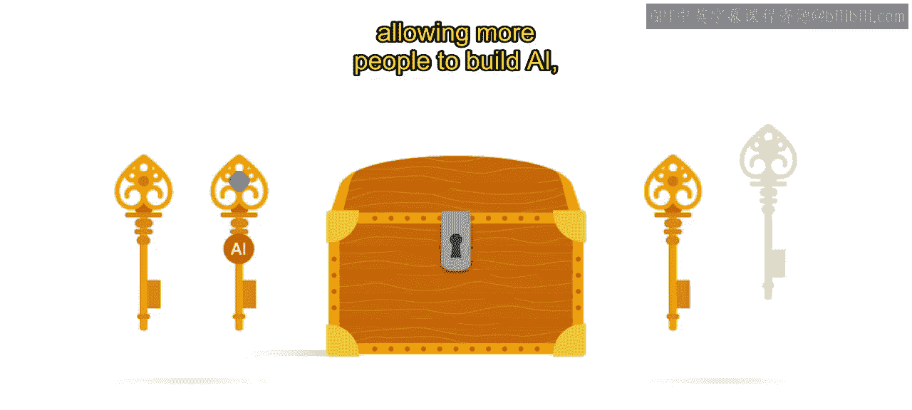

Now， AI systems are enabling computers to see， understand and interact with the world in ways that were unimaginable just a decade ago。

And these systems are developing at an extraordinary pace。

According to Stanford University's 2019 AI indexex report， before 2012。

 AI results tracked closely with Moore's law with compute doubling every two years。

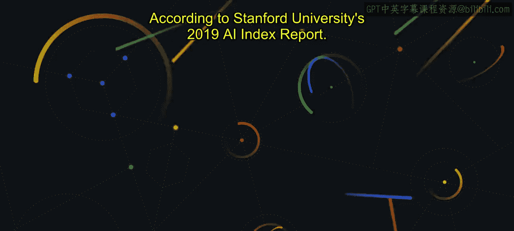

The report states that since 2012， computer has been doubling approximately every three and a half months。

To put this in perspective， over this time， Vision AI technologies have only become more accurate and powerful。

For example， the error rate for image net and image classification data set has declined significantly。

In 2011， the error rate was 26 per cent。By 2020， that number was 2%。For reference。

 the error rate of people performing the same task is 5% cent。And yet。

 despite these remarkable advancements， AI is not infallible。

Developing responsible AI requires an understanding of the possible issues。

 limitations or unintended consequences。

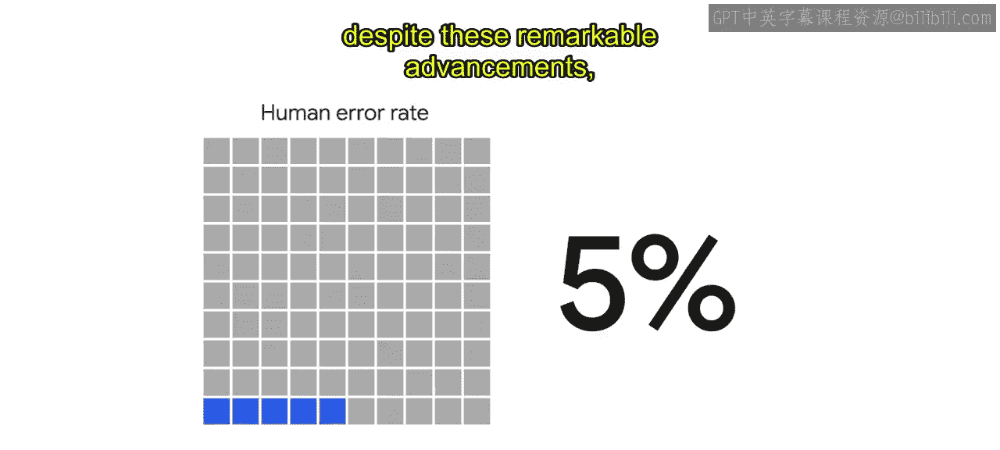

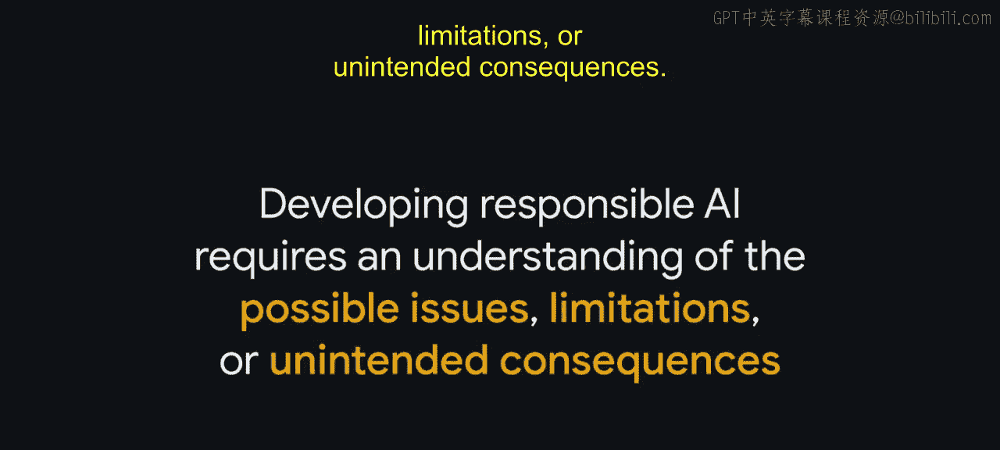

Technology is a reflection of what exists in society， so without good practices。

 AI may replicate existing issues or bias and amplify them。

But there isn't a universal definition of responsible AI。

 nor is there a simple checklist or formula that defines how responsible AI practices should be implemented。

Instead， organizations are developing their own AI principles that reflect their mission and values。

 While these principles are unique to every organization， If you look for common themes。

 you find a consistent set of ideas across transparency， fairness， accountability and privacy。

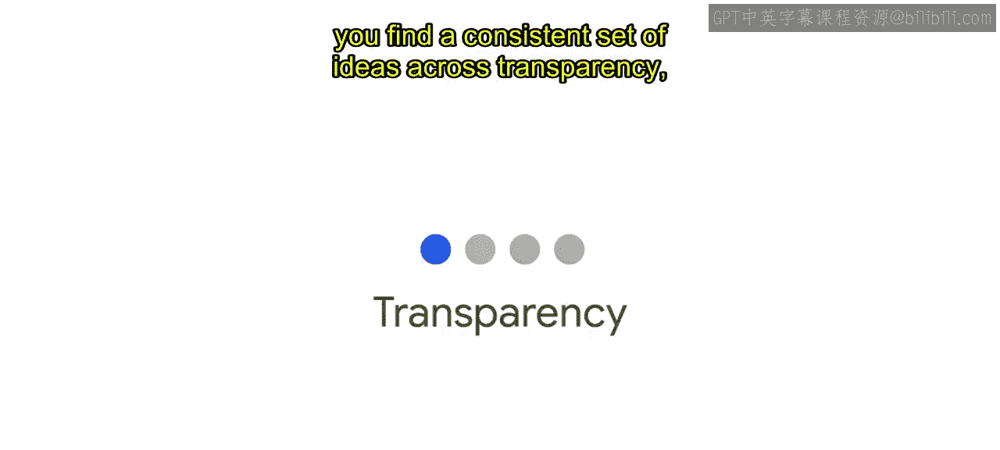

At Google， our approach to responsible AI is rooted in a commitment to strive towards AI that is built for everyone that is accountable and safe。

 that respects privacy， and it is driven by scientific excellence。

 We've developed our own AI principles， practices， governance processes and tools that together embody our values and guide our approach to responsible AI。

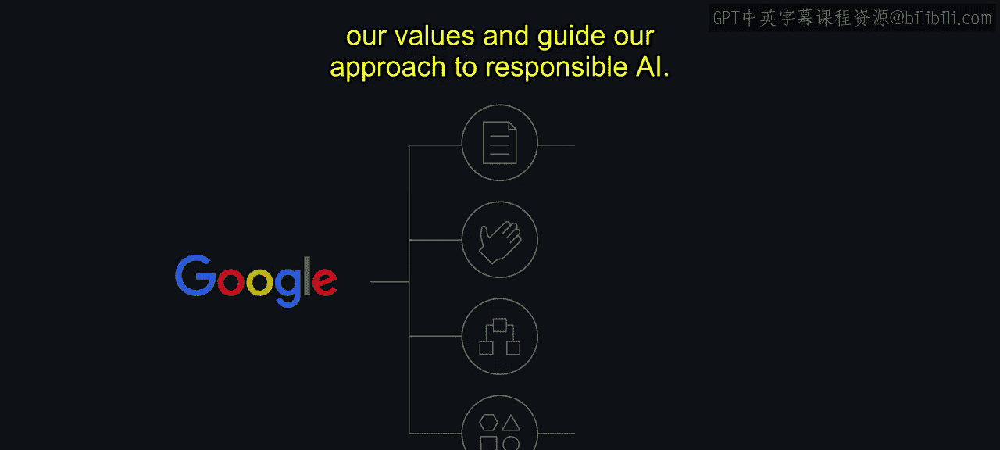

We've incorporated responsibility by design into our products， and even more importantly。

 our organization， like many companies， we use our AI principles as a framework to guide responsible decision making。

 We'll explore how we do this in detail later in this course。

It's important to emphasize here that we don't pretend to have all of the answers。

We know this work is never finished， and we want to share what we're learning to collaborate and help others on their own journeys。

We all have a role to play in how responsible AI is applied。

 Whatever stage in the AI process you are involved with from design to deployment or application。

 the decisions you make have an impact。 It's important that you， too。

 have a defined and repeatable process for using AI responsibly。

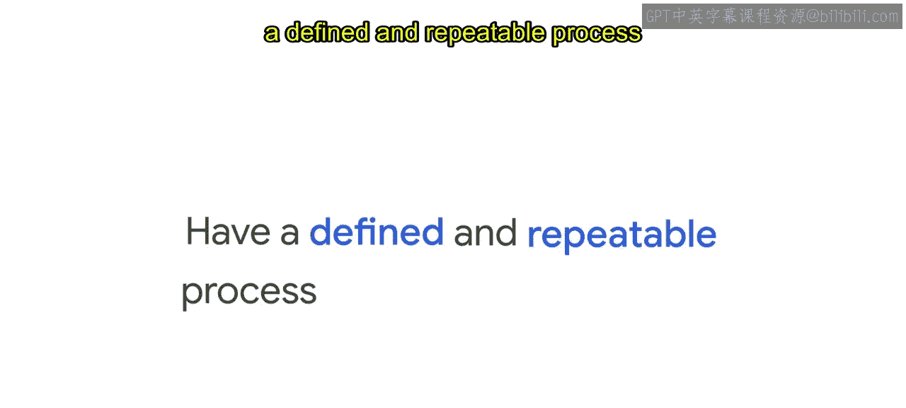

Google is not only committed to building socially valuable advanced technologies。

 but also to promoting responsible practices by sharing our insights and lessons learned with the wider community。

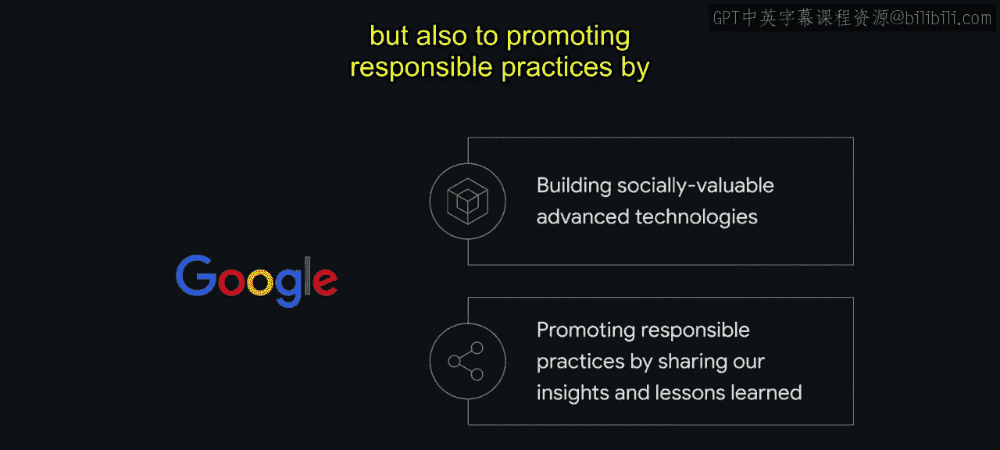

This course represents one piece of these efforts。The goal of this course is to provide a window into Google。

 and more specifically， Google Cloud's journey toward the responsible development and use of AI。

Our hope is that you'll be able to take the information and resources we're sharing and use them to help shape your organization's own responsible AI strategy。

But before we get any further， let's clarify what we mean when we talk about AI。Often。

 people want to know the differences between artificial intelligence。

 machine learning and deep learning。However， there is no universally agreed upon definition of AI。

Critically， this lack of consensus around how AI should be defined has not stopped technical advancement。

 Underscoring the need for ongoing dialogue about how to responsibly create and use these systems。

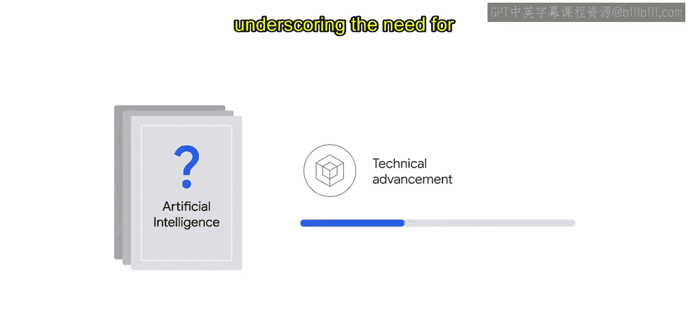

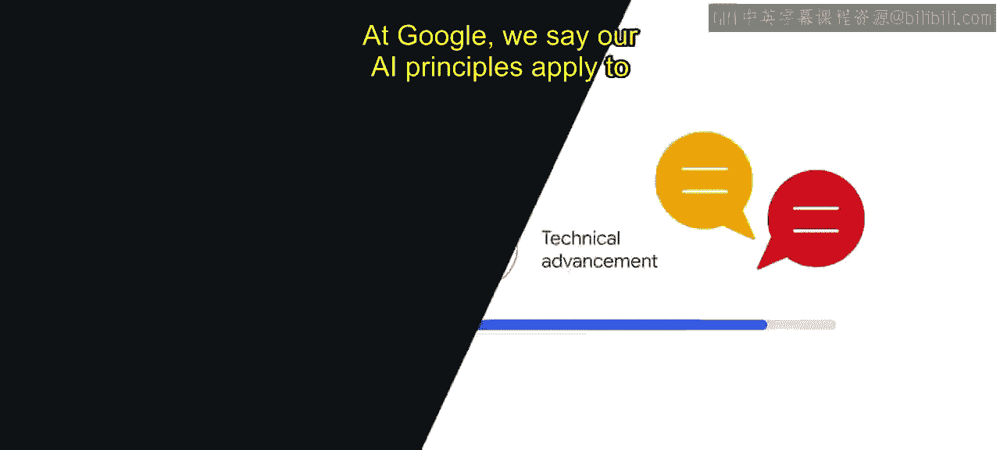

At Google， we say our AI principles apply to advanced technology development as an umbrella to encapsulate all kinds of technologies。

Becoming bogged down in semantics can distract from the central goal to develop technology responsibly。

As a result， we're not going to do a deep dive into the definitions of these technologies。

 and instead， we'll focus on the importance of human decision making in technology development。

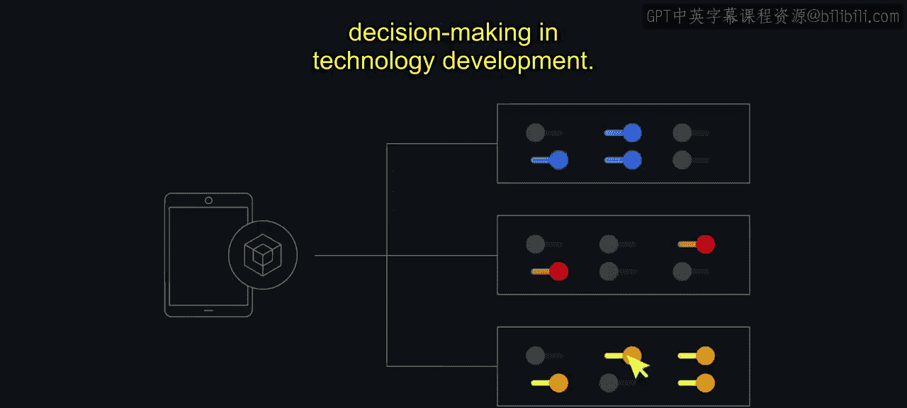

There is a common misconception with artificial intelligence that machines play the central decision making role。

In reality， it's people who design and build these machines and decide how they are used。

 People are involved in each aspect of AI development。

 They collect or create the data that the model is trained on。

 They control the deployment of the AI and how it is applied in a given context。Essential。

 human decisions are threaded throughout our technology products。

And every time a person makes a decision， they're actually making a choice based on their values。

Whether it's the decision to use generative AI to solve a problem as opposed to other methods or anywhere throughout the machine learning life cycle。

 they introduce their own set of values。This means that every decision point requires consideration and evaluation to ensure that choices have been made responsibly from concept through deployment and maintenance。

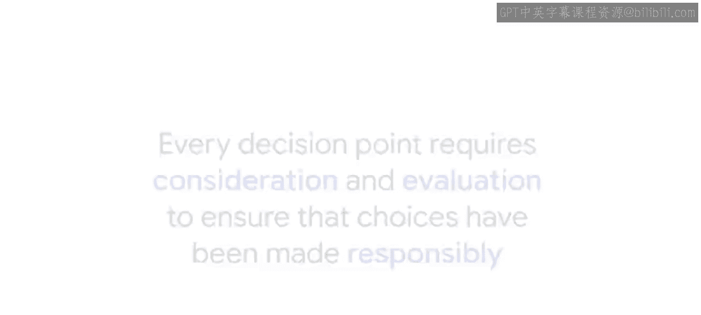