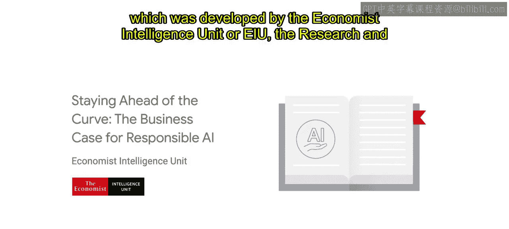
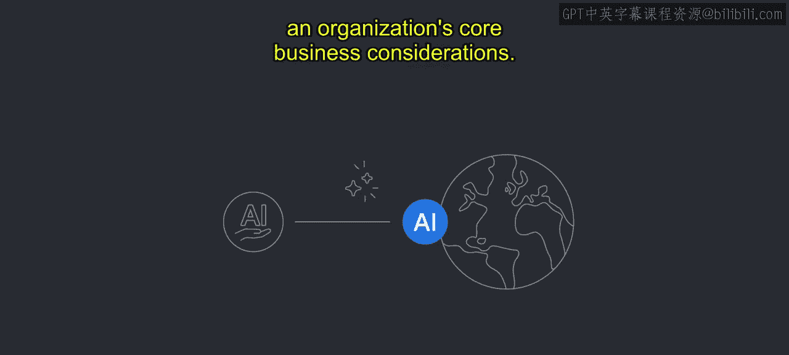
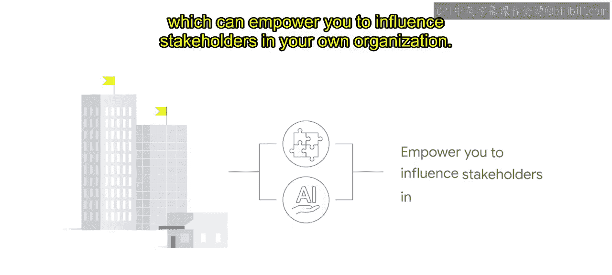
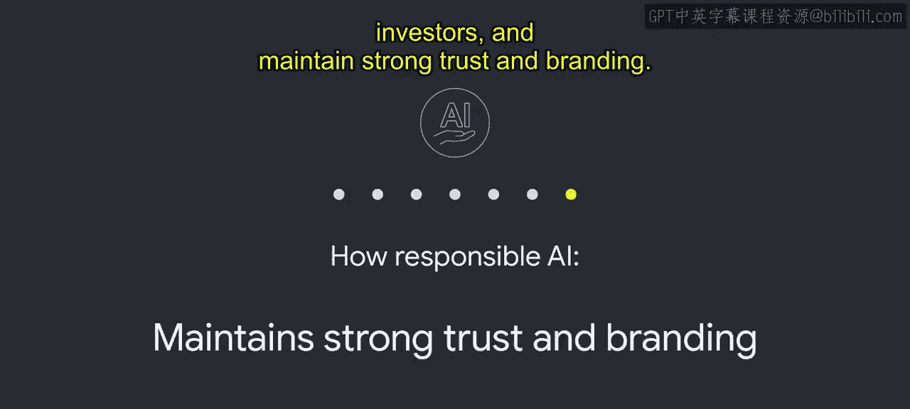

# 谷歌云《生成式AI学习路径（简介、LLM、负责的AI、应用）｜Introduction to Generative AI Learning Path》中英字幕 p07 3_经济学人智库报告.zh_en -BV1GM4m1m7xm_p7-

One leading estimate from Price Waterhouse Cooperers suggests that AI could boost global GDP by 14% or up to $15。

7 trillion by the year 2030。At Google， we believe that the responsible。

 inclusive and fair deployment of AI is a critical factor in realizing this projection。 Simply put。

 we believe that responsible AI is synonymous with successful AI that can be deployed for the long term with trust。

We also believe that responsible AI programs and practices afford business leaders a strategic and competitive advantage。

To explore the business benefits of responsible AI and depth。

 we sponsored an original report titledStaying ahead of the Curve。

 the Business case for Responsible AI， which was developed by the Economist Intelligence Unit or EIu。

 the research and Ana Division of the Economist Group。

The report showcases the value of responsible AI practices in an increasingly AI driven world。

 It comprehensively presents the impact that responsible AI can have on an organization's core of business considerations。

It's important to emphasize that the data collected to create this report came from extensive data driven research。

 industry expert interviews， and an executive survey program。

The report reflects the sentiment of developers， industry leaders deploying AI and end users of AI。

We will share the main findings， and we encourage you to read the full report available in the resources section of this course。

We hope you'll use these highlights to draw a connection between your business goals and responsible AI initiatives。

 which can empower you to influence stakeholders in your own organization。

The report is subdivided into seven sections and includes data on how responsible AI enhances product quality。

 improves the outlook on acquisition， retention and engagement of talent。

Contributes to better data management， security and privacy。

Leads to readiness for current and future AI regulations。

Leads to improvements to the top and bottom line growth。

Assist to strengthen relationships with stakeholders and investors。

And maintains strong trust and branding。

In the next video， we'll explore each of these seven sections in detail。

