# 谷歌云《生成式AI学习路径（简介、LLM、负责的AI、应用）｜Introduction to Generative AI Learning Path》中英字幕 p08 4_负责任创新的商业案例.zh_en -BV1GM4m1m7xm_p8-

Let's explore the seven highlights of the Economist Intelligence Unit's report titledSting ahead of the Curve。

 the business casese for Responsible AI。The first of the seven highlights from the EIU report says that incorporating responsible AI practices is a smart investment in product development。

97% of EIU survey respondents agree that ethical AI reviews are important for product innovation。

Ethical reviews examine the potential opportunities and harms associated with new technologies to better align products with responsible AI design。

These reviews closely examine data sets， model performance across subgroups and consider the impacts of both intended and unintended outcomes。

When organizations aren't working to incorporate responsible AI practices。

 they expose themselves to multiple risks， including delaying product launches， halting work。

 and in some cases， pulling generally available products off the market。

By incorporating responsible AI practices early and providing space to identify and mitigate harms。

 organizations can reduce development costs through a reduction in downstream ethical breaches。

According to CCS Insight's 2019 IT Decion maker Workplace Technology Sury。

 Trusting AI System remains the biggest barrier to adoption for enterprises。

 and in one study by Cap Gemini，90% of organizations reported encountering ethical issues。

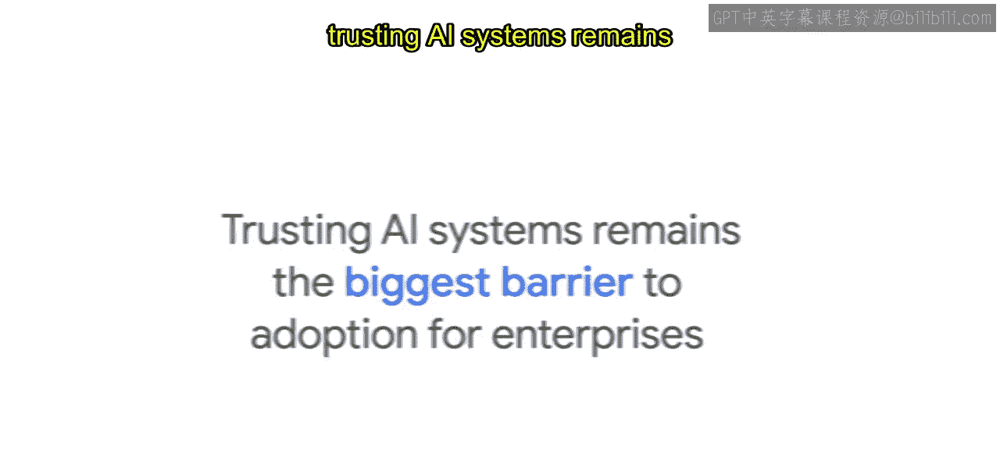

Of those companies，40 per cent went on to abandon the AI project instead of solving for those issues。

 In many reported cases， AI hasn't shifted out of labs and into production because of the real world risks inherent in the technology。

 So it makes sense that companies that have reached scale with AI are 1。

7 times more likely to be guided by responsible AI。 if implemented properly。

 Re AI makes products better by uncovering and working to reduce the harm that unfair bias can cause。

 Imp transparency and increasing security。

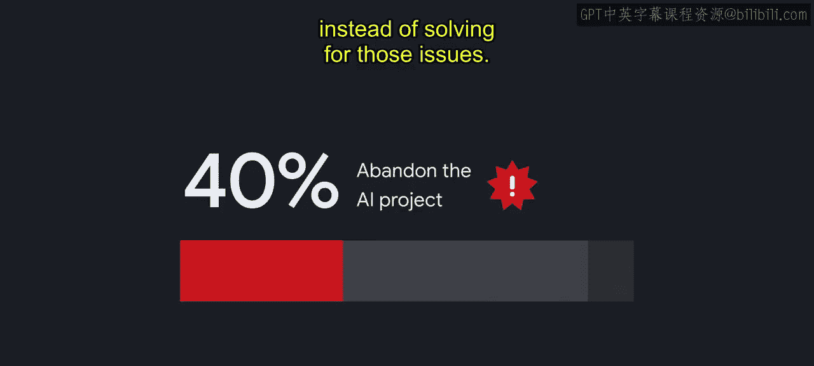

These are all key components to fostering trust with your product stakeholders。

 which boosts both the product's value to users and your competitive advantage。

The second highlight from the EIU report states that responsible AI trailblazers attract and retain top talent。

The world's top workers now seek much more than a dynamic job and a good salary。

 As demand for tech talent becomes increasingly competitive and expensive。

 research shows that getting the right employees is worth it。

 One study found that top workers are $400% more productive than average。

 less skilled individuals and 800% more productive and highly complex occupations such as software development。

 Research also shows that it's important to retain top talent when you have it。

 It can cost organizations around $30000 to replace entry levelve tech employees and up to $312000 when a tech expert or leader leaves。

So what can be done to keep great talent？The Deloitte Global Millennial survey showed that workers have stronger loyalty to employers who tackle the issues that resonate with them。

 especially ethical issues。Organizations that build shared commitments and responsible AI practices are best positioned to build trust and engagement with employees。

 which helps to invigorate and retain top talent。

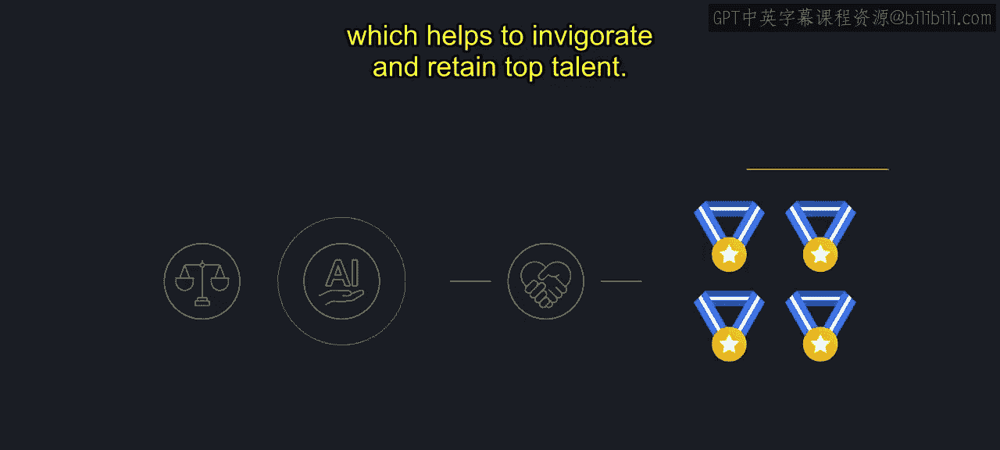

The third EIU report highlight is the importance of safeguarding the promise of data。

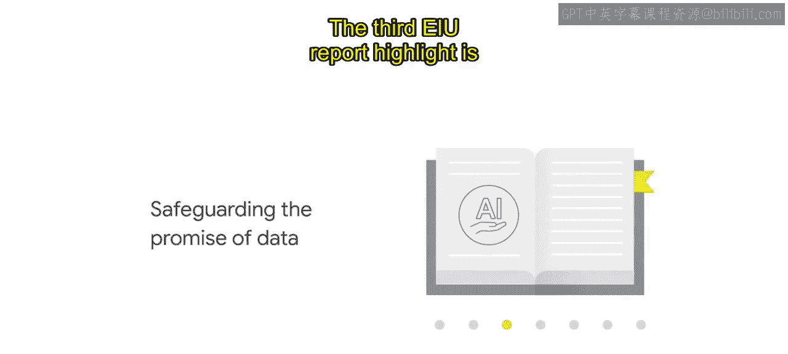

According to the EIU's executive survey， cybersecurity and data privacy concerns represent the biggest obstacles to AI adoption。

Organizations need to think very carefully about how they collect， use and protect data。Today。

 over 90% of consumers will not buy from a company if they have concerns about how their data will be used。

Data breaches are very costly for a business。 IBM and the Ponamon Institute reported that globally。

 the average data breach involved 25575 records and cost an average of $3。92 million。

 with the United States having the highest country average cost at $8。19 million。

 The research also found that lost business was the most financially harmful aspect of a data breach。

 Acing for $36% of the total average cost。

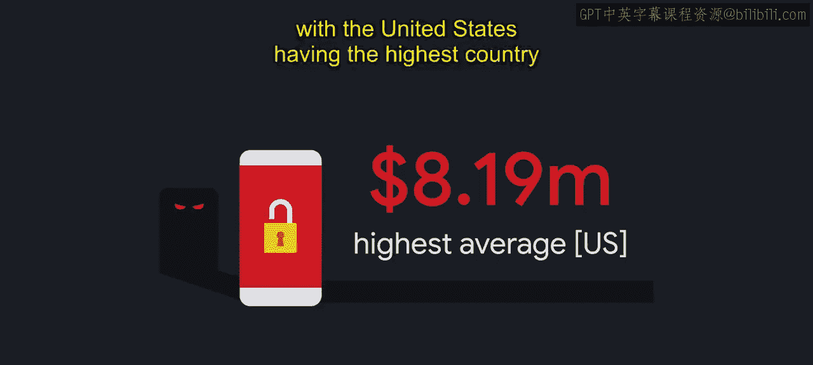

Consumers are also more likely to blame companies for data breaches rather than the hackers themselves。

 which highlights the impact that safeguarding data can have on customer engagement with firms。

Enterprise customers also need to be confident that the company itself is a trustworthy host of their data。

At Google， we know that privacy plays a critical role in earning and maintaining customer trust with a public privacy policy。

 we want to be clear about how we proactively protect our customers' data。

And when an organization can be trusted with data， it can result in larger， more diverse data sets。

 which will in turn improve AI outcomes。Cisco research reports that for every $1 invested in strengthening data privacy。

 the average company will see a return of $2。70。All these findings are clear indicators that using responsible AI practices to address data concerns will lead to greater adoption and business value of AI tech。

The fourth EIu report highlight is the importance of preparing in advance of AI regulation。

As AI technology advances， so do global calls for its regulation from broader society。

 in the business community and from within the technology sector itself。

Governments have realized the importance of AI regulations and have started working towards implementing them。

For example， to ensure a human centric and ethical development of AI in Europe。

 members of the European Parliament endorsed new transparency and risk management rules for AI systems。

Once approved， they will be the world's first rules on artificial intelligence。This is a good start。

 However， it still takes significant time and effort to have robust and mature AI regulations globally。

EIU executive survey data shows that 92% of US business executives from the five surveyed sectors believe that technology companies must be proactive to ensure responsible AI practices in the absence of official AI regulation。

Organizations developing responsible AI can expect to experience a significant advantage when new regulations come into force。

 This might mean a reduced risk of noncompliance when regulation does take effect or even being able to productively contribute to conversations about regulation to ensure that it is appropriately scoped。

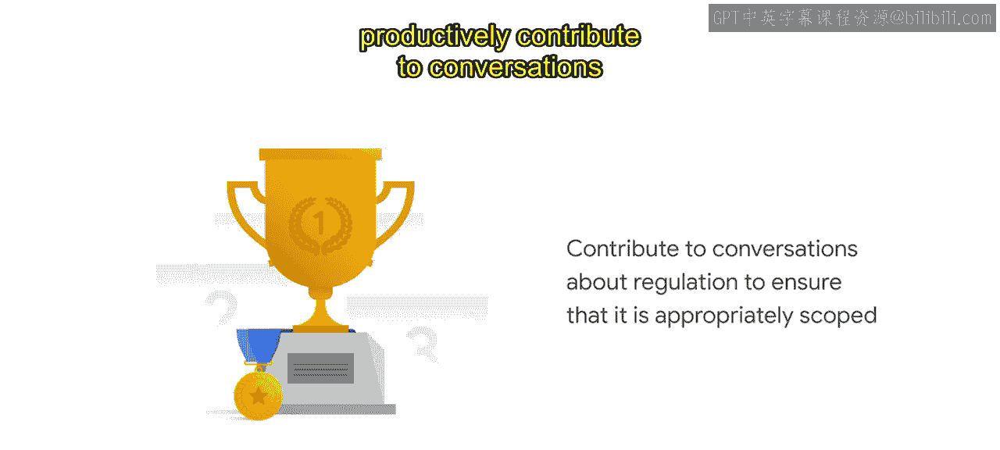

The challenge is to develop regulations in a way that is proportionately tailored to mitigate risks and promote reliable and trustworthy AI applications while still enabling innovation in the promise of AI for societal benefit。

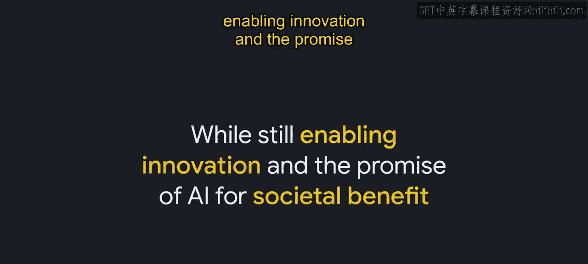

Take the general data protection regulation or GDPR in the European Union， for example。

 when it was first adopted， only 31% of businesses believe that their organization was already GDPR compliant before the law was enacted。

The cost of non compliance with GDPR was found to outweigh the cost of compliance by a factor of 2。

71。Although regulatory penalties are a well known risk of noncompliance。

 they accounted for just 13 per cent of total noncompliance costs。

With disruption to business operation causing 34%， followed by productivity loss and revenue loss。

Reflection on that experience has prompted many organizations to begin planning ahead of AI regulations。

The fifth highlight from the EIu report says that responsible AI can improve revenue growth。

For AI vendors， responsible AI can result in a larger target market。

A competitive advantage and improved engagement with existing customers。

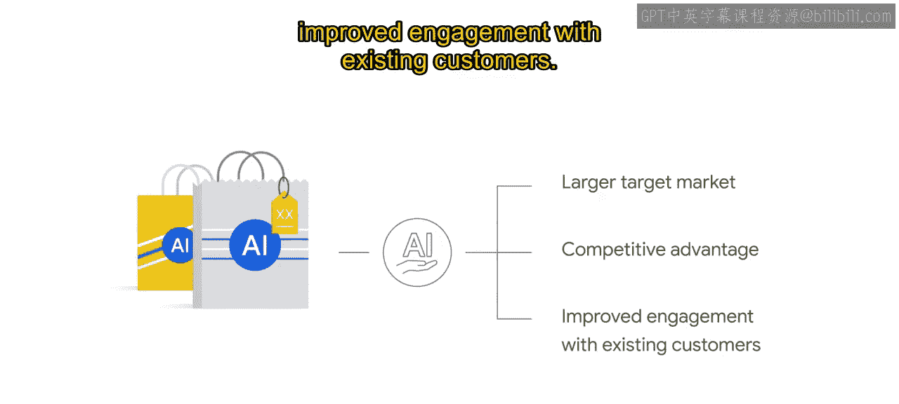

Of executives surveyed by the EIu，91% cent said that ethical considerations are included as part of their company's request for proposal process。

 A 91% cent also said they would be more willing to work with a vendor if they offered guidance around the responsible use of AI。

Furthermore， 66% of executives say their organization has actually decided against working with an AI vendor due to ethical concerns。

There is mounting evidence of a positive relationship between an organization's ethical behaviour and its core financial performance。

For example， companies that invest in environmental。

 social and corporate governance measures or AS S G perform better on the stock market。

While recent data shows that the world's most ethical companies outperform the large cap index by 14。

4% over five years。Customer behaviour is also influenced by ethics。

A Nielsen survey of 30000 consumers across 60 countries found that 66% of respondents were willing to pay more for sustainable。

 socially responsible and ethically designed goods and services。

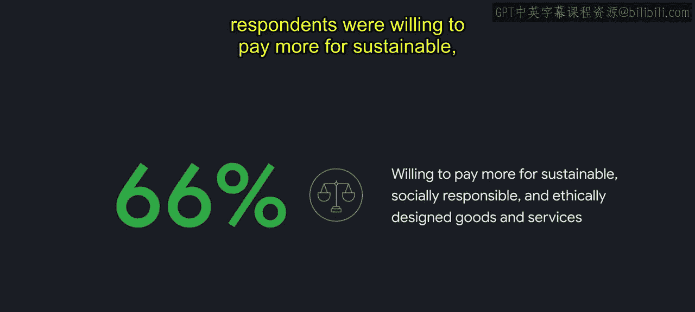

Next， the EIU report highlights that responsible AI is powering up partnerships。

Investors are increasingly looking to align their portfolios to their personal values。

 reflected an interest in sustainable， long term investing。

The stakeholder relationship can influence an organization's corporate strategy and financial performance。

The broadest definition of sustainable investing includes any investment that screens out unsavory investes or explicitly takes ES SG factors and risks into account such as greenhouse gas emissions。

 diversity initiatives and pay structures。Although ES SG assessment criteria don't traditionally include responsible AI。

 this trend toward investment in socially responsible firms indicates that funds will be reallocated toward companies that prioritize responsible AI。

1 UK investment firm， Herme's  investment management。

 made clear in its report titledInvest' Expectations on Responsible Artificial intelligencetel and data governanceance。

 that it evaluates investeees against a set of responsible AI principles。

More recent research has shown much the same trend。

 Forester research shows that investors are increasingly interested in nurturing responsible AI startups。

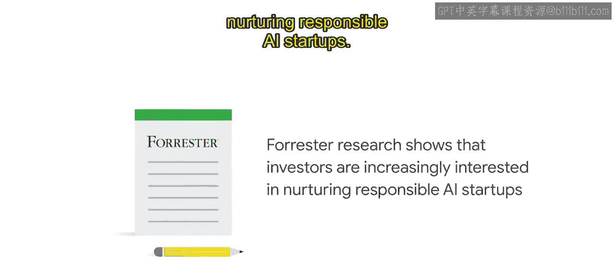

In 2013， there was $8 million in funding for responsible AI startups。

 and that grew to $335 million in 2020。 There was even a 93% increase in funding from 2018 to 2019。

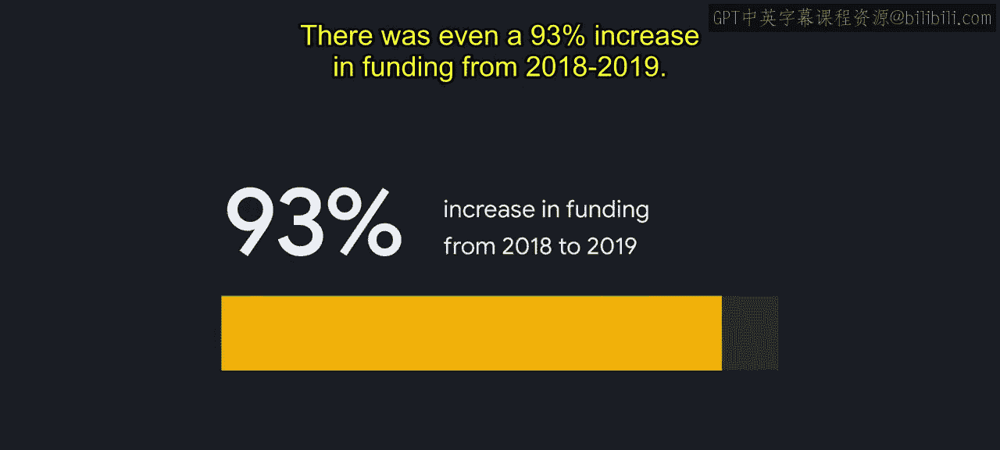

The final highlight from the EIU report relates to maintaining strong trust and branding。

Just as a lack of responsible AI practices can weaken customer trust and loyalty。

 evidenceence confirms that organizations that take the lead on responsible AI can expect to reap rewards related to public opinion。

 trust and branding。For technology firms， the connection between trust and branding has never been stronger。

Experts say that without strong oversight of AI， companies that are developing or implementing AI are opening themselves up to risks。

 including unfavourorable public opinion， brand erosion and negative press cycles。

 and brand erosion doesn't stop at the door of the company that committed the misdeed。

Organizations can mitigate these types of trust and branding risks through the implementation of responsible AI practices。

 which have the potential to boost the organisation and brands they are associated with。

As the report by the Economist Intelligence Unit emphasizes responsible AI brings undeniable value to firms。

 along with a clear moral imperative to embrace it。

 Although identifying the full spectrum of negative outcomes that could result from irresponsible AI practices is impossible。

 companies have a unique opportunity to make decisions to day that will prevent these outcomes in the future。

We hope this video will provide data and discussion points for you to use when engaging with your own business stakeholders and customers。

Our intention is that it will serve as a means to promote responsible AI practices and equip you with tools to develop your own business case for investment。

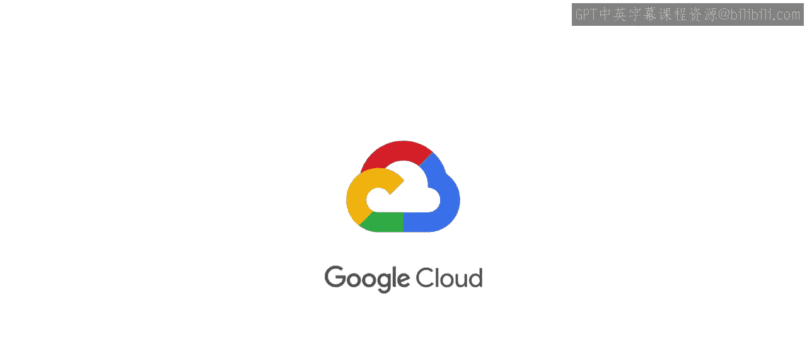