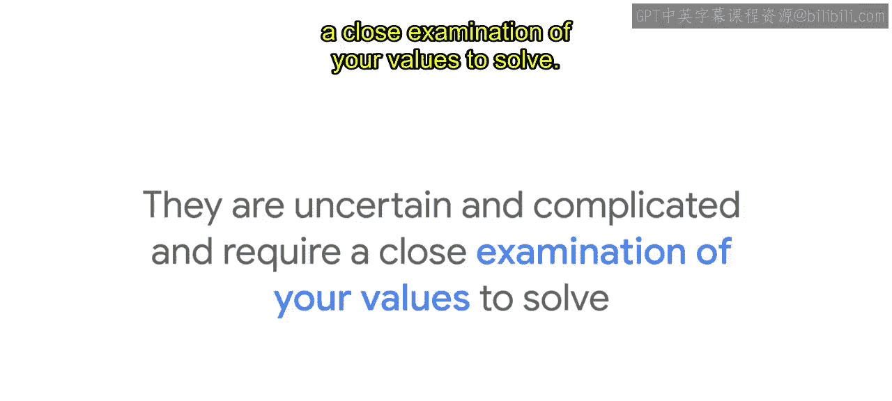
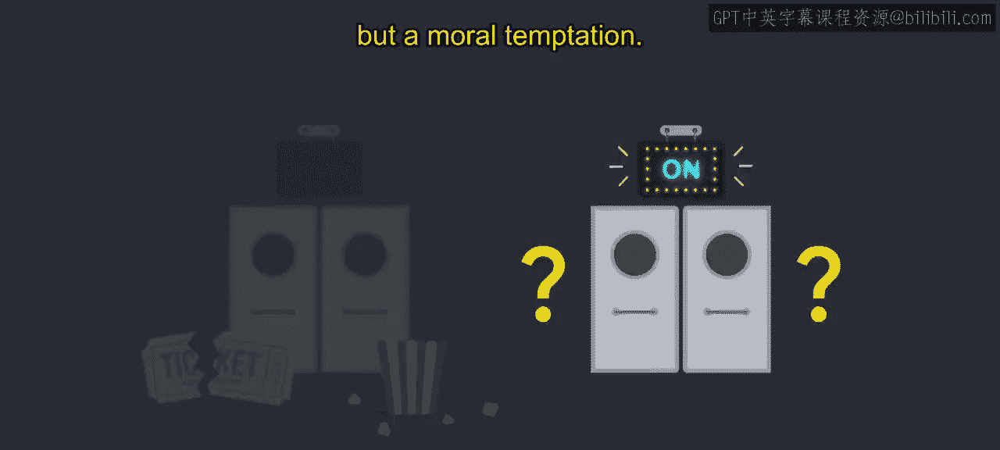
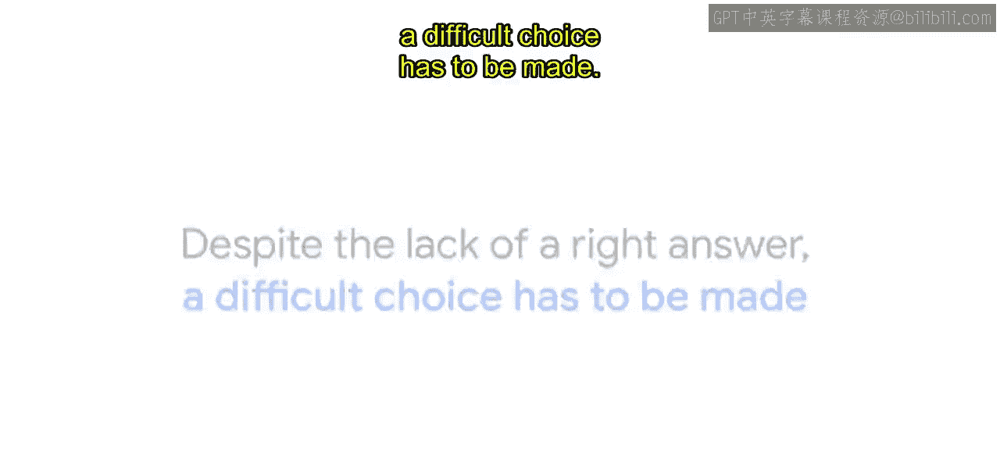
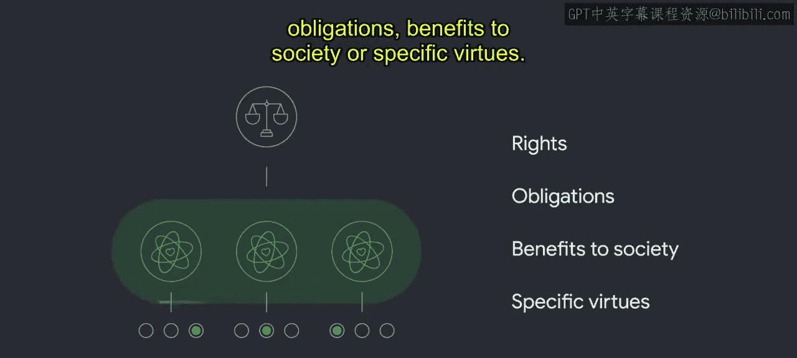
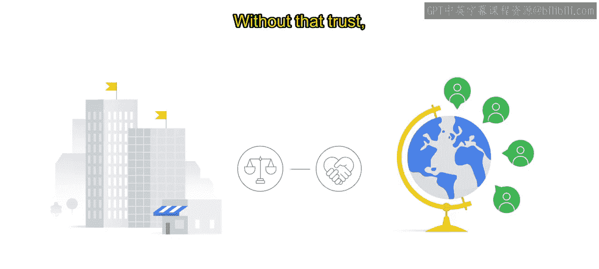
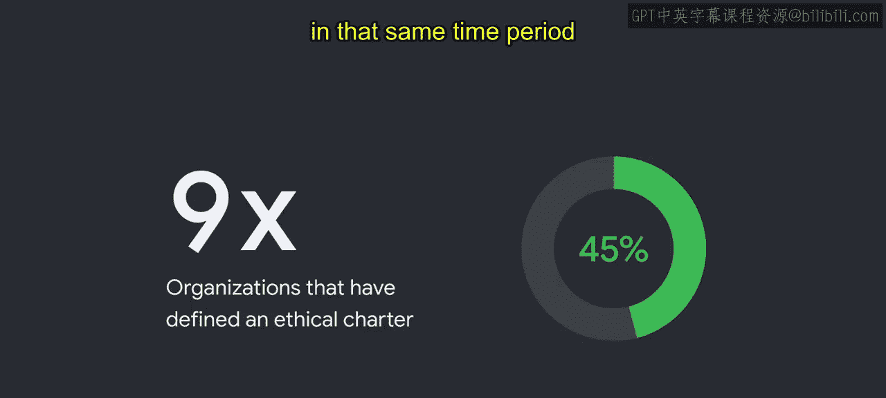
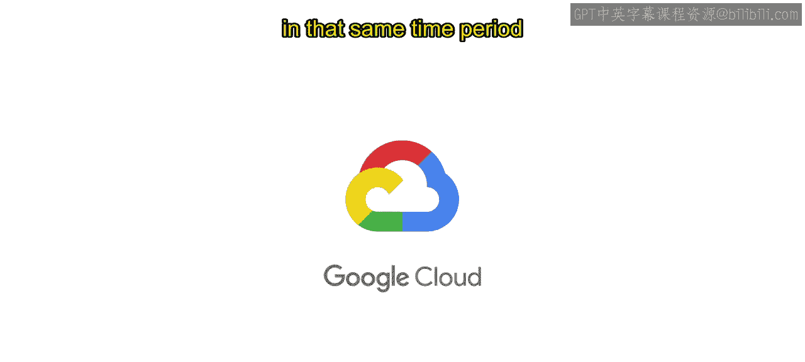

# 谷歌云《生成式AI学习路径（简介、LLM、负责的AI、应用）｜Introduction to Generative AI Learning Path》中英字幕 p09 5_AI的技术考虑与伦理问题.zh_en -BV1GM4m1m7xm_p9-

Imagine a scenario where you have a best friend， someone youve known since you are a kid that you also work with to day。

One day， your manager， whom you are also very close to。

 confines in you that your childhood friend will soon be laid off from their job。

 and they ask you to keep it confidential for now。Later that day。

 your friend calls you to share their excitement that they are planning on buying a new house。😊，Oh。

 no。 What do you do。An ethical dilemma is a situation where a difficult choice has to be made between different courses of action。

 each of which entails transgressing a moral principle。

Not making a decision is the same as making a decision to do nothing。

They are uncertain and complicated and require a close examination of your values to solve。

It's important to know that an ethical dilemma is different from a moral temptation。

A temptation is a choice between a right and a wrong。And specifically。

 when doing something wrong is advantageous to you。

Imagine your leaving a movie theater after seeing a film and notice that another movie you'd love to also see is starting。

 No one is around to check tickets。 Do you go。😊，This would not be considered an ethical dilemma。

 but a moral temptation。

So in our first scenario， do you share the information with your friend。

 despite the request from your manager to keep it quiet。

Do you pretend you don't know anything and keep the confidence of your manager。

Do you find some other way to warn them without crossing that line。

Different opinions are justifiable and could be considered ethical， depending on who you ask。

Despite the lack of a right answer， a difficult choice has to be made。

When building AI， there are many ethical dilemmas that may need to be confronted due to the impact AI can have on society。

This is why the focus on ethics must remain at the forefront in the AI community。

Consider these headlines。Building digital trust will be essential to adoption of AI tools。

Great promise， but potential for peril。Ethical concerns mount as AI takes bigger decision making role in more industries。

Responsible AI becomes critical in 2021。These headlines highlight the importance of responsible AI for companies and for society。

According to a Cap Gemini report in 2020， there was a growing demand from a wide range of stakeholders。

 both internal and external， for companies to develop more robust ethical values， processes。

 expertise， corporate culture and leadership。But what exactly do we mean when we talk about ethics。

In general terms， ethics is an ongoing process of articulating values and in turn。

 questioning and justifying decisions based on those values， usually in terms of rights， obligations。

 benefits to society or specific virtues。

Ultimately， ethics is what allows everyone to flourish together as a society。

This isn't to say that there aren't elements of subjectivity and cultural relativity that need to be acknowledged and confronted。

When looking at ethical frameworks and theories from around the world。

 the various approaches can often be contradictory， but regardless of the approach you align with。

 ethics is the art of living well with others。 As such。

 is crucial that ethical deliberation draws on a diverse set of perspectives and experiences。However。

 ethics doesn't lend itself well to rules or checklists。

 especially when trying to wade through moral challenges that have never existed before。

 like those created through ground breaking technology。

There's an element of ingenuity needed to help solve new moral challenges that haven't yet been faced。

It requires humility， a willingness to confront difficult questions。

 as well as change opinions in the face of new evidence and valid objections。

It's also important to understand that ethics should not be viewed as law and policy。

Ethics reflects values and expectations we have of one another。

 most of which have not been written down or enforce by a formal system。

While laws and policies often do draw insights from ethics， many unethical acts are legal。

 and some ethical acts are illegal。 For example， most types of lying。

 breaking promises or cheating are generally recognized as being unethical， but are often legal。

While some of the most heroic acts of civil disobedience were illegal at the time。

At the end of the day， defining what ethics means to your organization should compel you to think about the bonds of trust you want to have with your users。

 your teams and the wider society through the work they do。Without that trust。

 strong customer relationships won't exist。

Organizations are rapidly recognizing the need for responsible AI。

The challenges with advanced technologies are multiplying as the social。

 political and environmental impact of 21st century technology rapidly expands。

Technologies using AI have the power to unintentionally replicate harms at incredible speed and scale。

 making the need for a thoughtful， careful approach even more important。

Cap Geminize's AI in the Ethical conundrum survey in 2020 shows that twice as many executives are aware of AI related issues than were aware in 2019。

 and the percentage of organizations that have defined an ethical charter to provide guidelines on AI development has increased from 5% to 45% in that same time period。

