# 谷歌云《生成式AI学习路径（简介、LLM、负责的AI、应用）｜Introduction to Generative AI Learning Path》中英字幕 p10 6_对人工智能的担忧.zh_en -BV1GM4m1m7xm_p10-

So far， we've explored ethics at a high level。However。

 there are some ethical concerns that are especially relevant to the advanced technologies AI enables。

While this module may not be exhaustive， we'll take a look at some of the themes that receive a lot of attention when discussing ethical concerns with AI。

Each use case for AI raises unique challenges that Google works to address。But as an industry。

 we must grow our awareness of these concerns so we can develop approaches to tackle them together。

So what are the main AI concerns being raised。The first is transparency。

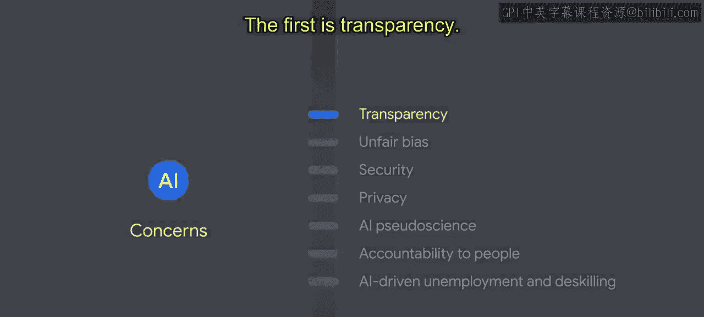

As AI systems become more complex， it can be increasingly difficult to establish enough transparency for people to understand how AI systems make decisions。

In many situations， being able to understand how an AI system works is critical to an end user's autonomy or ability to make informed choices。

A lack of transparency can also make it harder for a developer to predict when and how these systems might fail or cause unintended harm。

Models that allow a human to understand the factors contributing to a decision can help stakeholders of AI systems to better collaborate with an AI。

This might mean knowing when to intervene if the AI is underperforming。

 strengthening a strategy for using the results of an AI system and identifying how the AI can be improved。

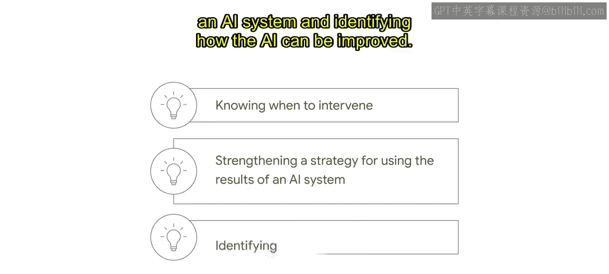

A second concern is unfair bias。AI doesn't create unfair bias on its own。

 It exposes biases present in existing social systems， and amplifies them。

A major pitfall of AI is that its ability to scale can reinforce and perpetuate unfair biases。

 which can lead to further unintentional harms。The unfair biases that shape society also shape every stage of AI。

 from data sets and problem formulation to model creation and validation。

AI is a direct reflection of the societal context in which it's designed and deployed。

To mitigate harm， the societal context and probable biases need to be recognized and addressed。

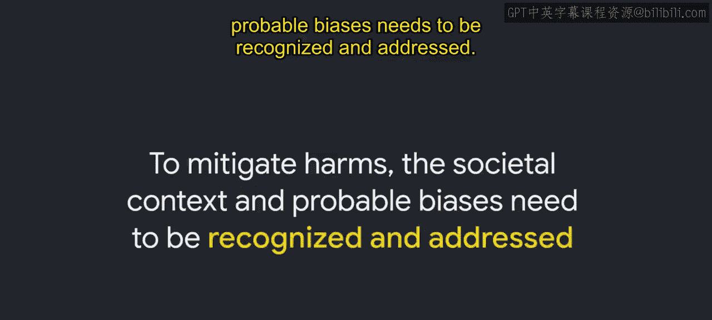

For instance， vision systems are being adopted in critical areas of public safety and physical security to monitor building activity or public demonstrations。

Here， bias can make surveillance systems more likely to misidentify marginalised groups as criminals。

These challenges stem from many root causes， such as the under representation of some groups and over representation of others in training data。

A lack of critical data needed to fully understand a system's impact or a lack of societal context in product development。

A third AI concern is security。Like any computer system。

 there is the potential for bad actors to exploit vulnerabilities in AI systems for malicious purposes。

As AI systems become embedded in critical components of society。

 these attacks represent vulnerabilities with the potential to significantly affect safety and security。

Safe and secure AI involves traditional concerns in information security， as well as new ones。

The data driven nature of AI makes the training data more valuable to exfiltrate。

 plus AI can allow for greater scale and speed of attacks。

We're also seeing new techniques of manipulation unique to AI， like deep fakes。

 which can impersonate someone's voice or biometrics。

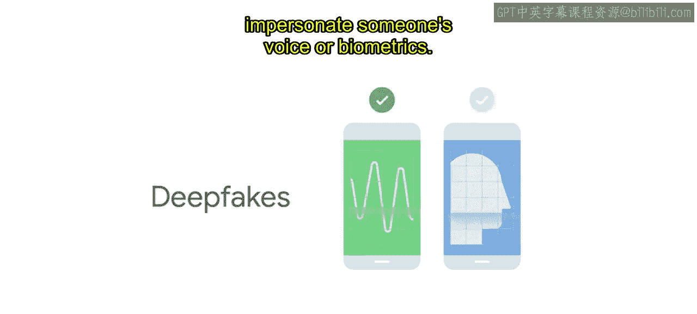

A fourth AI concern is privacy。AI presents the ability to quickly and easily gather。

 analyze and combine vast quantities of data from different sources。

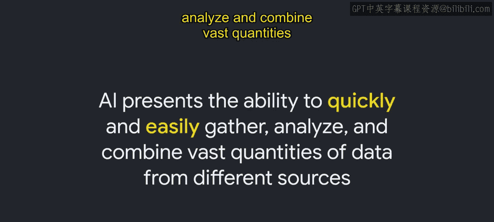

The potential impact of AI on privacy is immense， leading to risks of data exploitation。

 unwanted identification and tracking。Intrusive voice and facial recognition。 and profiling。

The expanded use of AI comes with a need to take a responsible approach to privacy。

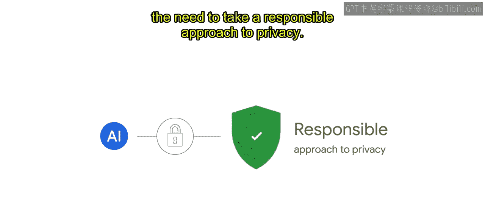

Another concern is AI pseudoci， where AI practitioners promote systems that lack scientific foundation。

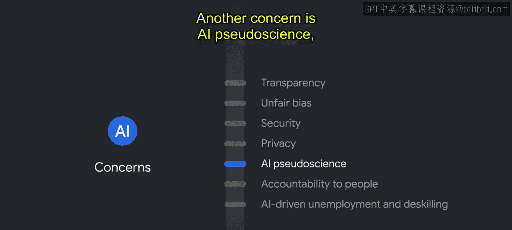

Examples include face analysis algorithms that claim the ability to measure the criminal tendency of a person based on facial features and the shape and size of their head。

Or models used for emotion detection to determine if someone is trustworthy from their facial expressions。

These practices are considered unscientific and ineffective by the scientific community and can cause harm。

However， they have been repackaged with AI in a way that can make pseudo sciencecience seem more credible。

These pseudoscientific uses of AI not only harm individuals and communities。

 but they can undercut appropriate and beneficial use cases of AI。

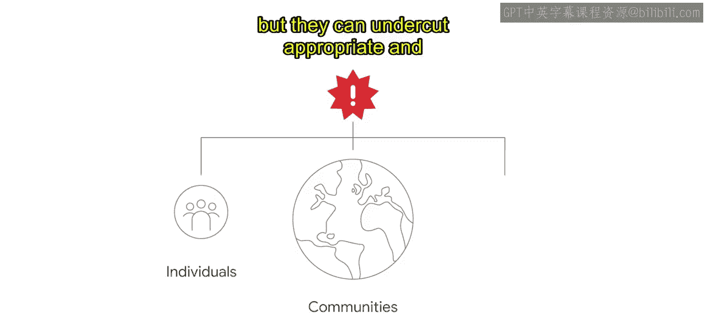

A sixth concern is accountability to people。AI systems should be designed to ensure that they are meeting the needs and objectives of all types of people。

 while enabling appropriate human direction and control。

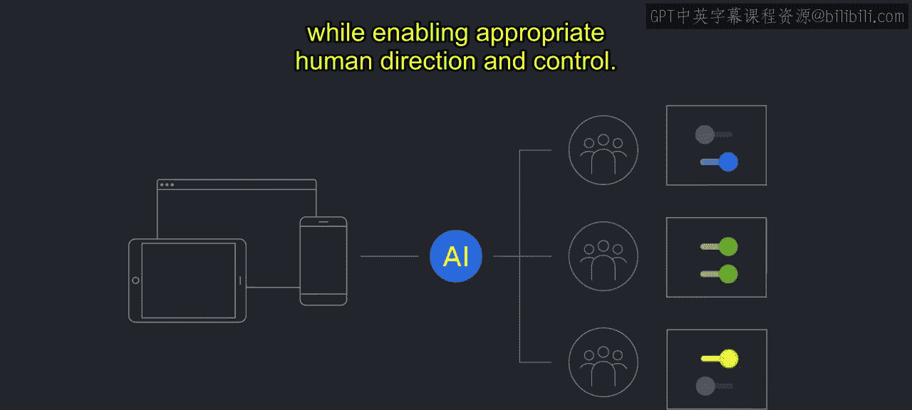

We strive to achieve accountability in AI systems in different ways。

Through clearly defined goals and operating parameters for the system。

 transparency about when and how AI is being used and the ability for people to intervene or provide feedback to the system。

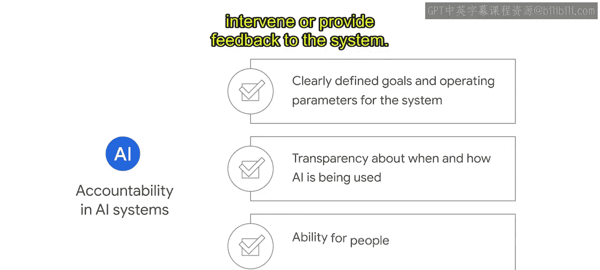

The final AI concern is AI driven unemployment and deskilling。

While AI brings efficiency and speed to common tasks。

 there is a more general concern that AI drives unemployment and dekiing。Further。

 there is a concern that human abilities will decline as we depend more on technology。

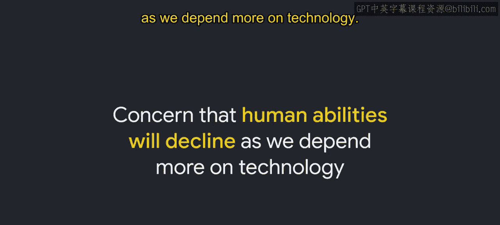

Society has seen technological innovation in the past， and we' have adjusted accordingly。

 like when cars replaced horses， but created new industries and jobs previously unimagined。Today。

 innovation and technology advances are happening faster and at a scale， unlike previous times。

If generative AI delivers on its promise capabilities。

 the Labour market could face significant disruption。However， jobs will shift。

 as they always do during any major technological advances。For example。

 who could have imagined flight attendants before commercial air travel。

While many jobs might be complemented by generative AI。

 entirely new jobs we can't imagine today will be created as well。

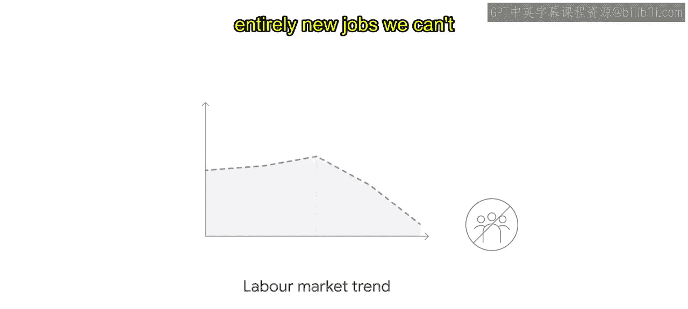

This challenge is accompanied with opportunities。We need to work together on programs that help people make a living and find meaning in work。

 facing the challenge and seizing the opportunity。

In addition to the list of concerns for generic AI applications and models。

 there are concerns unique to generative AI。As a well known type of generative AI。

 large language models generate creative combinations of text in the form of natural sounding language。

There are three main concerns on large language models。Pollucinations， factuality。

And anthropomorphization。In generative AI， hallucinations refer to instances where the AI model generates content that's unrealistic。

 fictional or completely fabricated。Factuality relates to the accuracy or truthfulness of the information produced by a generative AI model。

Anthropomorphization refers to the attribution of human light qualities， characteristics。

 or behaviors to non human entities such as machines or AI models。

These are just a selection of some of the common concerns related to AI and generative AI development and deployment。

Your awareness of these unique technological challenges can guide you when developing approaches to tackle them。

So what's causing these concerns？The executive respondents of a Cap Gemini survey cited a number of reasons for these reported ethical issues。

A lack of resources dedicated to ethical AI systems， so funds people and technology。

A lack of diverse teams when developing AI systems with respect to race， gender and geography。

And a lack of an ethical AI code of conduct or the ability to assess deviation from it。

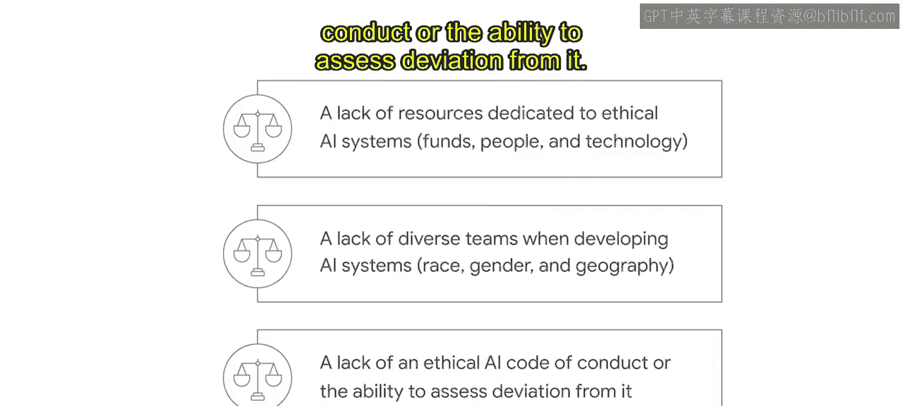

In the report， executives also identify the pressure to urgently implement AI as the top reason why ethical issues arise from the use of AI。

This pressure could stem from the urgency to gain a first mover advantage。

The need to acquire an edge over competitors with an innovative application of AI。

All the pressure simply to harness the benefits that AI has to offer。

It's also worth noting that 33 per cent of respondents in the survey stated their ethical issues were not actually considered while constructing I systems。

 which is concerning in itself。But ethics isn't just about the things we don't want to do or shouldn't do。

There are plenty of socially beneficial uses for AI and emerging technology to help contribute positively to life and society。

AI and new technology can help solve complex problems by improving materials， designs and processes。

Developing new medical and scientific breakthroughs。

Allowing more reliable forecasting of complex dynamic systems。

And providing more affordable goods and services and freedom from routine or repetitive tasks。

Even for these very socially beneficial solutions， responsible AI is critical to ensuring those benefits are realized by all and not just small subsets of stakeholders。

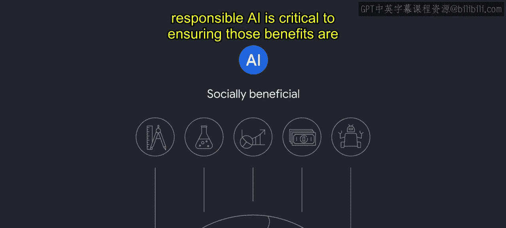

The key benefit of ethical practices in an organization is that they can help to avoid bringing harm to customers。

 users and society at large。Ethical practices promote human flourishing。

This is what we need to focus on the most。At Google。

 the goal of our AI governance is to try to address these concerns that are fuelling ethical issues and responsible AI practices can help achieve this。

Implementing your own responsible AI governance and process can help address these ethical concerns in your business。

