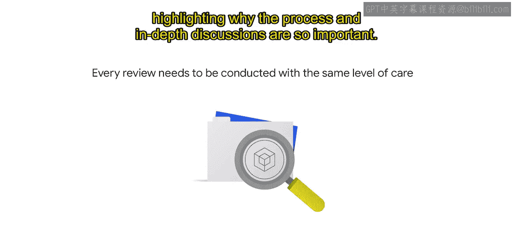
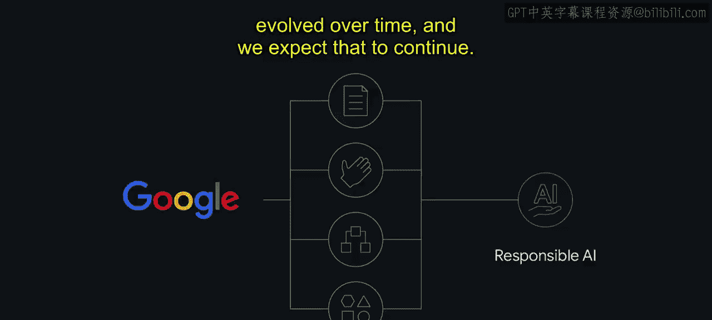
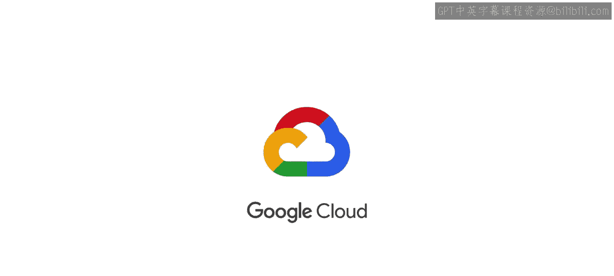

# 谷歌云《生成式AI学习路径（简介、LLM、负责的AI、应用）｜Introduction to Generative AI Learning Path》中英字幕 p15 11_Google Cloud的审核流程.zh_en -BV1GM4m1m7xm_p15-

Google Cloud develops a wide range of technologies for enterprises that build and implement AI through our AI platform。

 Vertex AI， MLOps capabilities， APIs， and end to end solutions。

Google Cloud has implemented our own custom AI principles review processes。

 as we believe that ethical evaluation of the impacts of the products we're creating is critical for trust and success。

Two connected but deliberately distinct review bodies exist in Google Cloud to ensure AI is developed responsibly。

A customer AI deal review and a cloud AI product development review。

The customer AI De review looks at early stage customer projects。

 which involve custom work above and beyond our generally available products to determine whether a proposed use case conflicts with our AI principles。

The Cloud AI Product development Review focuses on how we assess scope。

 build and govern the products Google Cloud creates using advanced technologies before a product can become available to the public。

These review processes answer two big questions。Is the proposed use case aligned with our AI principles。

 and if it is， how should we approach the design and integration of this solution to ensure the intended benefit is realized and harms are mitigated。

Even the most socially beneficial use cases need to follow responsible design practices。

 or they risk not fulfilling their intended benefit。

So how do Google Clouds review processes work in practice？

Let's start with the Google Cloud customer AI deal review。

 The goal is to identify any use cases that risk not being aligned with our principles before the deal moves forward。

This review happens in several stages。Sales deal submission is the intake process that can be achieved in two ways to ensure coverage。

Field sales representatives are trained to submit their AI customer opportunities for review。

Additionally， an automated process flags deals for review in our company wide sales tool。

In the preliminary review stage， members of the Cloud AI Princs team with help from the central Responsible Innovation team。

 review deals submitted via the intake process and prioritized deals needing a deeper review。

During this preliminary review， they apply any relevant historical precedent。

 discuss and debate potential AI principles risks， and request additional information where required。

This analysis sets the review agenda for the AI Principalles Deal Review Committee。

 which is the group directly responsible for making final decisions。At the review。

 discuss and decide stages， the De Review Committee meets to discuss the customer deals。

This committee is composed of leaders across multiple functions in the organization， such as product。

 policy， sales， AI ethics， and legal。Careful consideration is given to how the AI principles apply to the specific deal and news case。

 and the committee decides whether the deal can proceed。

The range of decisions this group makes can include go forward， don't go forward。

 cannot go forward until certain conditions or metrics are met。Or escalate decision。

The decisions here are made by consensus。If a clear decision cannot be agreed upon。

 the Deal Review Committee can escalate to the Council of Senior Executives。

Now let's walk through the Cloud AI Product development review。

It also consists of several different stages。For pipeline development。

 the Cloud AI Princles team tracks the product pipeline and plans reviews。

 so they happen early on in the product development lifecycl。

This is important when seeking to ensure an ethics by design approach to development。

Ensuring responsible AI considerations are incorporated in the design of the product as opposed to Tactton at the end。

Preliminary review is where a team works to prioritize the AI products for review based on launch timelines unless a particular use case is deemed more risky。

With a healthy product pipeline， we aim for in depth reviews every two weeks。Before a review meeting。

 members of the Cloud AI Princips team evaluate the product and draft the review brief。

They work hand in hand with the product managers， engineers。

 other members of the Cloud AI Princips team and fairness experts to deeply understand and scope the product review。

The review brief includes the intended goals and social benefits of the product。

What business problem the product will solve？The data being used。

How the model is trained and monitored。The societal context in which the product is going to be integrated。

And its potential risks and harms。In this evaluation。

 the teams collaborate to think through each of the stakeholder groups affected by the AI system。

They discuss the ethical dilemmas and value tensions that exist when deciding on one course of action versus another。

Finally， a key aspect of the review brief is a proposed alignment plan to align the product development with the AI principles by addressing potential harms。

This review brief is the basis for the review meeting。

Committee members spend time in advance of the meeting familiarizing themselves with the product and potential issues in order to be ready to discuss them from their specialized perspective。

Providing the review brief in advance allows for the review time to be focused。

 effective and efficient。Discuss and align is where the team actually meets to review the AI product from a responsible AI perspective。

These in depth live product reviews are a critical component of our review process。

It allows us to spot and discuss additional ethical issues as a team。

And make decisions that incorporate responsible AI into a product design。

 development and future roadmap。Over time， these reviews have been effective at normalizing tough conversations about risky technologies and preventing potentially adverse outcomes。

After the review meeting takes place， the AI Principals team works to synthesize the relevant content from the review brief and adds new issues。

 mitigations or decisions brought up in the review meeting to update and finalise an alignment plan。

At the approval stage， the alignment plan is sent to the committee and product leaders to sign off。

With this sign off， the alignment plan is incorporated into the product development roadmap。

 and the AI Princs team tracks the execution and completion of the alignment plan。

The alignment plan is unique to each product or solution。

It's important to note that not all paths forward involve technical solutions or fixes。

Ethical risks and harms aren't always a result of technological lapses。

 but can be a result of the context in which the product is being integrated。

The path forward could include， among other things。

Narrowing down the scope of the technology's purpose。Launching with an allow list。

 meaning the product is not available generally and needs a customer deal review prior to use。

 or launching with education materials packaged with the product such as an associated model card or implementation guide with information on using a solution responsibly。

Over time， reviewing products with similar issues has surfaced some findings that can be leveraged across multiple reviews。

This is allowed for the creation of certain generalized policies。

 which then become precedents that simplify the process for product teams。

Every review needs to be conducted with the same level of care as each new case brings up new considerations。

 highlighting why the process and in depth discussions are so important。

The process of how we put our AI principles into practice has grown and evolved over time。

 and we expect that to continue。

As you think about developing your own AI governance process。

 we hope that this serves as a helpful framework that you can adapt to fit the mission， values。

 and goals of your organization。Later in the course。

 we'll explore more lessons we've learnedt that have made our reviews at Google more effective。

