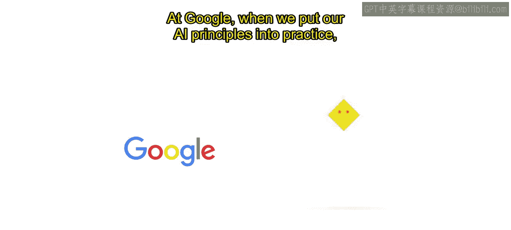
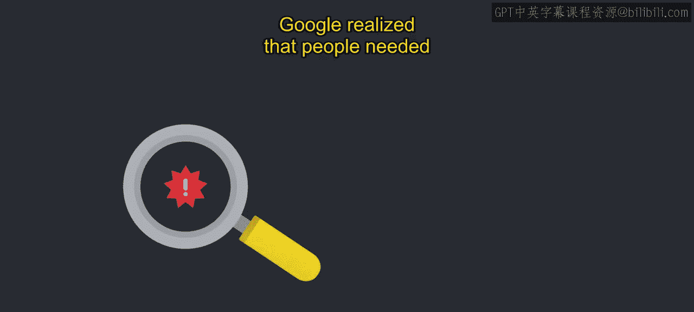
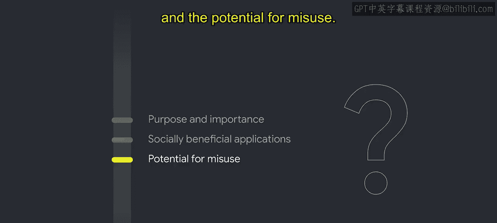
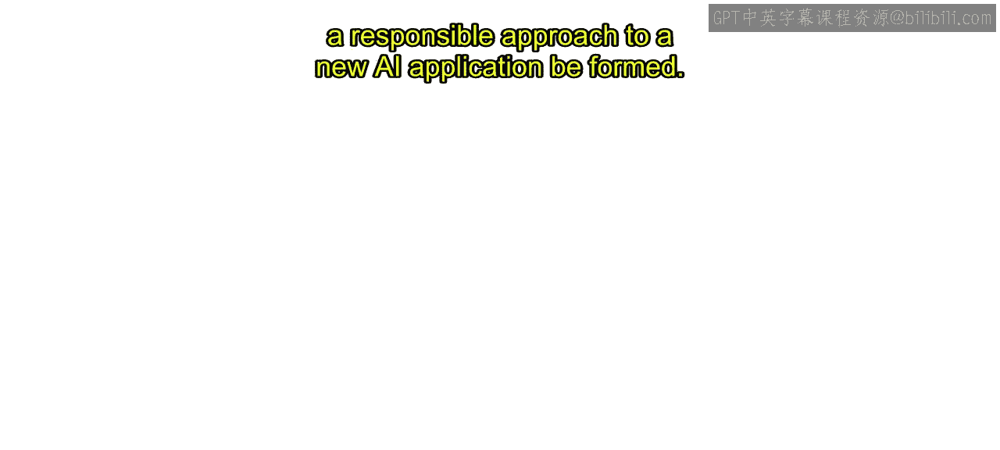

# 谷歌云《生成式AI学习路径（简介、LLM、负责的AI、应用）｜Introduction to Generative AI Learning Path》中英字幕 p17 13_问题发现过程.zh_en -BV1GM4m1m7xm_p17-

At Google， when we put our AI principles into practice。

 a key part of the AI governance and review process is issue spotting。

This is the process of identifying possible ethical issues with the AIU case in question。

Google realized that people needed a guide to help spot ethical issues。

But that guide couldn't be a simple checklist， which can hinder critical analysis。Instead。

 our approach to issues spotting is based on providing questions that require people to think critically about the technology that they've developed。

These questions are rooted in well established ethical decision making frameworks that emphasize the importance of seeking out additional information and considering best and worst case scenarios。

This helps to uncover potential ethical issues that may have otherwise gone unnoticed。

The questions cover a variety of topics， including overall product definition。

 What problem is being solved？It's intended users。What data is being used and how the model is trained and tested。

There are also questions that focus on context， such as the purpose and importance of the use case。

The socially beneficial applications of the use case。And the potential for misuse。

These questions are intended to highlight the implications of design decisions that could impact fair and responsible use of the AI model。

We assess all AI use cases， starting from an assumption that there are always issues we can address。

 even if a use case seems obviously socially beneficial。

If issues arise in this critical thinking process that may conflict with the ethical aims of the I principles。

 then a more in depth review takes place。Over the course of conducting AI principles reviews。

 we have recognized certain complex areas during AI development that warrant a closer ethical review。

Identifying the areas of risk and harm for use cases relevant to your business context is critical。

And particular care should be taken when building AI applications in these areas。These could。

 for example， be use cases involving surveillance or synthetic media among many others。

Areas that are complex for your business will depend a lot on your domain and customers。

Identifying emerging areas of risk and social harm is all part of an active discussion within the industry。

 and we can expect forthcoming standards and policies in this area。

Let's take a look at a hypothetical use case using issue spotting questions to assess whether any AI principles are being or are at risk of being infringed。

We'll review a fictional product called the Autism Spectrum disorderorder ASD Carebot。

 adapted from a case study created by the Marcular Centre for Applied Ethics at Santa Clara University。

The causes of ASD are deeply debated， though research indicates that its prevalence is increasing and that children diagnosed early and provided with key services are more likely to reach their fullest potential。

Some schools have found success with robots that help students practice verbal skills and social interactions under the supervision of a trained therapist。

 but this isn't yet an affordable or widely accessible resource。As a result。

 not all schools provide such support。Now， imagine that an AI product team proposes to build an affordable ASD carebot aimed at preschool aged children and intended for use in children's homes。

They envision a cloud based AI chatbot with speech， gesture， facial sentiment analysis。

 and personalized learning modules to reinforce positive social interactions。In issue spotting。

 it's useful to first identify the questions needed to think critically about the use case。

 Que such as who are the stakeholders for this product？What do they hope to gain from it。

Do different stakeholders have different needs？How might each of the AI principles either be fulfilled or violated with the development and use of the ASD Carebot？

Your AI principless review may ask more questions than you can immediately answer。

 but the analysis will uncover areas for exploration that will ultimately impact how your team proceeds。

From a social benefit standpoint， the aim of the product is to expand access to a form of therapy not currently available for all who could benefit from it。

However， is this the best or right way to offer this therapy and should ASD be treated as something that needs this type of intervention at all？

The goal of avoiding the creation or reinforcement of unfair bias may lead your team to ask。

How might the team involve influence the fairness of the model？

Reviewing the product design and integration， where should fairness be closely considered and evaluated？

Do we have the necessary input from the people who will be directly affected by the carebo？

Where will the training data be sourced to develop the underlying models for the carebot？

Who will that data represent and are there people or groups of people with ASD who may not be well represented。

In terms of safety， what could happen if this model doesn't perform as expected or is subject to model drift or decay over time？

Could human safety be endangered？Taking a look at potential privacy risks and considerations。

 the home can be seen as a highly sensitive and shared environment， even more so than the classroom。

What kind of data will this carebo be collecting？Are there data sets that could pose special privacy risks？

What design principles could help ensure appropriate privacy protections for this highly sensitive use case？

To evaluate how accountable the system is， the developers may want to know how human oversight of the system will be ensured and determine what kind of informed consent is appropriate for those engaging with this system。

For example， should the carebo be allowed to present itself as a friend？

Are there possible positive and negative impacts to consider？

Scientific excellence urges product owners to evaluate whether they have the necessary expertise to develop such a tool or if they should consider engaging an external partner who specializes in ASD or education therapy to develop a deep understanding of the needs of the students。

Some questions to help determine this include what kinds of testing and review would be appropriate for this use case to ensure that it performs and delivers the desired benefits。

What are the technical and scientific criteria for doing this responsibly？Lastly。

 the AI principle be made available for uses at accord with these principles。

 suggests that product owners think about whether the solution will be broadly available to users such as being affordable and accessible。

By asking issue spotting questions， teams can think critically to assess the potential benefits and harms of a use case。

Only with a thorough review can a responsible approach to a new AI application be formed。

