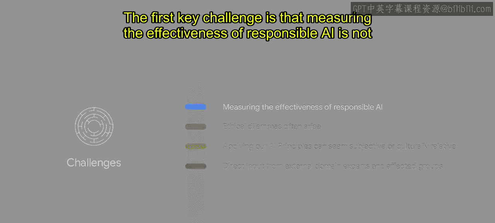
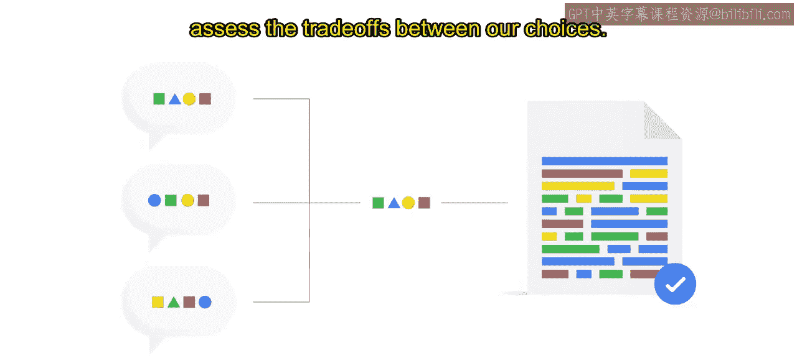
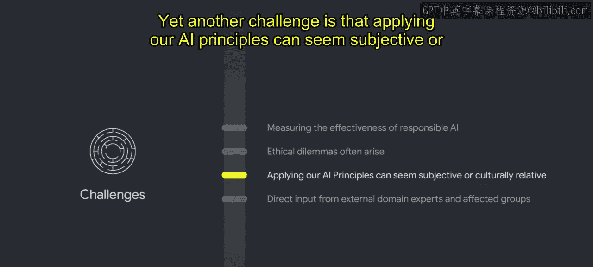
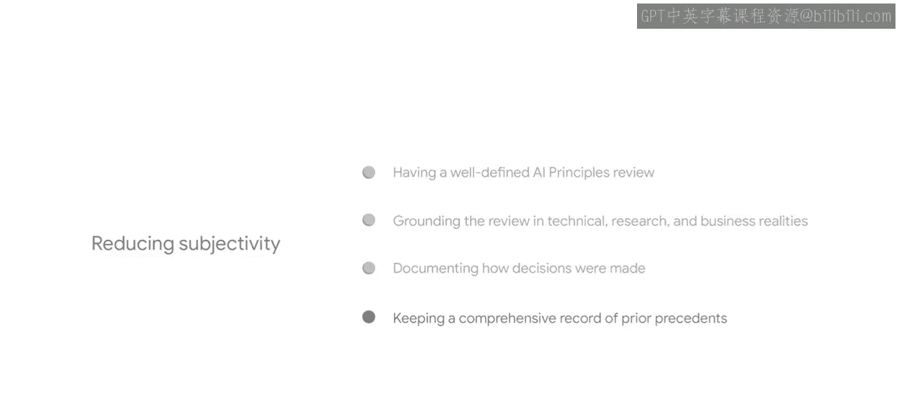
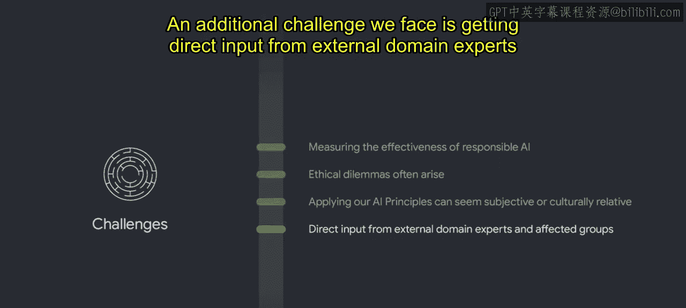
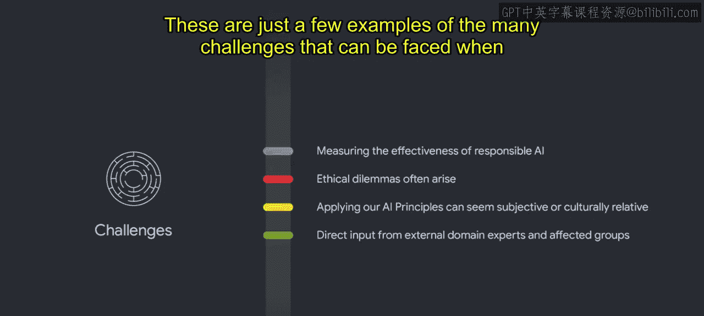

# 谷歌云《生成式AI学习路径（简介、LLM、负责的AI、应用）｜Introduction to Generative AI Learning Path》中英字幕 p18 14_从实施AI原则中学到的挑战.zh_en -BV1GM4m1m7xm_p18-

Our journey to operationalize Google's AI principles required the collaboration and diligent work of many。

We continue to learn a lot about this process， both from our successes and challenges。

 and are committed to iterating， evolving and sharing along the way to help you on your journey。Next。

 we'll explore some challenges we often encounter during the AI principles process。

All of which we suspect might not be unique challenges to Google alone。

The first key challenge is that measuring the effectiveness of responsible AI is not straightforward。

Assessing how mitigations address ethical issues can be more difficult than assessing technical performance。

In a sector that values impact metrics and quantifiable results。

 measuring the effectiveness of mitigations that prevent a potential harm or issue from happening is not easy。

Because of this， the metrics that indicate successful for responsible innovation may look a bit different from traditional business metrics。

For example， we track issues in the related mitigations and how they are implemented in the product。

We also look at the impact our AI governance has on building customer trust and accelerating deal success。

Another measure of effectiveness is gathering end user' experiences and perceptions through surveys and customer feedback。

These types of metrics help to track impact， identify trends and establish precedentnce。

Another challenge is around ethical dilemmas。When applying our principles。

 ethical dilemmas often arise rather than clear decisions between right and wrong。

Members of the Review Committee， each with their own individual interpretation of the AI principles。

 lived experiences and expertise， apply their own values to ethical issues。

This can create a tension between different values that foster a lot of debate。

It's important to remember that these dilemmas in resulting deliberations are a core goal of an AI principless review Working through these dilemmas requires open and honest conversations and an understanding that these aren't easy decisions to make。

These conversations ultimately help identify and assess the trade offs between our choices。

Yet another challenge is that applying our AI principles can seem subjective or culturally relative。

A few ways we reduce the subjectivity include。Having a well defined AI principles review and decision making process to foster trust in that process。

Grounding the review in technical， research and business realities connects the mitigations to real world issues。

Documenting how decisions were made can provide necessary transparency and ensure accountability for the review team and beyond。

And keeping a comprehensive record of prior precedents is important to ensure consistency by assessing whether the case at hand is relevantly different from cases in the past。

An additional challenge we face is getting direct input from external domain experts and affected groups。

 This is critical， but it's not easy， and we want to recognize that the process of doing so can be difficult。

No one person can represent the viewpoints of the group of people you are trying to represent。

The goal is to hear as wide a range of voices as possible so that the products are made for everyone。

These are just a few examples of the many challenges that can be faced when developing responsible AI。

On the responsible AI journey， there will always be issues and challenges。

 Striving to minimize and mitigate them starts with that recognition。

