# 谷歌云《生成式AI学习路径（简介、LLM、负责的AI、应用）｜Introduction to Generative AI Learning Path》中英字幕 p20 16_继续迈向负责任的AI之旅.zh_en -BV1GM4m1m7xm_p20-

At Google， we believe that rigorous evaluations of how to build AI responsibly are not only the right thing to do。

 They are a critical component of creating successful AI。

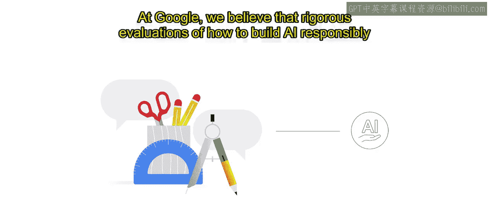

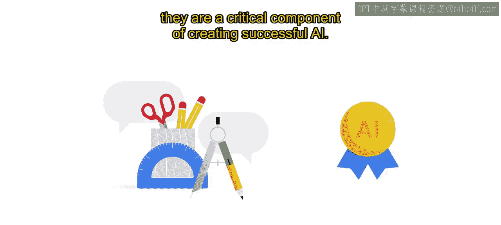

Products and technology should work for everyone。Our AI principles keep us motivated by a common purpose。

 guide us to use advanced technologies in the best interest of people around the world and help us make decisions that are aligned with Google's mission and core values。

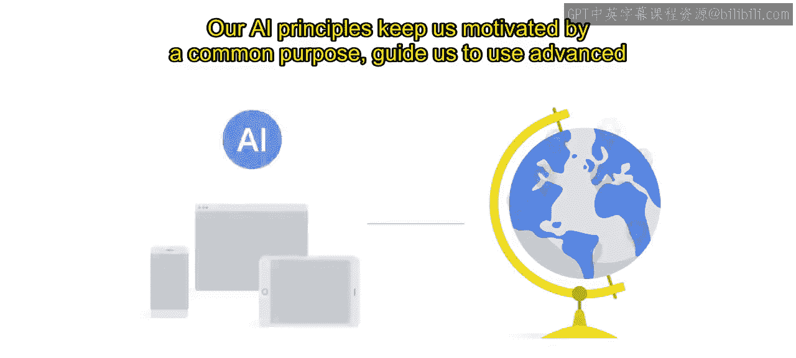

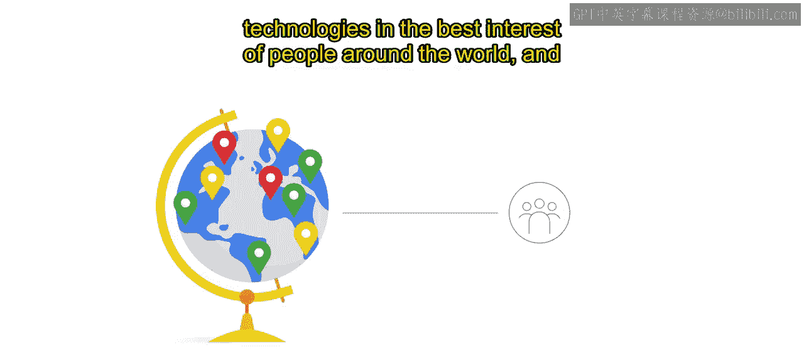

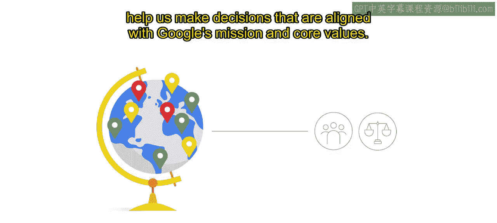

We will have a role to play in how responsible AI is applied。

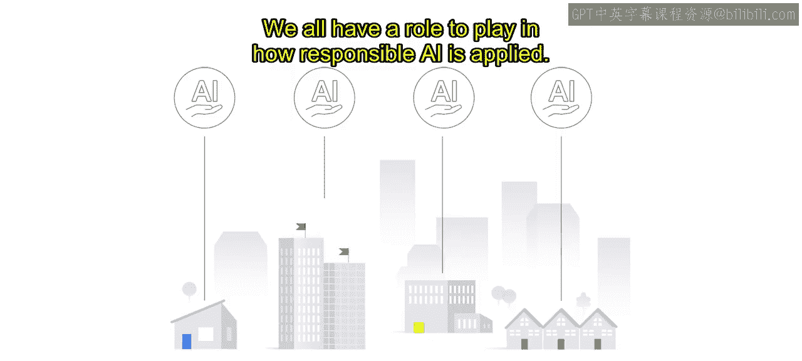

Our aim is that through taking this course， you've gained an understanding of how we at Google developed our AI principles and how we've operationalized them within the organization。

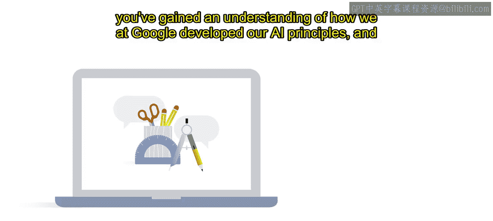

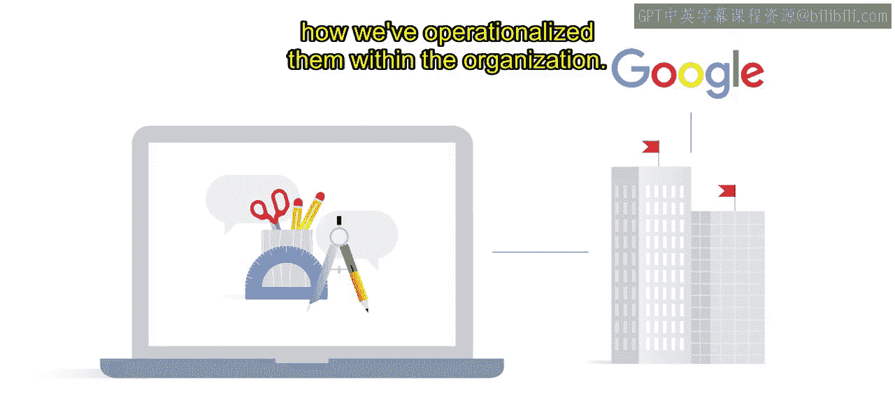

Our hope is that you can take the lessons learned and best practices from this training as a starting point to work with your teams to further your responsible AI strategy。

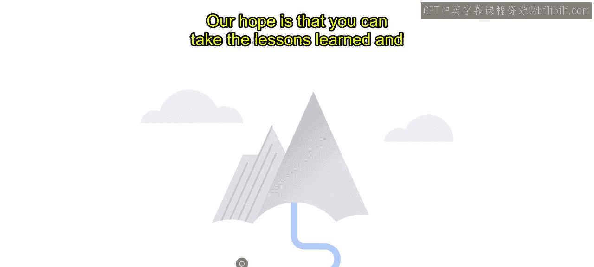

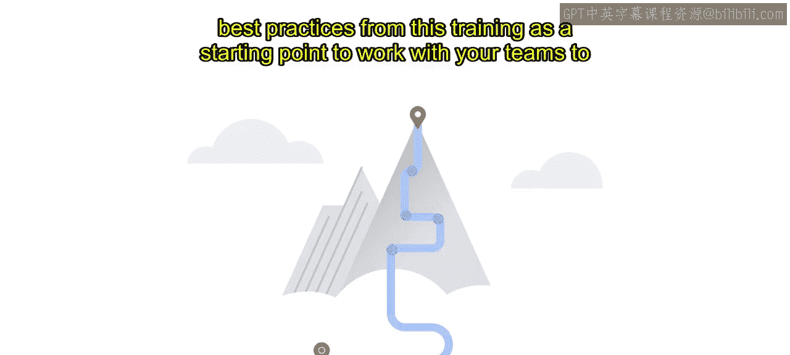

Our challenge to you is that you now take this knowledge and develop your own AI principles and accompanying review process。

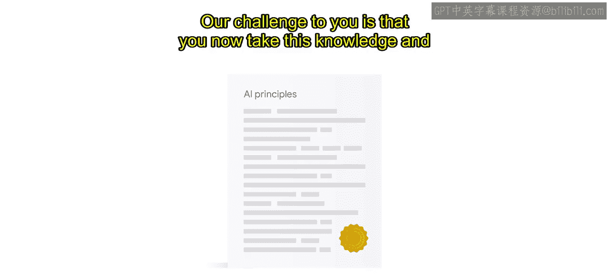

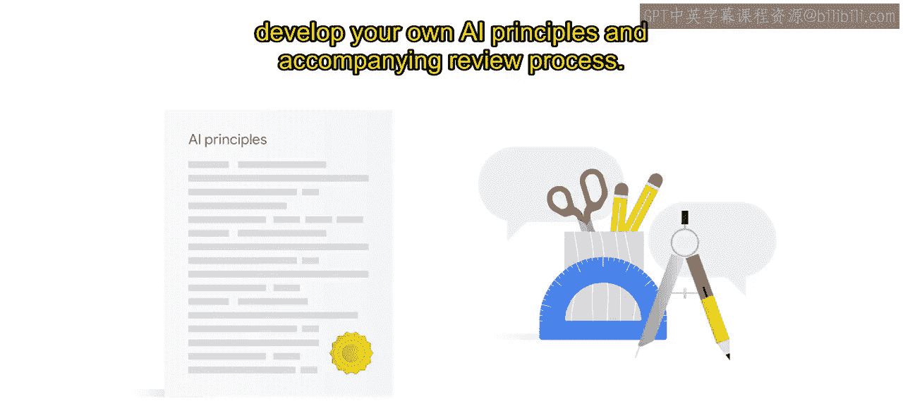

Wherever you are in your AI journey， a valuable goal can be to talk with your teams about what responsible AI means in the context of your own business。

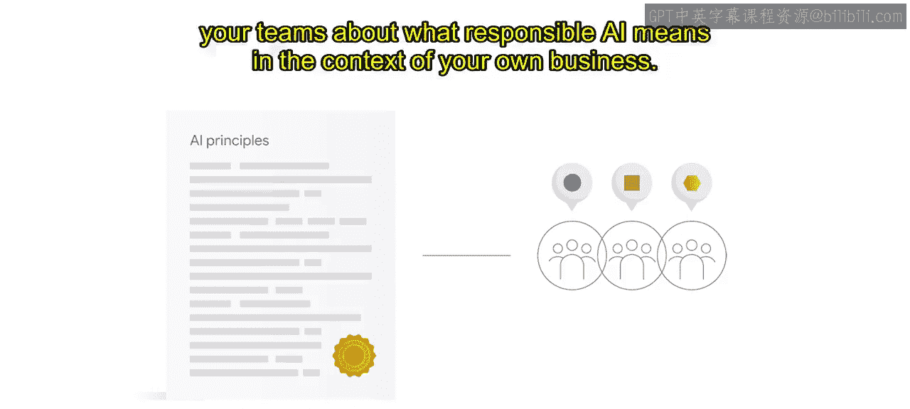

Those discussions can help you when outlining your own AI principles。

We know no system whether human or AI powered will ever be perfect。

 so we don't consider the task of improving it to ever be finished。

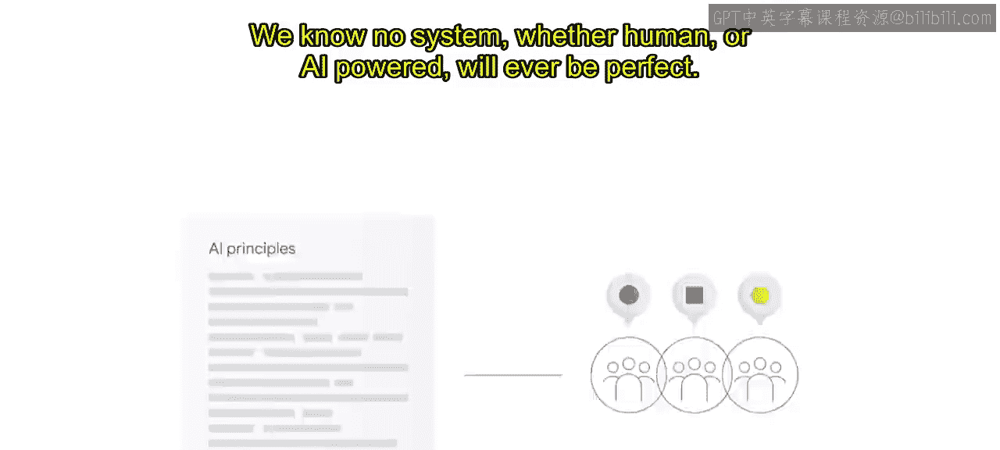

We look forward to continuing to update you on what we're learning and on our progress。

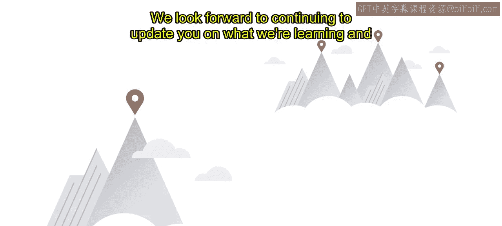

We share these on the Google and Google Cloud responsible AI pages。

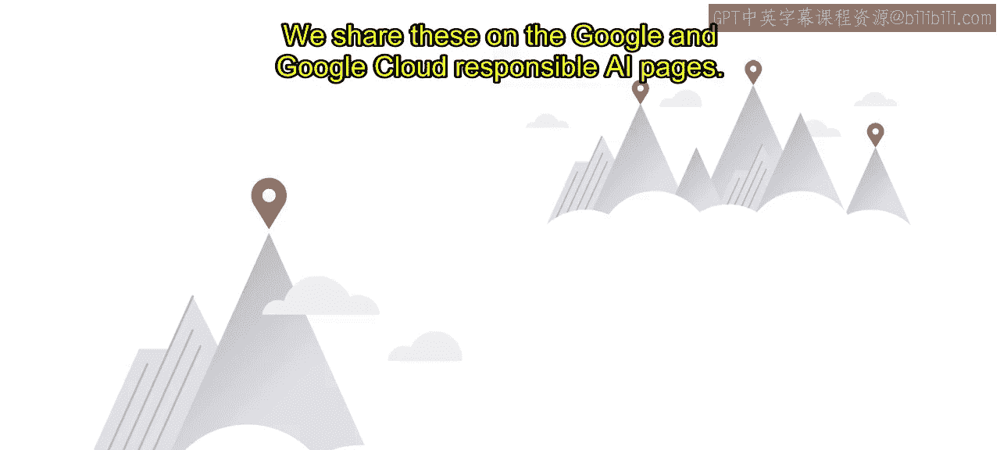

If you want to take the next step and work with Google on your next project or business goal。

 you can always reach out to your local Google Cloud account representative or a Google Cloud ML specialized partner。

If you have specific questions around responsible AI。

 you can reach out to the Google Cloud Responsible AI team directly。

We are unwavering in our commitment to responsible AI。

Thank you for joining us on this journey and learning with us。

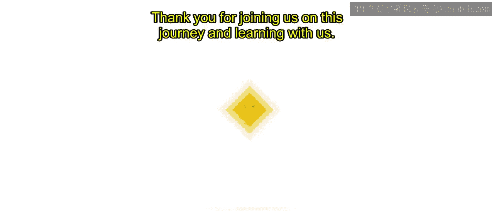