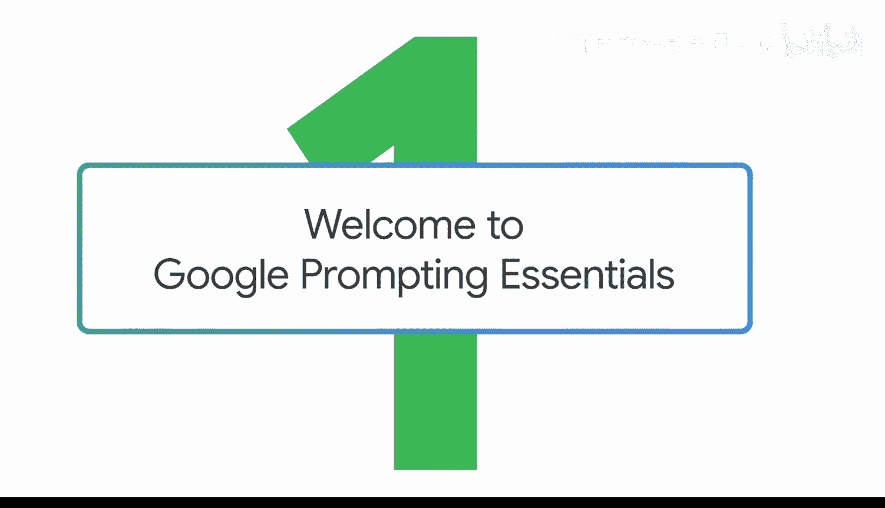
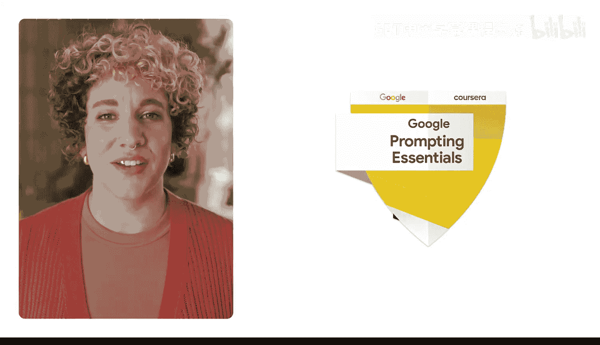
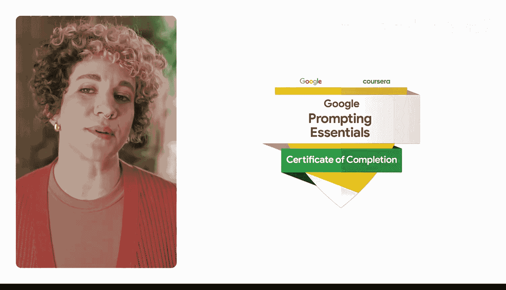

# 谷歌《提示词基础课程｜Google Prompting Essentials》中英字幕（deepseek p01 01_01_01_欢迎来到谷歌提示词基础课程.zh_en -BV1zT6eYqEeR_p1-

🎼。

🎼。Chances are you've already experimented with generative AI。

 and you've probably gotten some results that have been helpful and maybe some that fell short throughoutout this course。

 AI experts at Google will teach you the difference between a good prompt and a great prompt。

 so you can work faster and smarter with Jen AI at your side。

And we'll share practical examples of where you can use JenAI at work。Hi， I'm Aina。

 I work on generative AI at Google。 In this course。

 my colleagues and I are going to teach you how you can get the most out of Gen AI。

 You'll learn when to use Jen AI and how by designing better prompts to get the best results。

 You'll apply what you've learned with hands on activities and quizzes to level up your prompting skills After you've completed this course。

 you'll have lots of practice applying Gen AI in ways that matter to you and your job。😊。

As recognition of your work， you'll earn a certificate from Google to share with your network and potential employers。

 We have a lot of exciting stuff in store， so let's get to it。

🎼。