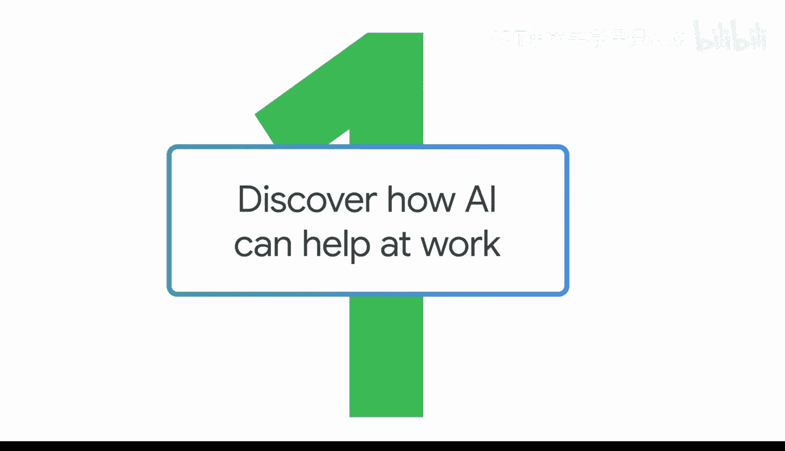
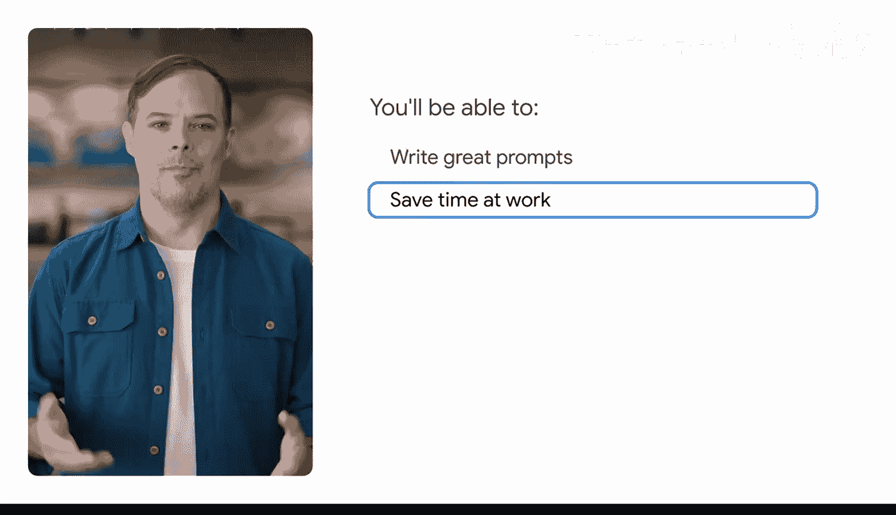
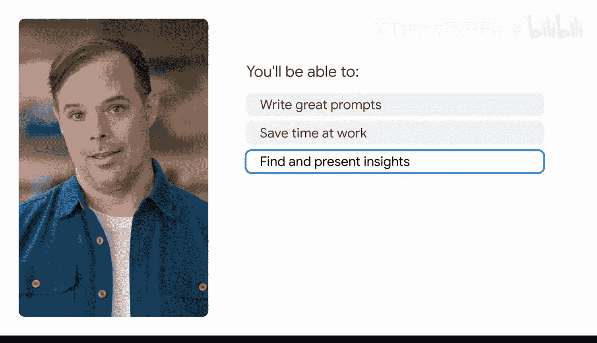
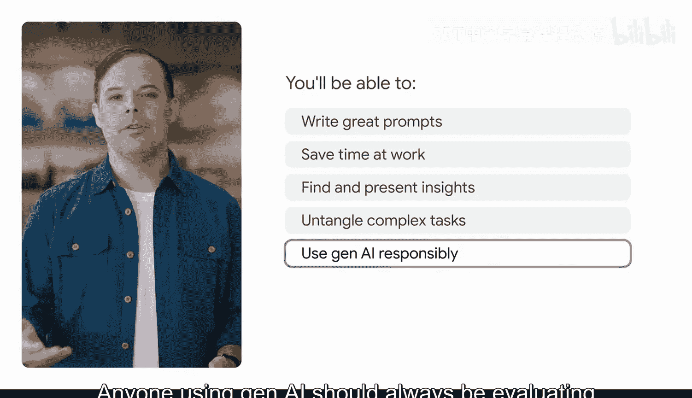
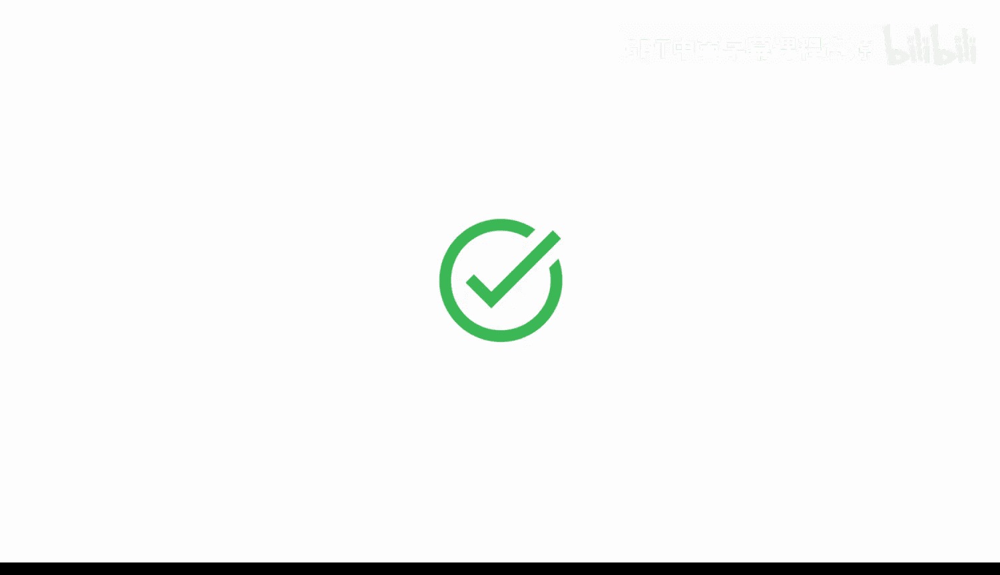

# 谷歌《提示词基础课程｜Google Prompting Essentials》中英字幕（deepseek p02 02_01_02_探索AI如何在工作中助你一臂之力.zh_en -BV1zT6eYqEeR_p2-

Hi， I'm Timothy， a director of developer relationslations at Google For the last 14 years。

 I've been helping developers and Google work better together。

 I've recently been working a lot more with Gen AI to do things like technical writing and generating code。

 I've also been helping more developers integrate Gen AI into their apps。

 Prompting is a new skill that a lot of us are learning and trying to get better at myself included。

AndMy first experience using Gen AI that was transformative was for a pretty simple task。

 I needed to quickly collect everyone's availability for an important team meeting。

 I asked over chat， and everyone responded in a different format as people are likely to do。

 And it was a lot to track， But with the help of Gen AI。

 I was able to organize everyone's availability into a table and then transposed it for the table was sorted by date。

 not by chat message。 A task that would have taken forever manually。

 only took me a few minutes with Gen AI。 And that was my breakthrough moment。

 using Gen AI in my everyday tasks to turn things that used to be a headache into something simple and easy。

 And that's what this courses about， using Gen AI to help you get your job done。

 So what is prompting anyway。 What simply prompting is the process of providing specific instructions to a gen AI tool to receive new information or to achieve a desired outcome on a task。

😊，Those instructions are called prompts。 When we write a prompt for a Gen AI tool。

 we're giving it a series of inputs and telling it what we would like it to generate。

 Some Gen AI tools can generate text or images while others generate video， audio or even code。

A promptmping is both an art and a science to get the best results。

 We need to be precise in defining what we need。 Now。

 this is similar to the way you would help your teammate get started on a new project。

 providing context and setting parameters will get you the best output from Gen AI。

 The first thing you'll learn is the prompting framework。 It's a formula for writing great prompts。

 You'll use this framework throughout the course。And after that。

 it's all about putting prompts to use on specific tasks that can save you time in your job。

You'll use Jen AI to brainstorm ideas， develop plans and draft emails for different audiences。

 We'll teach you how to summarize meeting notes， assign action items and more。

We'll also teach you how to analyze data and spreadsheets with Jen AI。

You'll write prompts that can help you find insights buried in data。

 You'll then use Gen AI to turn those insights into visuals and eventually turn it all into a slide deck with talking points for a presentation。

 Next， you'll learn advanced prompting techniques to help you untangle complex tasks。 For example。

 you'll learn how to create prompts that can help make long term。

 complicated projects easier to plan and execute。You'll also learn how to design a prompt to create your own personalized AI agent to do things like practice before an interview or prepare for difficult work conversations。

And finally， you'll learn how to use JenAI responsibly。

 including guidelines for using it in your job and on your team。This is crucial。

 Gen AI tools help you with the work that you do， but they don't do it for you。

 Anyone using Jen Ai should always be evaluating and fact checking outputs。

 There are a lot of Gen AI tools out there and in this course。

 We're going to demonstrate how to prompt using Gemini and other Google AI tools like Gemini for Google workspace and Google AI studio。

 But all of the techniques and best practices you'll learn in this course can be applied to other Gen Ai tools like chat GPT Copit or cloudd。

 Last thing， we designed this course to give you skills that you can use at work right away。

 So all of these lessons and techniques you're going to learn are rooted in real world scenarios。

 You should experiment and play around to figure out what works best for you。

 And as you go through this course， feel free to pause the video and test what you just learned with something you're working on right now。

 Now， let's get started with our first prompts。😊。

