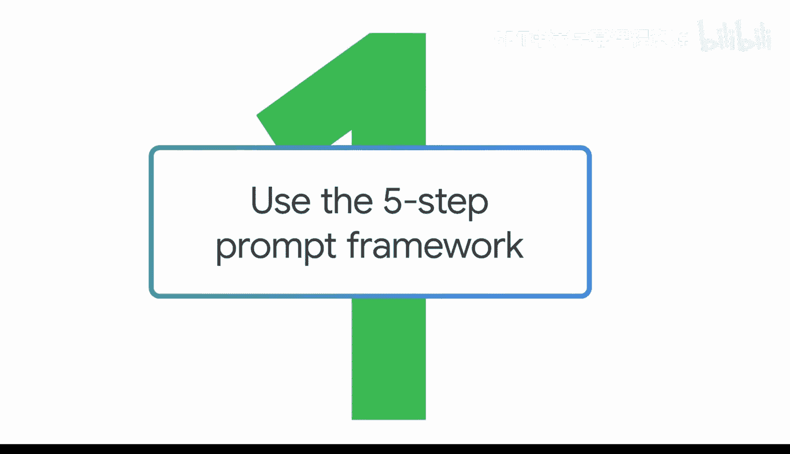
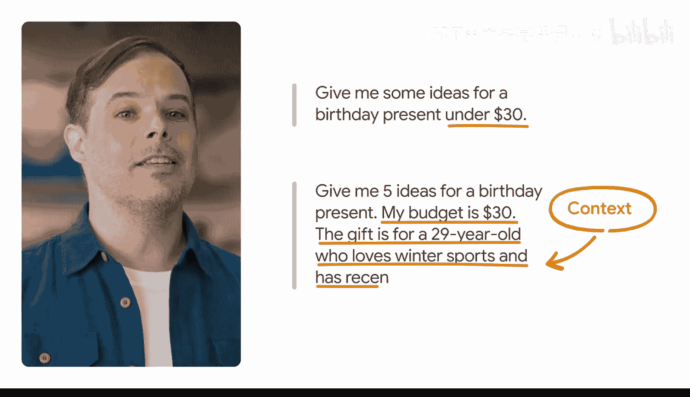

# 谷歌《提示词基础课程｜Google Prompting Essentials》中英字幕（deepseek p04 04_01_01_使用五步提示词框架.zh_en -BV1zT6eYqEeR_p4-

In this lesson， you're going to learn how to create effective prompts a good prompt follows a simple framework。

Task， context， references。Evaluate and iterate。

If you ever forget a step， just remember， thoughtfully create really excellent inputs。

First is task You need to describe the task you want the generative AI tool to help you with。

 Now this should include a persona and a format preference so that the task is specific。

 persona refers to what expertise you want the Gen AI tool to draw from。

You can ask the tool to take on a persona like a professional speechwriter or a marketing executive with 15 years of experience。

 or you can ask it to create output for a specific audience。

 a customer or even your manager you can be as detailed as you'd like when adding a persona to your task format refers to how you want the output to appear。

 whether that's a bulleted list， short sentences or table So there you have it taskask Next you'll include context or the necessary details to help the Gen AI tool understand what you need from it。

This is the difference between writing。 Give me some ideas for a birthday present under $30 and give me  five ideas for a birthday present。

 My budget is $30。 The gift is for a 29 year old who loves winter sports and has recently switched from snowboarding to skiing。

😊。

Sometimes you'll add references for the JenAI tool to use while creating its output。

You just asked a GenAI tool to give you ideas for birthday present right， Well。

 if you add examples of birthday presents you've given in the past as references。

 the GenAI tool can give you a more useful output there aren't always going to be clear references of what you need。

 especially if you're working on something more abstract or searching for ideas and inspiration。

Once you have your output， it's time to evaluate。 Ask yourself if the input you provided gave you the output you needed。

 This leads us to the final part of the framework， iterate。

If you evaluate your output and determine that you're not getting what you need。

 you can try again by adding more information or tweaking your prompt。

 And this is a key part of prompting effectively， and we'll explore it in depth later on in the course。

 One more note on the framework。 There are plenty of ways to construct an effective prompt。

 The order of how you construct a prompt is less important than the substance of the prompt itself。

 As long as you are thoughtfully creating really excellent inputs， your outputs should be great。😊。

🎼。

