# 谷歌《提示词基础课程｜Google Prompting Essentials》中英字幕（deepseek p05 05_01_02_将提示词框架付诸实践.zh_en -BV1zT6eYqEeR_p5-

🎼。嗯。🎼。

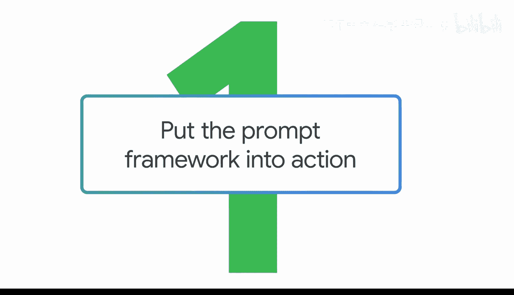

Let's put the framework into action。First， we'll log into Gemini and then use the tool to help us brainstorm ideas for a new high performance sneaker line。

First， let's add the task。Generate five ideas for a new， high performance sneaker line。 Okay。

 we've asked Gemini to complete a task， but we're not really applying the prompting framework yet。

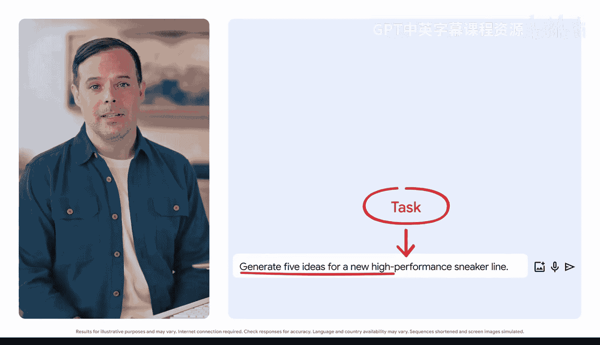

Remember， thoughtfully create really excellent inputs。This prompt is all task and nothing else。

 which might give us an output that's too broad and not very useful。 Still。

 Gem and I generated five ideas with unique names and descriptions。 This isn't a bad start。

 but we can do better。 Let's add some more details like our desired format and a more specific task for the tool to complete。

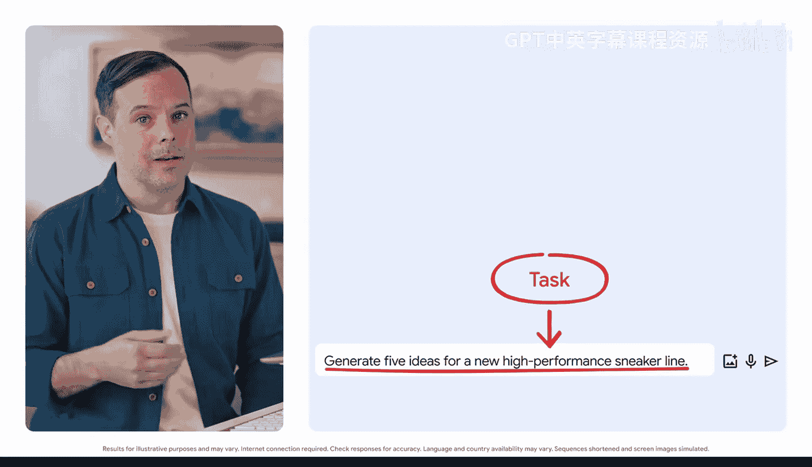

List the concepts。And materials。

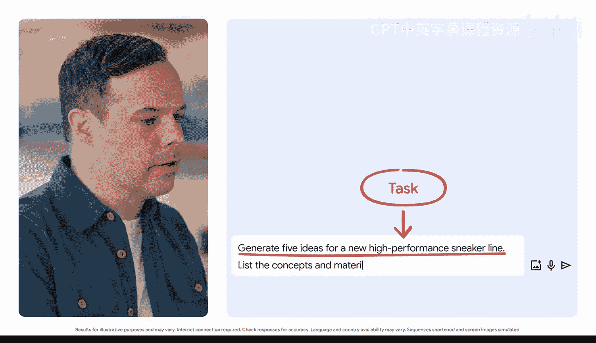

Or each sneaker in an outline。

That's much better。 Now， we have a set of unique ideas for a sneaker line that includes the materials for each shoe。

 And it came in our preferred format。

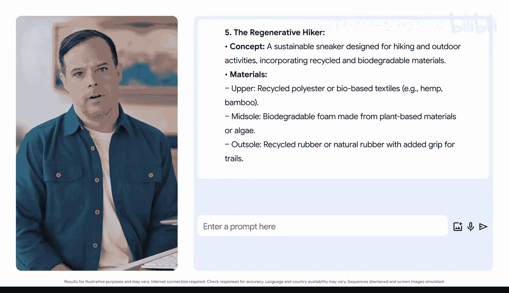

I think we can do even better， don't you， Let's add some context。

The sneakers should be made for athletes doing cross training activities with the new information。

 Gem and I created five new sneaker ideas that are more suited to our specific goals。😊。

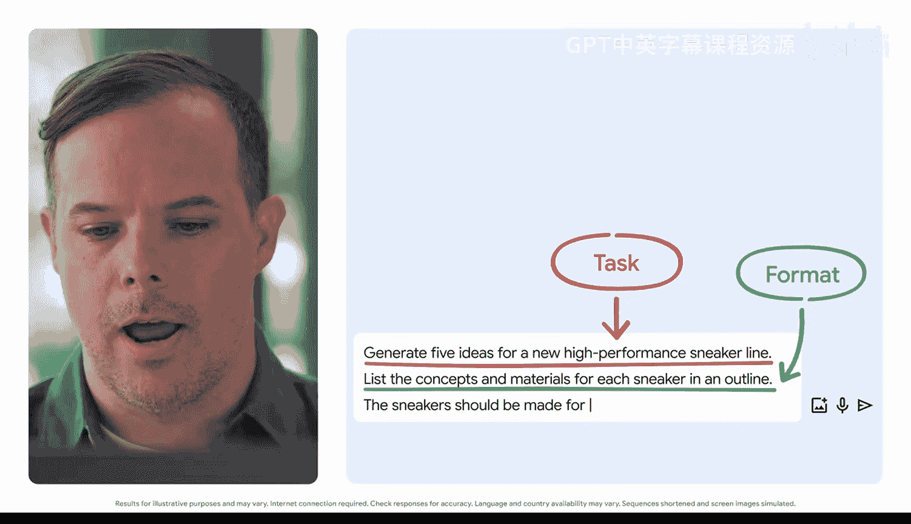

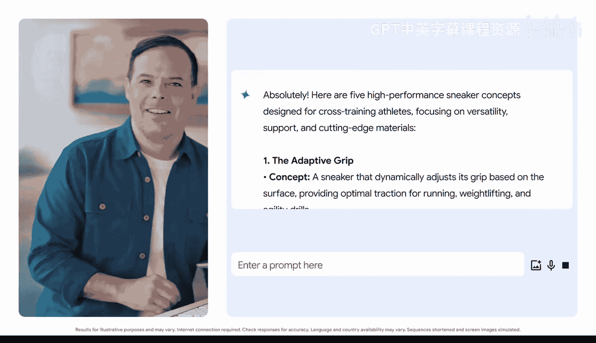

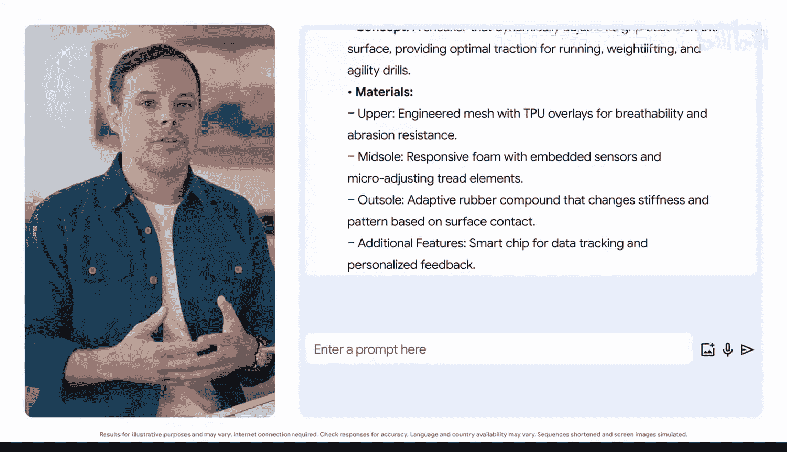

Remember getting tailored outputs means we need to provide a JenAI tool with more details and context in order to generate more useful results successcces is all about the details。

 so let's give references a try。

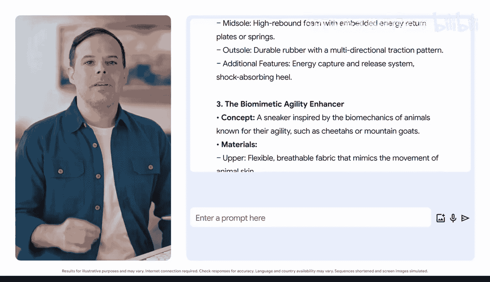

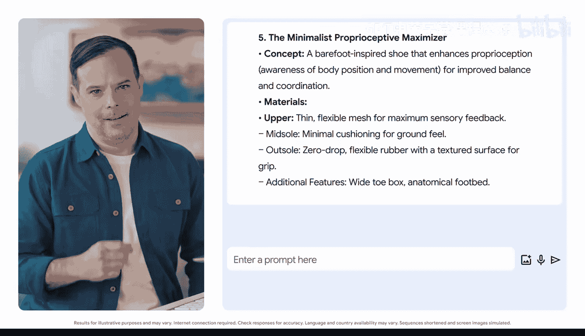

References give Gen AI tools examples to work from。

 and that can mean asking a Gen AI tool to learn from the tone， style or length of a given reference。

 providing multiple references is also known as few shot prompting。

 Shos are just references or examples， and the term is used a lot。

There's also single shot prompting， which means we're giving it one reference and zero shot prompting。

 which means we don't give the AI tool any references。

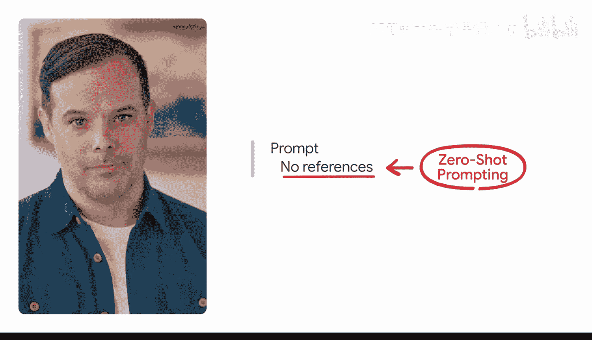

Now most of the time， between 2 and 5 references is the sweet spot for a gen AI tool。

 to few references， and we don't give enough context。 Too many。

 we could skew the results and limit creativity to practice few shot prompting with our new sneaker line。

 Let's include descriptions of shoes that already exist。 One of them is from a budget line of shoes。

 And the other one has a new adaptive soul。😊，We can input those descriptions like this。

Keep the five ideas generated， but refine them using these two examples as references。

Here's we'll paste in the references。 there's a lot of choices here。

 And they all seem like good options for the task。 And this is cool。

 A shoe that regulates temperature。😊。

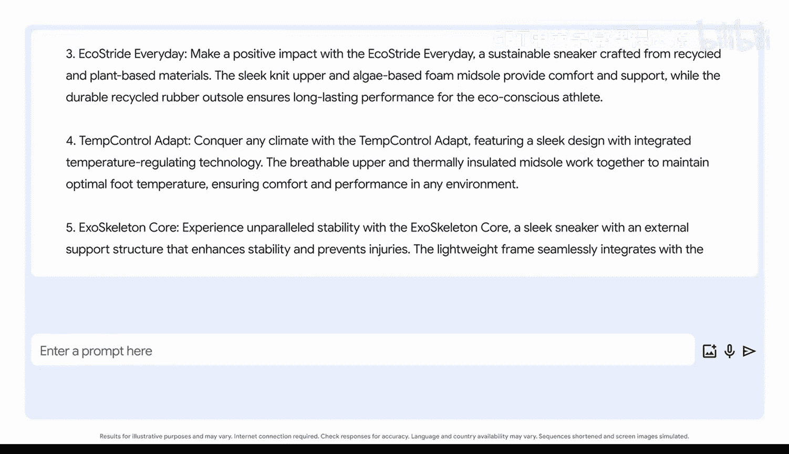

Evaluating the output and iterating might be the last parts of our prompting framework。

 but they're also where we get to experiment and get creative。

 Each new output is an opportunity to further refine your prompt until you get the response you want。

 In fact， we've been evaluating and iterating this whole time。

 we evaluated the sneaker ideas from our first prompt。 and we iterated by adding context。

 We evaluatedated the output again， and we iterated by adding references。 And remember。

 we can always add details or tweak phrasing in order to change our outputs。

 We like to say A BI or always be iterating。😊。

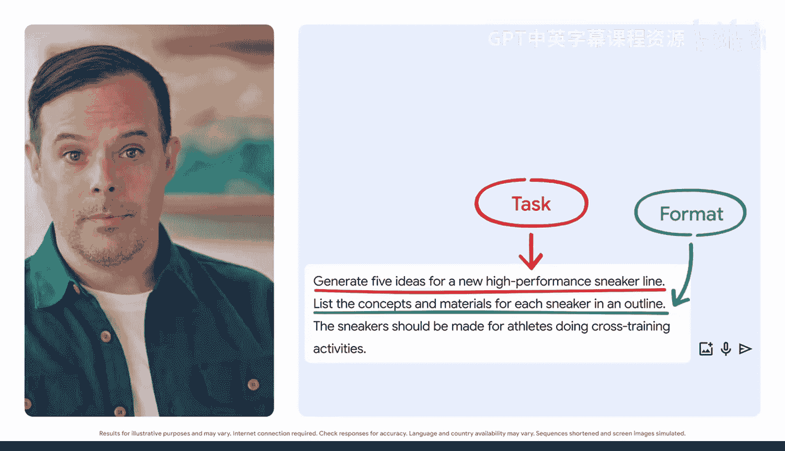

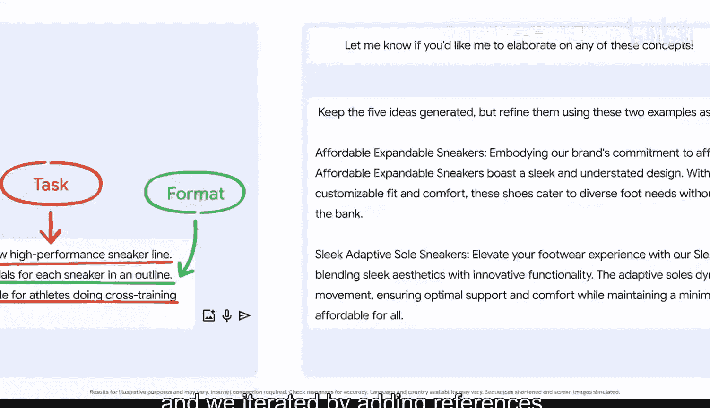

Give the prompting framework a try yourself remember it's always better to start simple and then slowly add complexity iterating as you go If your outputs start to lose quality。

 you might need to go back and make your prompts simpler and that's okay Learn what works and what doesn't is all part of the journey If you ever get stuck just remember to thoughtfully create really excellent inputs and you'll get back on track。

🎼。🎼。

