# 谷歌《提示词基础课程｜Google Prompting Essentials》中英字幕（deepseek p07 07_01_05_练习四种迭代方法.zh_en -BV1zT6eYqEeR_p7-

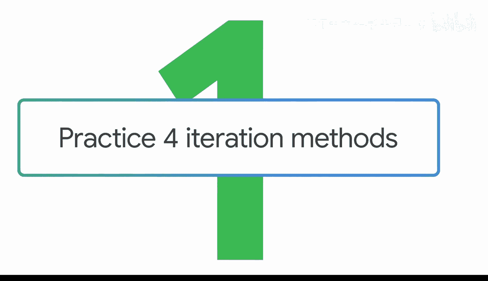

There are going to be times when your prompt simply isn't giving you what you want。

But instead of scrapping all your work and starting again from zero。

 think about how you can always be iterating or ABI to try and mold the outputs into something more useful。

By the end of this video， you'll learn four helpful iteration methods。

 The first method is to revisit the prompting framework and make sure you're providing enough specificity in your task。

 context and references。 For example， if you wrote， give me five blog post ideas。

 a generative AI tool might respond better， if you adjusted your prompt to include the persona and format。

 For example， you are an expert on sports nutrition。

 Pro five blog post headlines that summarize the biggest trends happening in the industry。

 for an audience of physical therapists working with professional basketball players。😊。

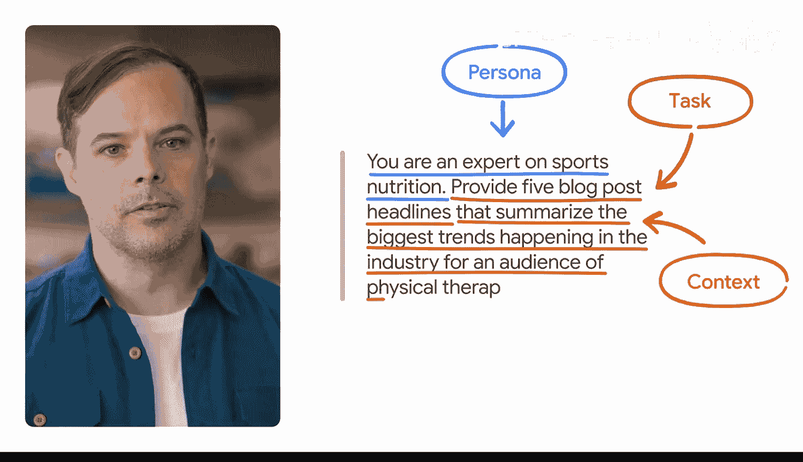

The second method is to separate your prompt into shorter sentences。

Start by taking a long input and breaking it down into smaller tasks。 This is the long input。

 summarize the key data points and information in this report。

 Then create visual graphs from the data and shorten the key information into bullets。

 You can break this up into shorter sentences and input them as separate prompts。

 You'll input each prompt， receive an output and then follow up with a new prompt until all of your tasks have been submitted。

 First， summarize the key data points and information in this report。

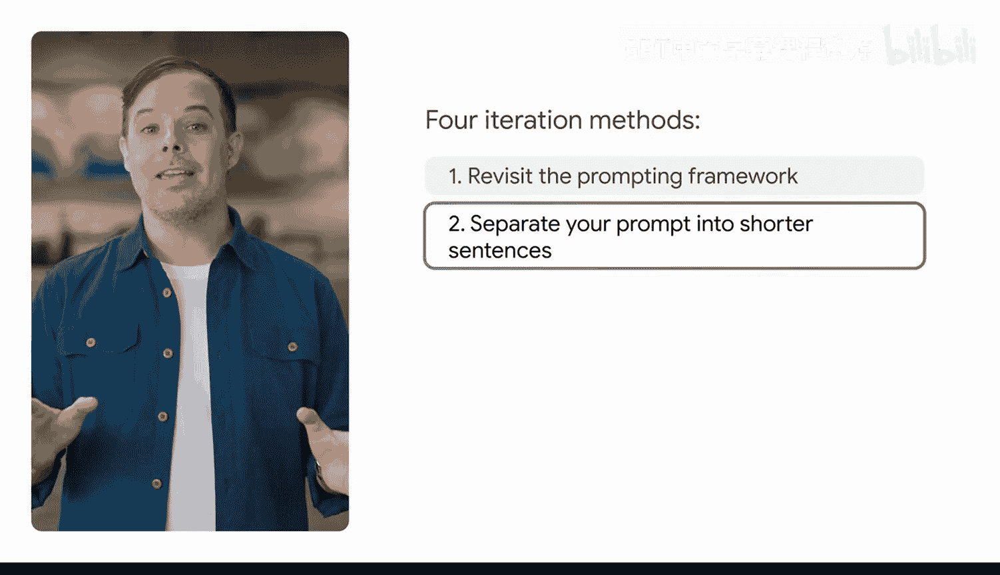

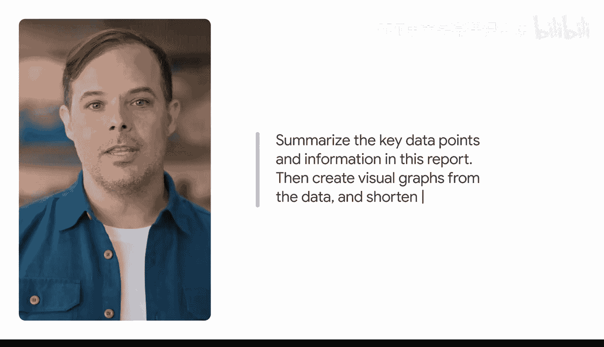

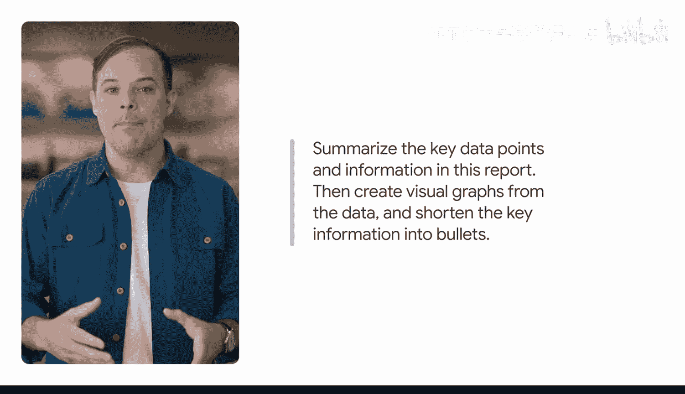

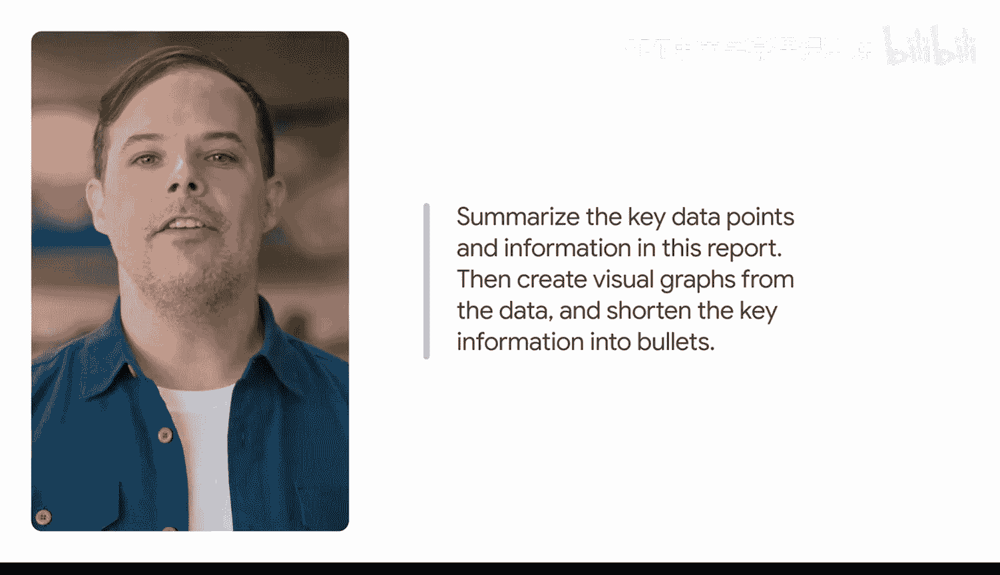

Then follow that up with， create visual graphs with the data you summarized。 and finally。

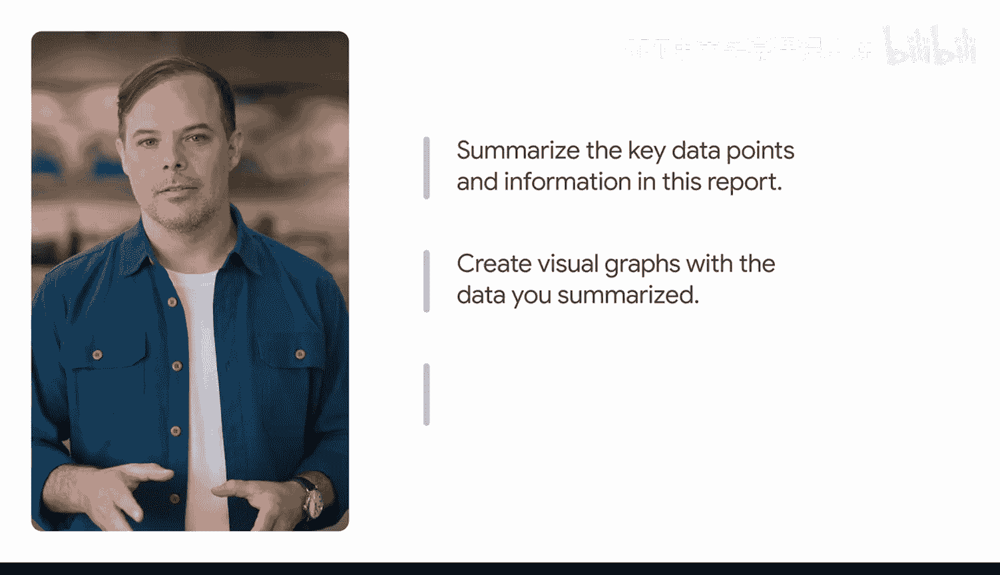

Shorten the key information you summarized into bullets。

 Sometimes shorter sentences can yield more precise results because the Gen AI tool can parse one small task at a time instead of identifying the relationships between all of them at once。

 You can also try using different phrasing or switching to an analogous task。

 which is a task that is very similar to the one you're trying to complete。

 but different enough to trigger a new response。 for example。

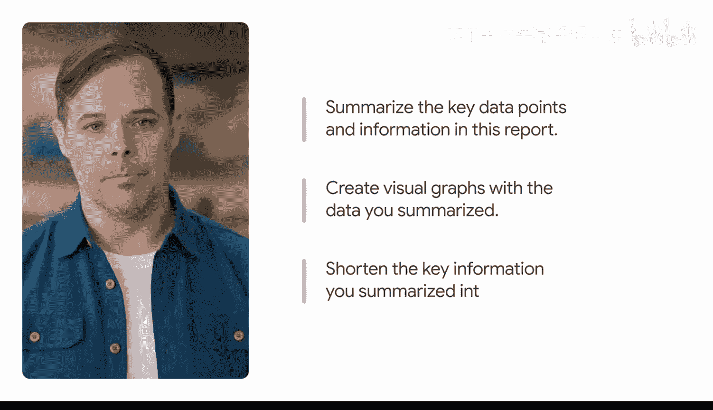

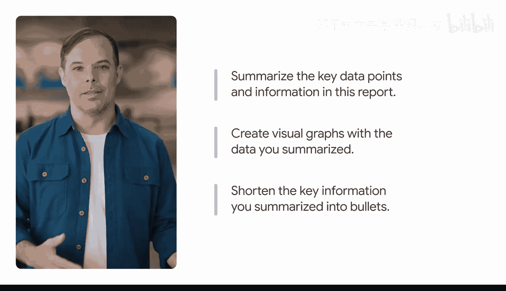

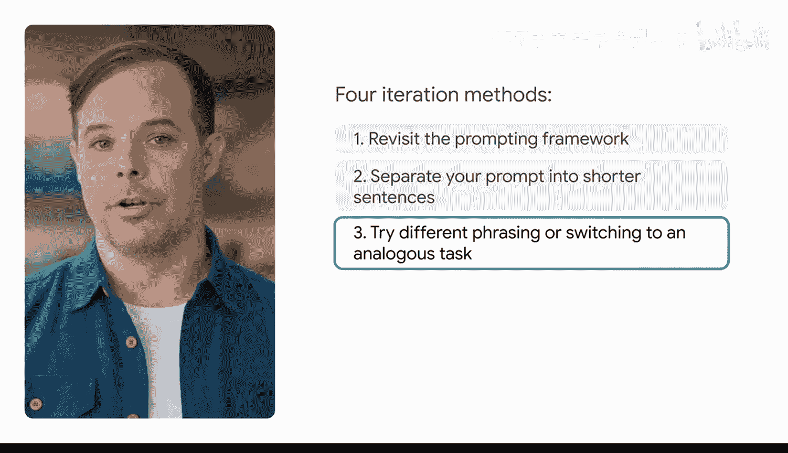

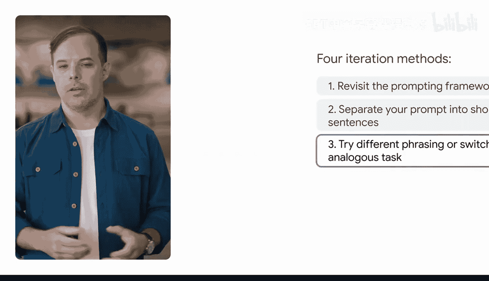

If you're asking a Gen AI tool to help write a marketing plan for a product or service。

 you could instead ask it to write a story about how this product fits into the lives of our target customer demographic by moving from write a marketing plan to write a story。

 You're asking the Gen Ai tool to approach the task differently。

 which might lead you closer to a useful output。 Finally。

 introducing constraints might also help focus a Gen Ai tools outputs。

 Maybe you want to make a playlist for an upcoming road trip。

 and you're trying to figure out what artists you want to include。

 You've added some context about your favorite genre， but the results are kind of boring。

 you've heard all these songs a million times before。

 to get better output and something more unexpected。

 you could start adding constraints like specifying you only want artists from a certain region or artists that have released music in the last five years。

 adding constraints to your prompt will help the。😊。

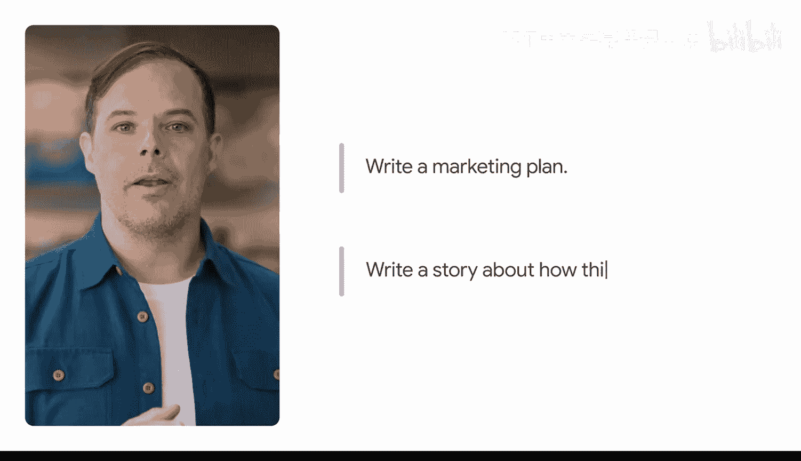

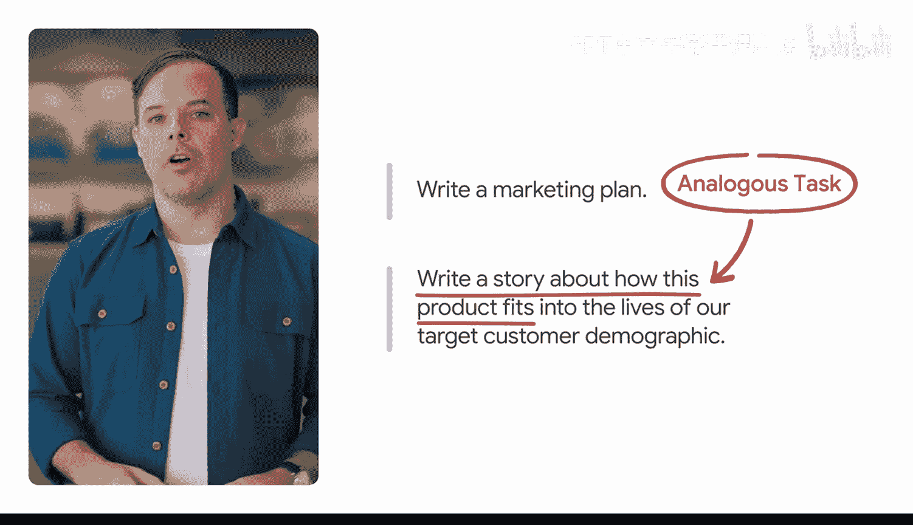

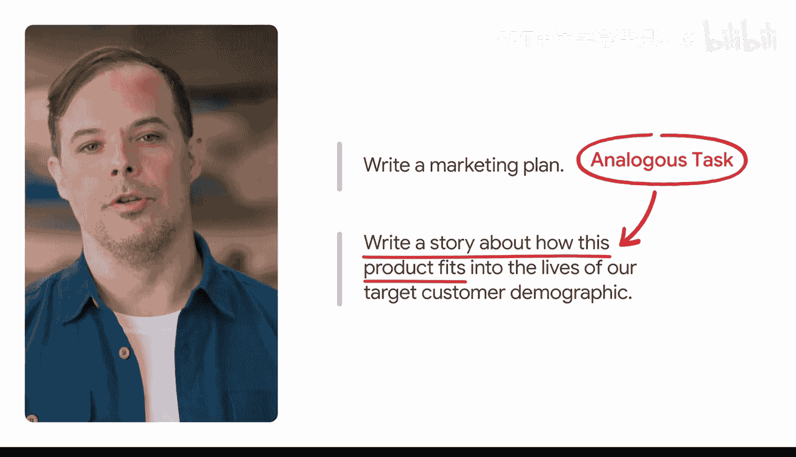

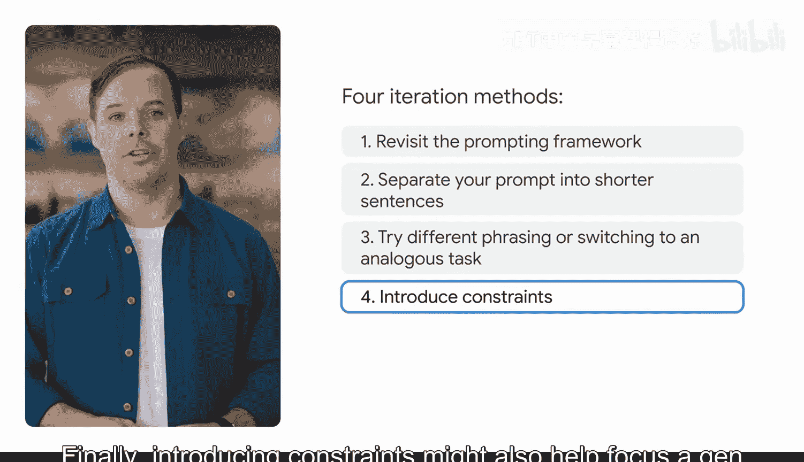

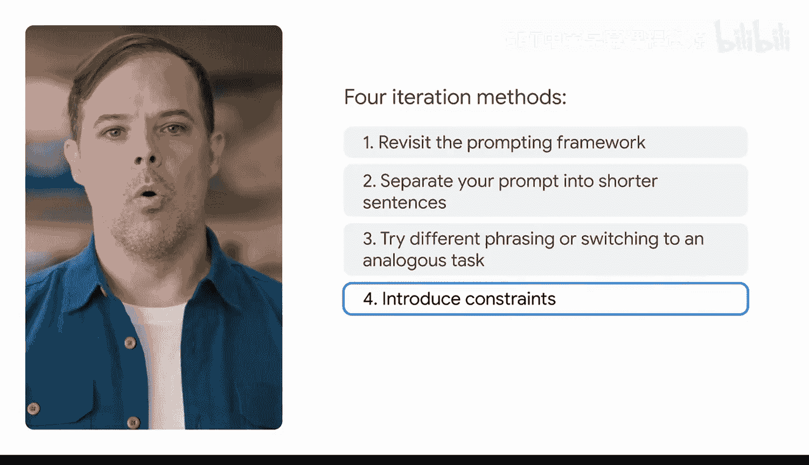

AnAI toolol narrow down its outputs and give you something more helpful or unique。

The better you can evaluate and iterate， the better your output will be。🎼Yeah。

