# 谷歌《提示词基础课程｜Google Prompting Essentials》中英字幕（deepseek p09 09_01_01_用生成式AI创作图像.zh_en -BV1zT6eYqEeR_p9-

🎼。

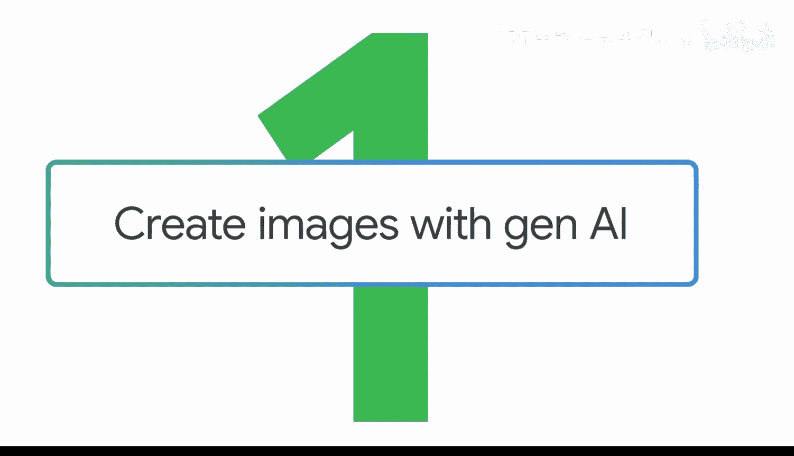

Images and visuals can be as important as words when you want to communicate ideas In this lesson I'm going to teach you how to use generative AI tools to create visuals so far we've asked Gen AI tools to produce responses in what's called a text based modality。

Modalities are the different formats in which JenAI tools receive or produce information。

 whether that's text， images， video， audio or code。

Different Gen AI tools are better at working in certain modalities。

 be sure to check the Gen AI tool you're using to find out which modalities it's capable of using or producing。

 Let's start with image generation。 Some gen AI tools can create images， a sunrise。

 a bouquet of flowers or even a crab right a dolphin。

 But those same tools can also make images for a business or a professional presentation。😊。

Maybe you're a musician playing a gig in New Orleans and you want to promote your concert。

 so you use a Gen AI tool to help you create a poster to advertise the show。

Let's prompt Gemini to create both text and images so we can discuss the subtle differences between prompting for each modality。

We'll start with the text first。Remember to keep the thoughtfully create really excellent inputs framework in mind。

 T based prompts work best when we specify our task and add some clear context so we could prompt。😊。

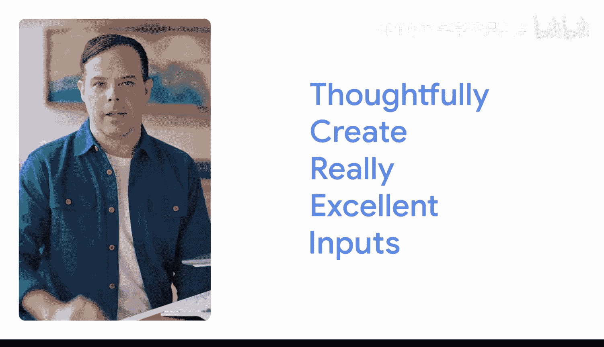

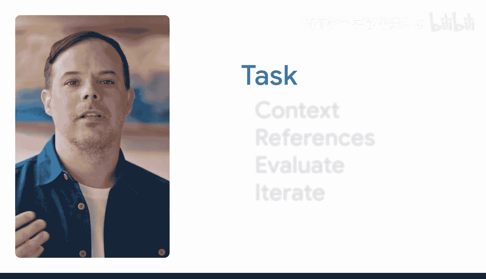

Generate headlines for a poster promoting a rock concert in New Orleans。

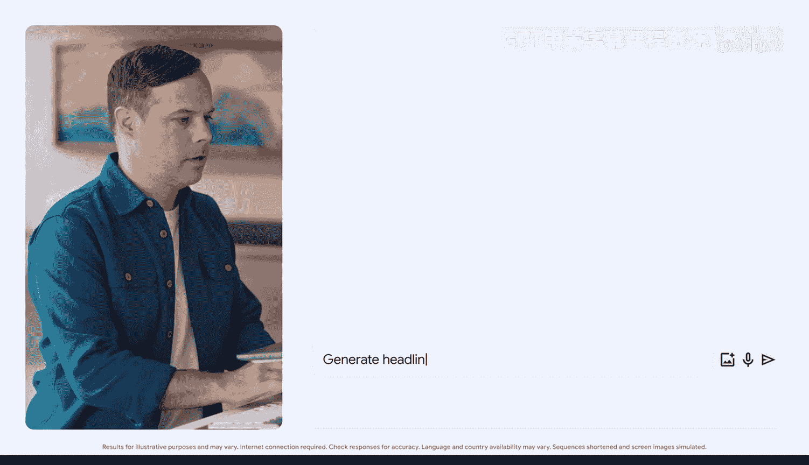

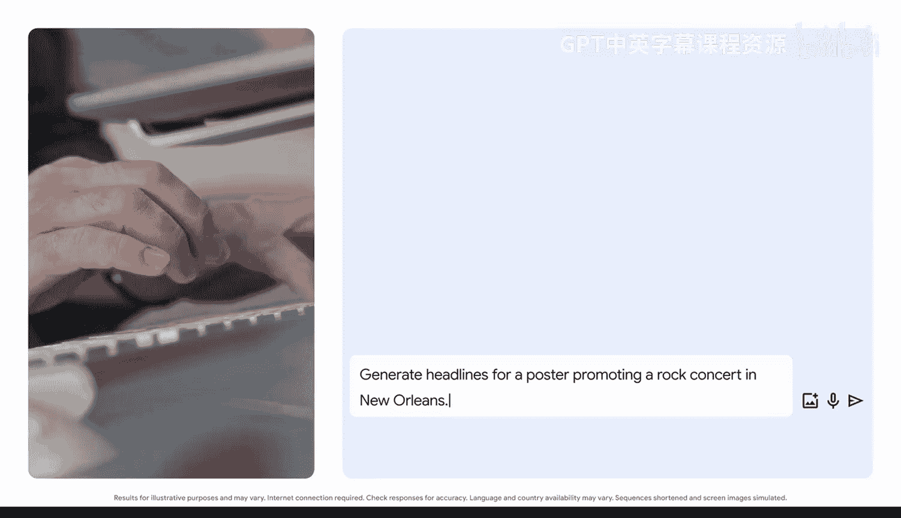

And to add a little more context about the task we could write， the concert is one night only。

 and the headlines should encourage the audience not to miss out。

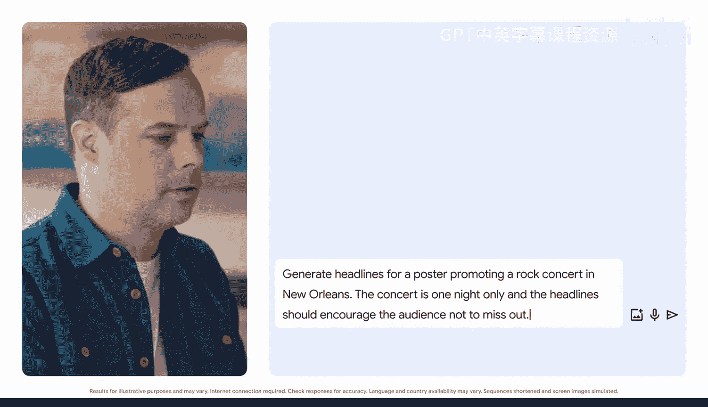

By specifying our task and adding context， we're guiding the JenAI tool to the text based output we want。

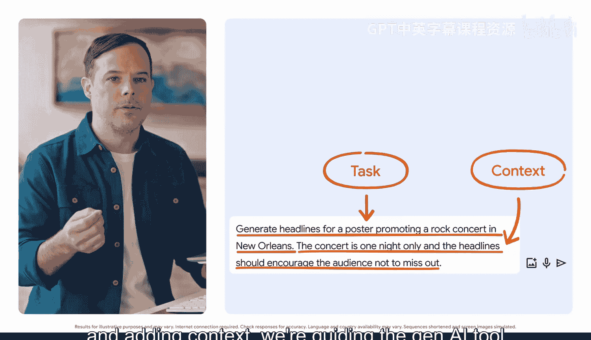

And just like that， Jem and I came up with a few catchy headlines for the poster。

And this is a good one right here。 Nola， this is it unforgettable rock one night only。

 it's catchy and it gets to the point。Now， in order to prompt the Gen AI tool for an image。

 we'll need to tweak our language。 We'll still use the prompting framework。

 but we'll need to provide more vivid descriptions that help the Gen AI tool determine the type of image it needs to create。

 This means specifying the size， color and position of things in the image and the overall aesthetic we want。

 So first， we'll specify our task and format。

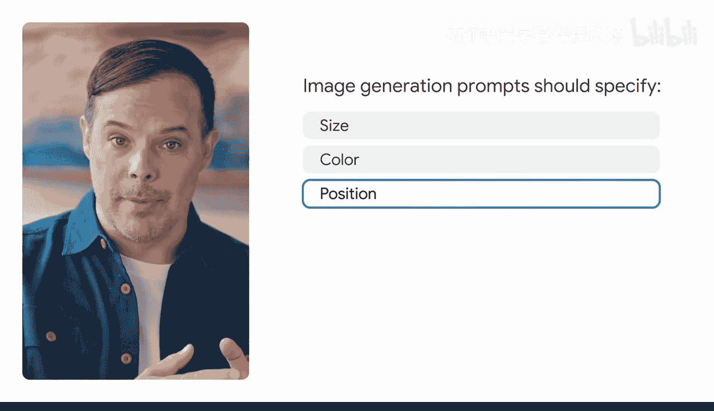

Generate an image of an electric guitar or a poster。 It should be a photographic style。

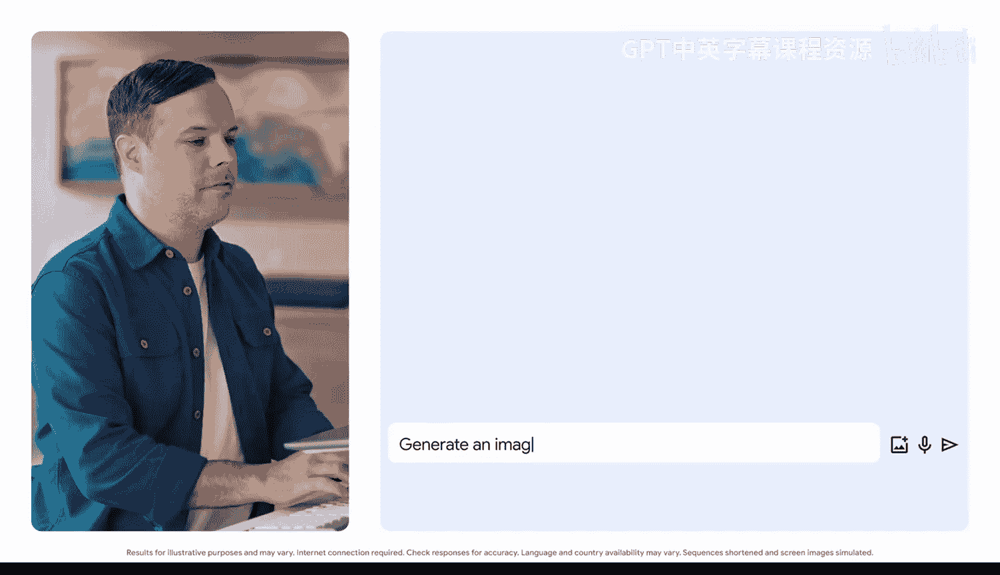

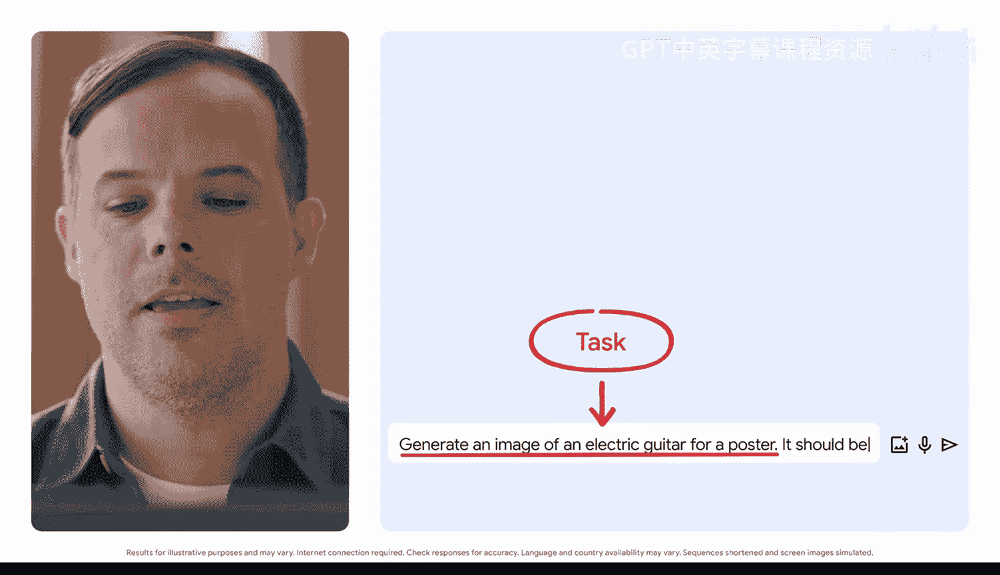

And how about some vivid descriptions？

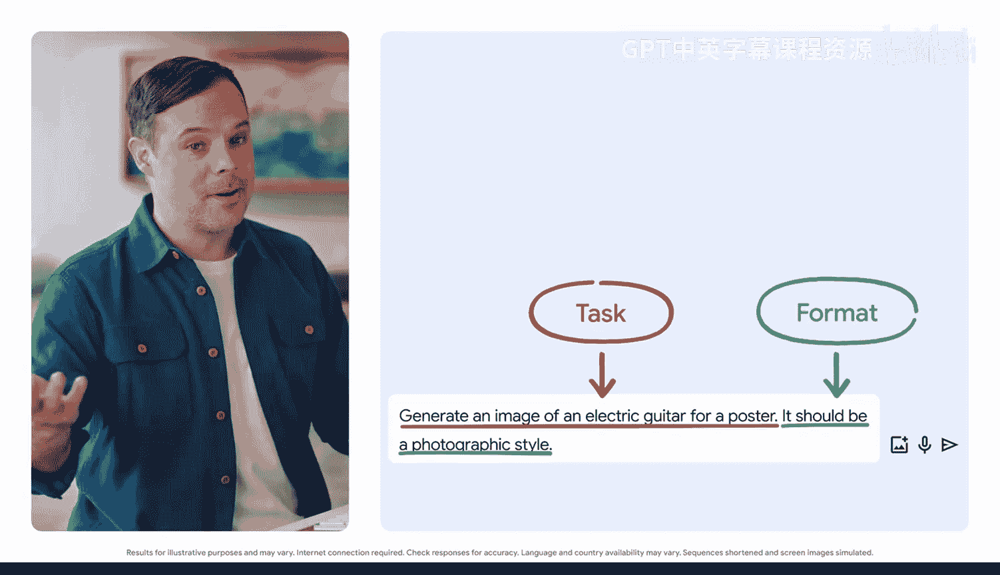

The guitar should be glittery or sparkly and create a sense of excitement。

The guitar should be in the foreground and give a sense that it's floating in the sky。

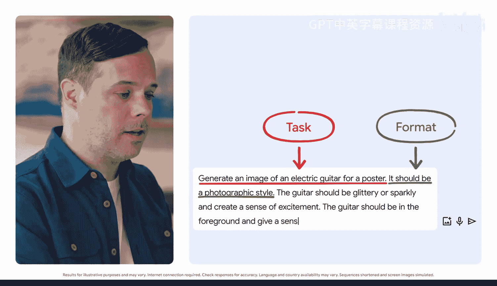

Great， Ge and I created four different images that you can use on your poster。

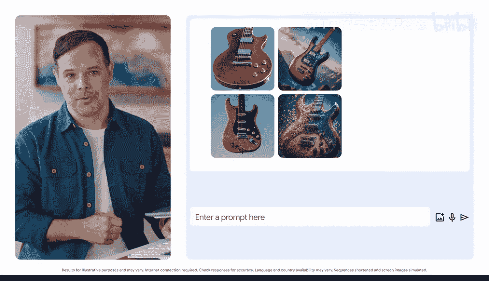

So how can we make these images even better， Let's break down how to iterate and refine a prompt for images。

 We're still going to use the prompting framework， but with a few little tweaks for the concert poster。

 maybe you liked the appearance of the guitar， but you want to make it even more exciting by adding a storm with lightning。

 striking the guitar。 We could refine it by writing。😊，Now make the sky stormy。

With lightning hitting the guitar。There we go， you could keep this image or keep evaluating and iterating again and again。

 adding relevant details from each new output until you get one that works。😊。

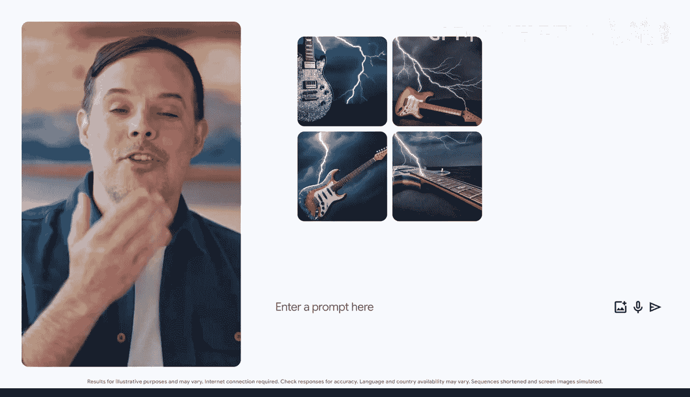

🎼。

