# 谷歌《提示词基础课程｜Google Prompting Essentials》中英字幕（deepseek p11 11_01_03_在提示词中运用图像、文档等多元素材.zh_en -BV1zT6eYqEeR_p11-

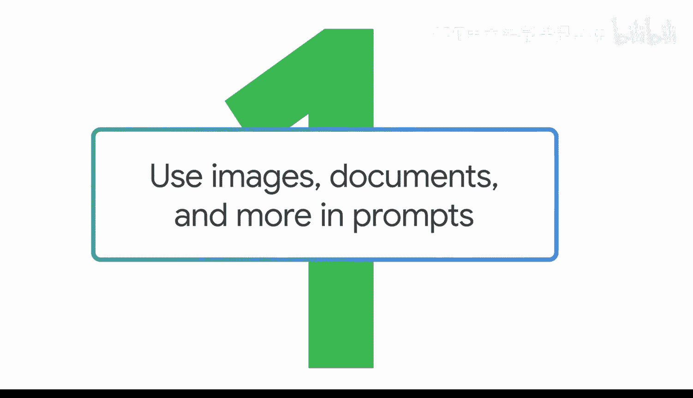

Okay， we just use text to create an image， but we can also use an image as part of our prompt to create a different type of output let me introduce you to multimodal prompting。

The essence of multimodal prompting is using different types of media to prompt a generative AI tool。

 like inputting image and text or audio and text。This can be especially useful in the workplace。

 You could take a picture of a chart and ask a Gen AI tool to explain the data in plain language。

 You could upload different logo options for your company's rebrand as a set of references and then prompt the Gen AI tool to give you more choices based on each direction。

 or you could capture audio of another language and ask for a transcription in the language you understand。

😊，Here's an example where we'll prompt with both image and text to receive a text based output from Gemini。

 Let's imagine you're an entrepreneur who needs help creating social media captions for a new design of nail art you're selling。

You can take a picture of your nail art and ask for help writing a caption。

Here's a photo of the nail art， and we'll input this into Gemini and prompt write a social media post featuring this image。

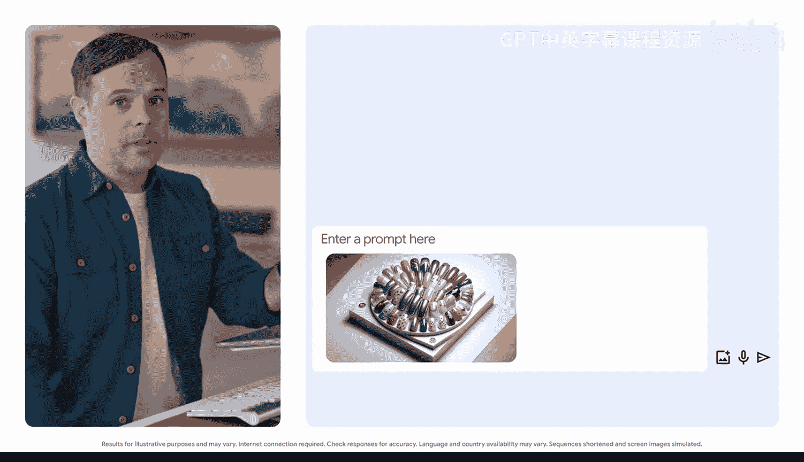

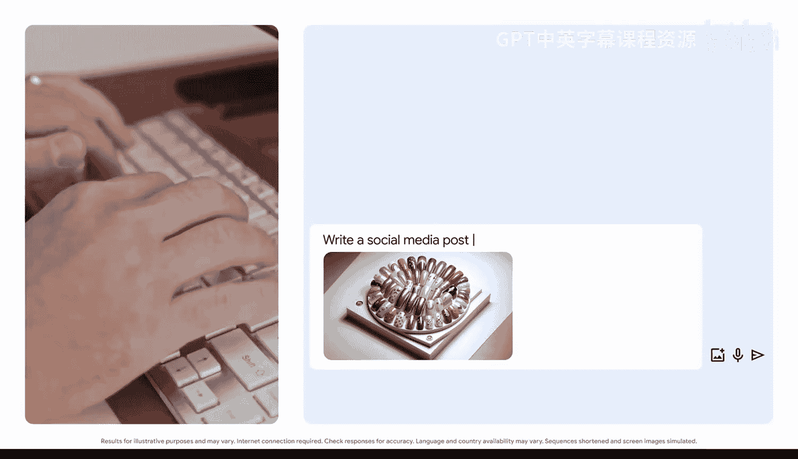

The post should be fun， short。 And focus on the fact。 It's a collection of new designs I'm selling。😊。

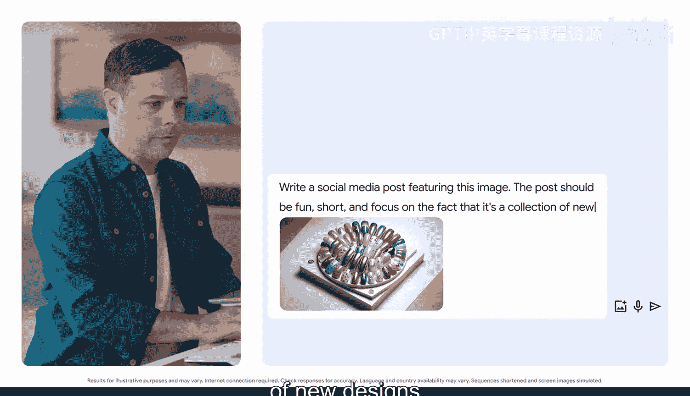

Note that in addition to including a reference photo of the nail art。

 we still used the other elements of our prompting framework。 We specified our task。

 added some context and included the format。 Besides the image itself。

 we didn't provide other references。 But if we have a specific tone or voice。

 we want the Gen AI tool to match。 We could always input a few captions from previous posts to reference。

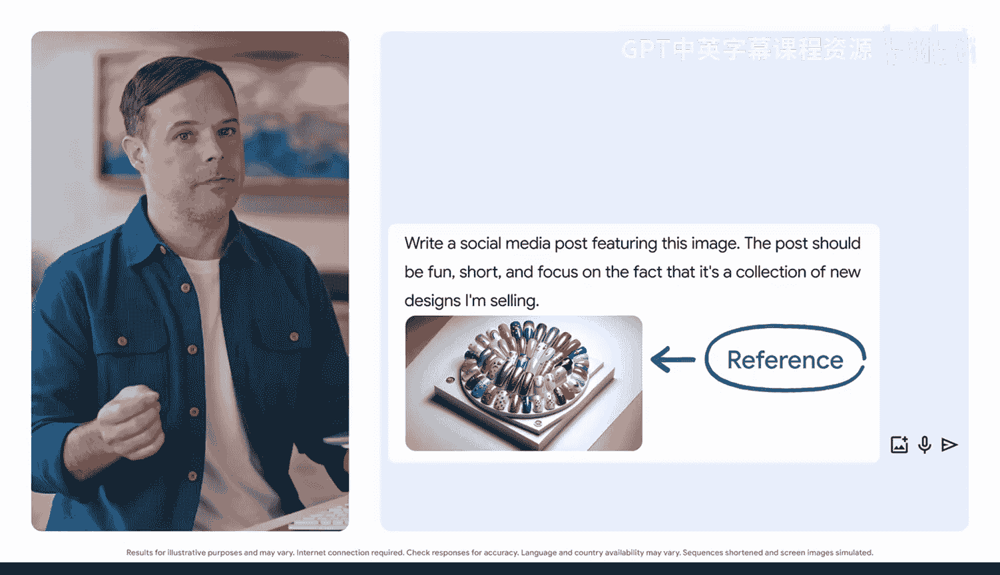

This is great。 Gem and I analyzed the image and created a fun caption you can use to market the nail art。

Notice how it uses emojis to break up the text and how it engages followers by asking a question about their favorite design。

 The cool thing about multimodal prompting is that it reflects the way you experience the world。

 You don't just discuss the words or images in a work presentation。

 You build connections between them to get a fuller understanding of the topic in question。😊。

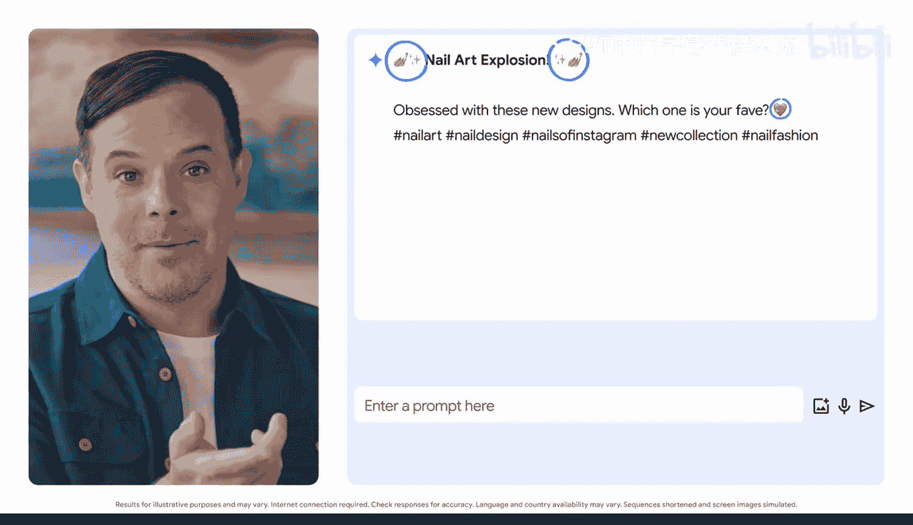

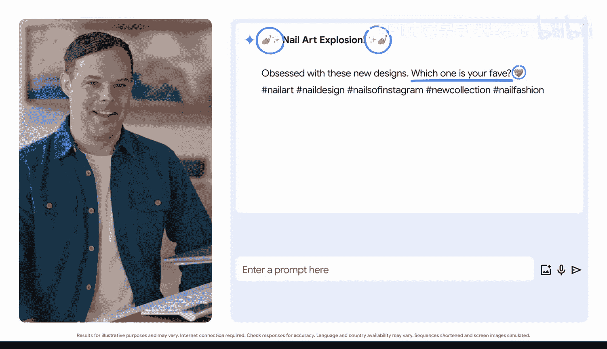

A mix of text， images and other modalities can open up new ways of solving problems or saving time。

 You could use a Gen AI tool to turn a picture of a city map into a list of notable landmarks。

 Find key insights within an audio file or quickly extract a list of room names from an office floor plan。

 Here's another example。 You go to a conference and receive a schedule of events。

 And you want your team to focus on a few of the events in particular。😊。

I want to send a reminder to my colleagues about certain events from a conference schedule。

 extract the times of the keynote speaker and to panel discussions from this schedule into a table。

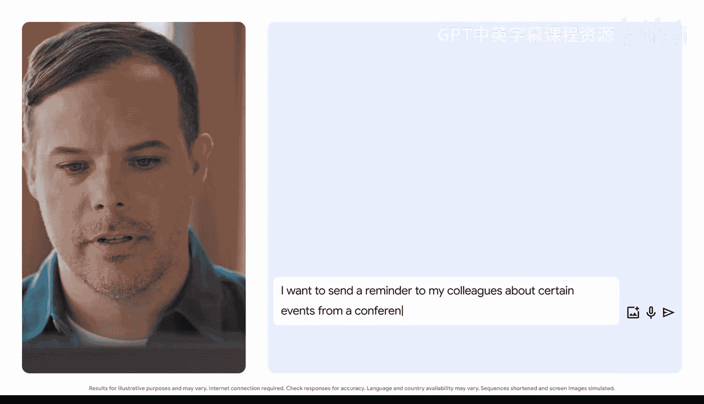

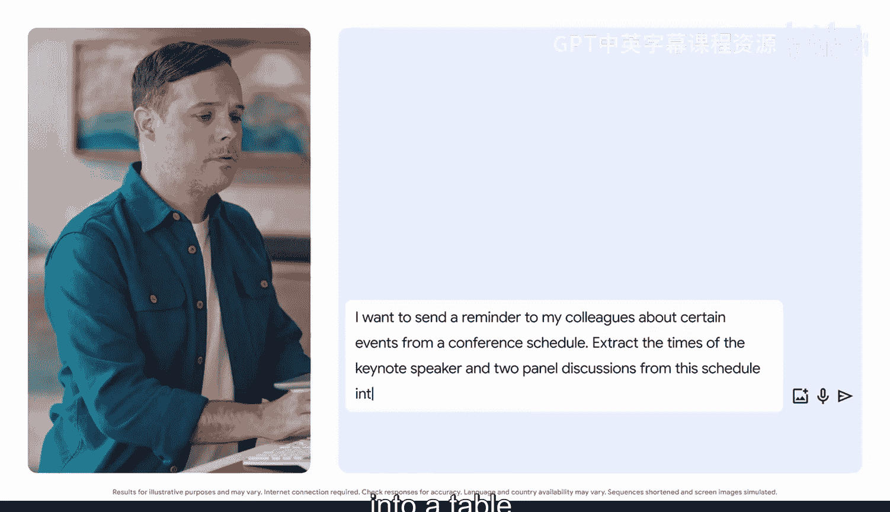

Again， we specified our task， provided helpful context。

 and included the format before inputting the picture of the schedule。Let's check it out。Great。

 the table makes it really easy to see where your team needs to go and when you can even take it a step further and prompt Gemini to draft an email about these events。

 We'll get into prompting for email drafts later in the course。

 Just remember to keep the prompting framework in mind。

 no matter what modality you are prompting in to achieve the best results。

 How might you leverage different modalities in your prompts to help you at work。😊。

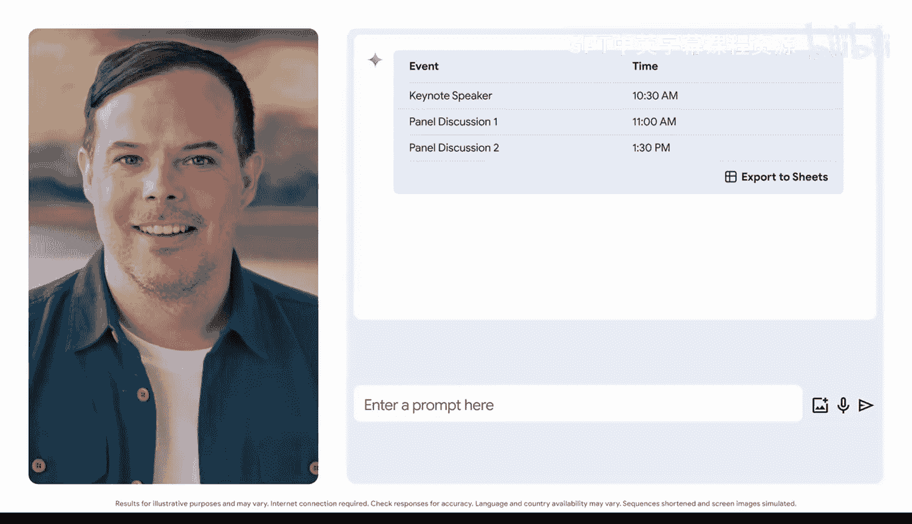

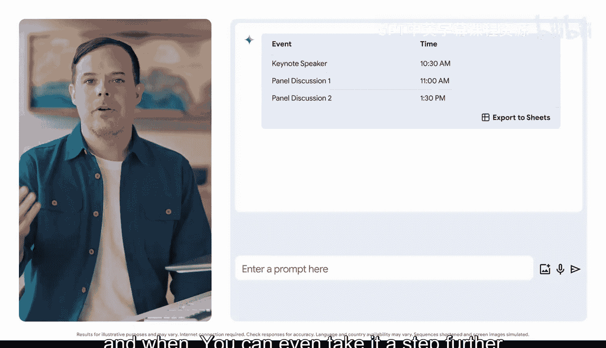

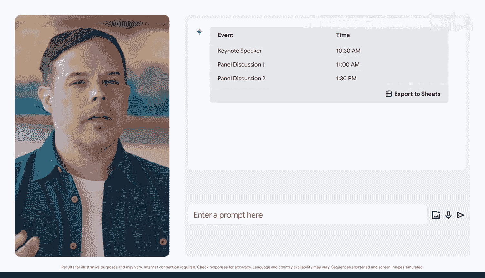

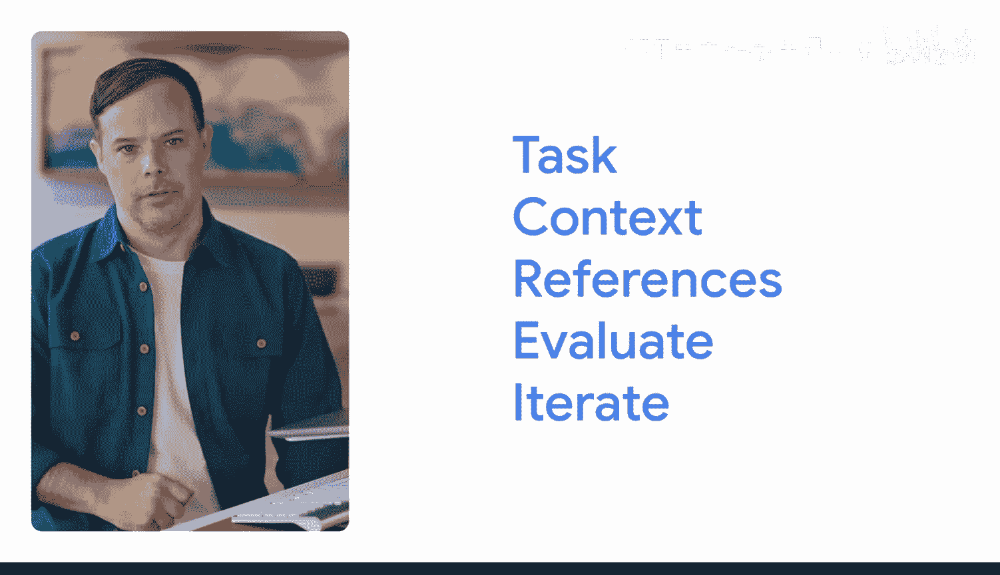