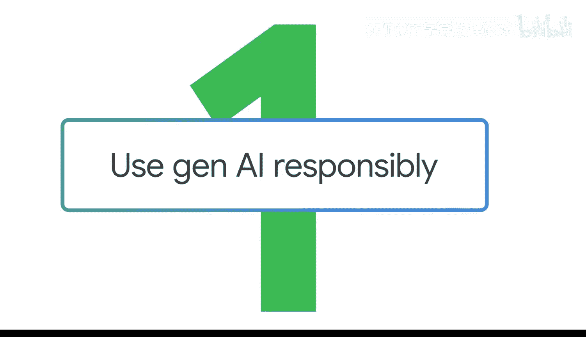
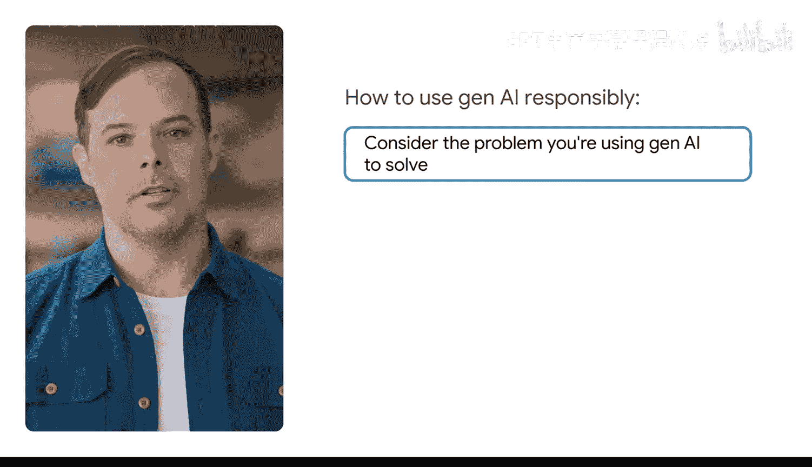
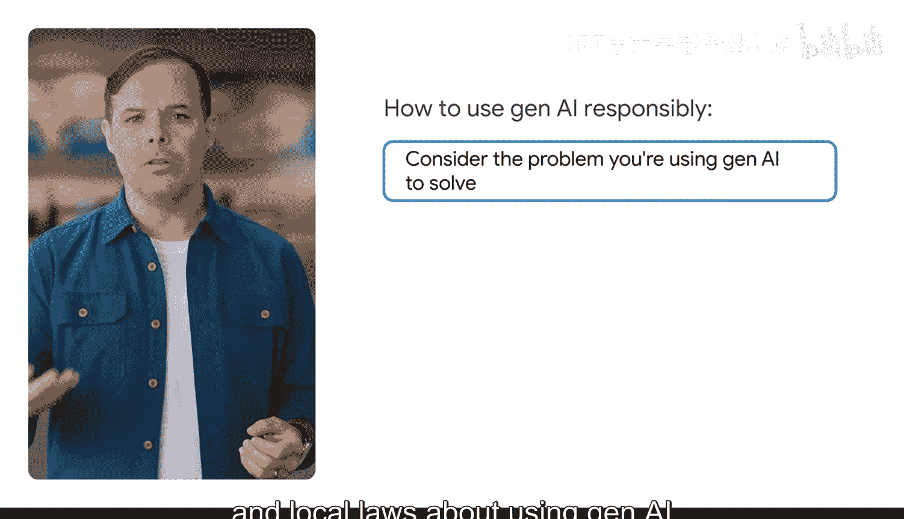
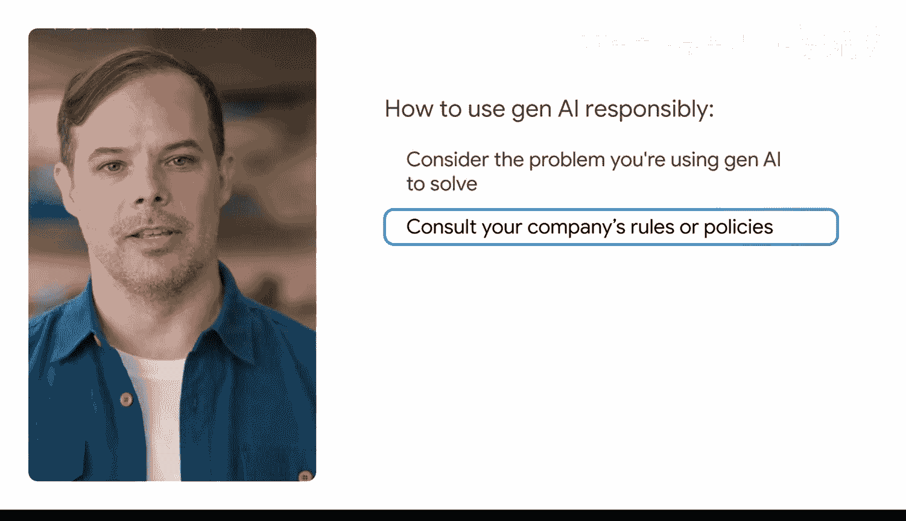
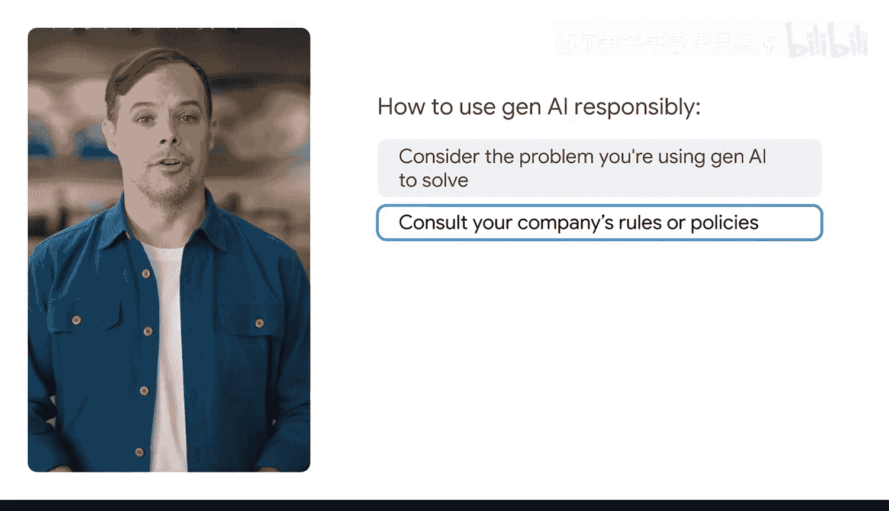
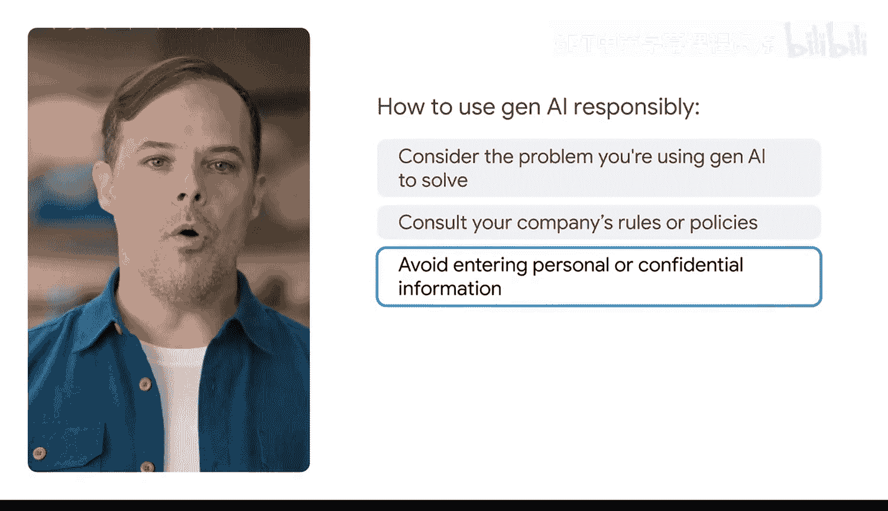
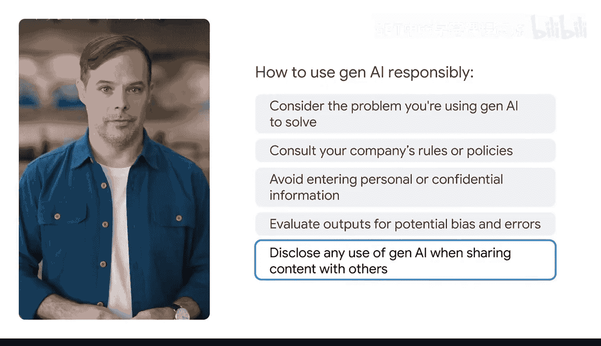

# 谷歌《提示词基础课程｜Google Prompting Essentials》中英字幕（deepseek p12 12_01_01_负责任地使用生成式AI.zh_en -BV1zT6eYqEeR_p12-

🎼。

Genative AI tools are powerful， but like any tool， it's important you use them responsibly。

 especially at work。 First， consider the problem you're using Jen AI to help you solve。

 Does it align with your goals and your obligations to your clients and coworkers。

What about your organization's policies and local laws about using JenAI to perform this type of task。

 if it doesn't align， then you should rethink your process and whether or not a JenAI tool is right for the job。

Second， consult your company's rules or policies before entering confidential or sensitive data into Geni tools。

 You can also check if your company has an enterprise version of a Geni tool that is okay for other types of use。

 And remember， if you're using Gen AI tools for personal use。

 avoid entering personal or confidential information about yourself into publicly available tools and always check how the data you enter might be used。

 Finally， being a responsible Geni user means evaluating outputs for potential bias and errors and disclosing any use of Gen Ai when sharing content with others。

 while it's okay to enlist the help of Gen Ai， you'll still need to evaluate the outputs for accuracy the way you would for any output。

 the same goes for hallucinations， which is when a Gen AI tool provides outputs that are inconsistent incorrect or even nonsensical。

😊。

Hallucinations most often happen when someone gives a Gen AI tool vague or unclear instructions。

 or when a tool guesses at an answer to something it didn't quite understand。

Hucinations can be hard to recognize。 That's why it's so crucial to fact check and cross reference outputs to confirm if a fact or statement in an output is true。

 Remember， Gen AI tools aren't thinking critically the way humans can。

 It's important to keep what we call a human in the loop approach。

 meaning a human should verify Gen AI outputs before using them。

 I recently generated an image for a presentation。 I wanted to have。

A bunch of cats on a rocket going to the moon。Now， instead， the output was a little bit off。

 The cats were on top of the rocket rather than inside it， and that's not exactly safe for cats。

 is it。While I did write in my prompt that cats needed to be on a rocket。

 I didn't mean that literally。 but the tool didn't know that。

 So I iterated and specified that the cats should appear safe and sound inside the rocket instead of on top of it。

 Some Gen Ai tools such as Gemini have a built in fact checker that allows you to cross reference the outputs using Google search comparing outputs side by side makes it easier to determine how accurate your initial output is and to find any discrepancies。

 So how can you avoid these issues before they become a problem。😊。

Try to recognize biases and outputs and the negative consequences they can have。

They may appear as stereotypes or unfair representations of a group of people。

 avoiding biased to negative outputs starts with inputting specific detailed prompts and iterating as needed。

Another key part of this is using language that includes people of all backgrounds。

 genders and ethnicities and avoid stereotypes and generalizations in your inputs。 For example。

 if you are using a Gen AI tool to help you write the description for a job posting。

 you should avoid the gendered terms like service man or workman。 Instead。

 use service person or worker So the tool doesn't write a description that only speaks to someone who identifies as male。

 Remember， Gen AI tools or only tools。 They don't think critically and can't understand nuance the way humans can。

 Its your job to bring that human perspective every time you use a Gen AI tool。🎼。

