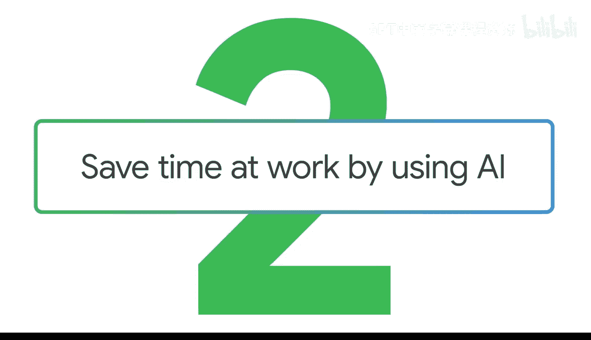
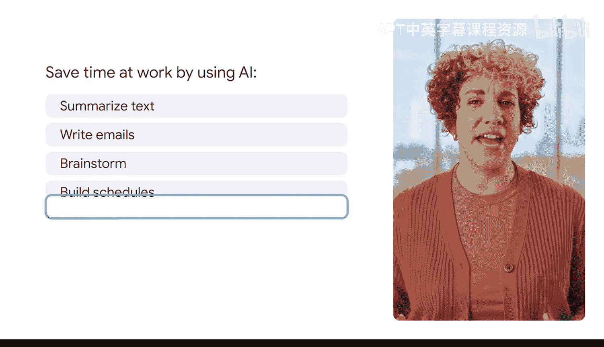

# 谷歌《提示词基础课程｜Google Prompting Essentials》中英字幕（deepseek p14 1_01_01_使用AI节省工作时间.zh_en -BV1zT6eYqEeR_p14-

🎼。

I have to read a lot of research papers for my job。

 Sometimes I get several sent to me in a single day。

 and even though I love hearing about everything new happening in my field。

 there are times when I can't get through every line of every paper When that happens。

 I'll upload one of these papers to a generative AI tool and start a conversation I'll prompt for the most important points in the research and then ask follow up questions on information that I'm curious about。

It's helped me get familiar with a lot of topics quickly。

 because it's like having a creative on demand assistant that I can have a conversation with in this module。

 you're going to learn about the best ways to prompt Gen AI tools to help you summarize text。

 write better emails， level up your brainstorming， build schedules effortlessly and take meeting notes instantly。

Now let's learn more about what you can do with those prompts and how they can benefit you at work to boost your productivity and spark your creativity。

🎼。🎼。

