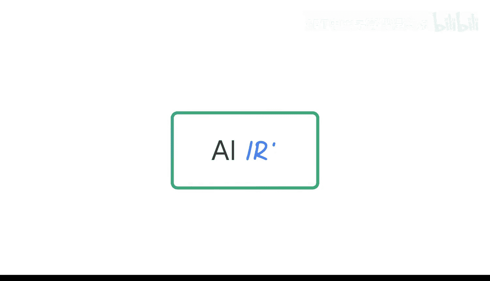

# 谷歌《提示词基础课程｜Google Prompting Essentials》中英字幕（deepseek p15 2_01_02_AI实战应用：借助AI处理待办事项清单.zh_en -BV1zT6eYqEeR_p15-

🎼，So Laura I mean for some people like this is just a beginning for them So how do they get started what advice do you have for them Yeah I think sometimes it can be intimidating just to look at a blank AI screen and say where should I start and so summarizing brainstorming planning researching you know is any of that something that you were going to do my job is to coach top executives at Google in the area of productivity I also started productivity at Google so I share productivity tips both internally and externally for people to get more done in their day when I'm doing my coaching sessions I usually have someone pull out their actual to do list for that day or that week and I scan through it with them and say is there anything on this list that AI could help with so if it is you know I need to write the email to my team or I've been meaning to research this or start this project I go write to AI and say is there a way that AI can help kick this off and so instead of thinking of what can I do with AI think what am I already doing that AI？

And health。🎼。

🎼。