# 谷歌《提示词基础课程｜Google Prompting Essentials》中英字幕（deepseek p16 3_01_03_使用生成式AI撰写邮件.zh_en -BV1zT6eYqEeR_p16-

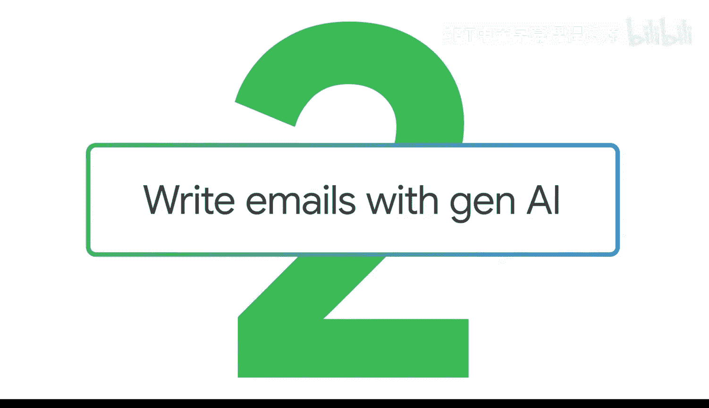

Hi， I'm Clara， and I'm a product marketing manager on the Gemini team。

 and I'm one of your instructors。 Before I joined Google， I was a startup founder。

 And as any founder can tell you， one of the most important and challenging parts of running a start is getting in touch with investors。

 I sent out a lot of emails。 And sometimes I wouldn't get a response。

 I spent a lot of time coming up with creative follow up emails in order to get their attention。

 Genrative AI is really good at that sort of thing。 Gen Ai tools can help you draft emails。

 adjust your tone or style of writing。 and give you ideas on how to change your approach。

 Here's how we can put that to work for you。😊，Let's try this example。 Using our prompt framework。

 we'll add the task， provide context， then evaluate and iterate。 This is a useful exercise。

 whether you're a copywriter working on an ad campaign。

 a speech writer drafting talking points for an executive or gym manager communicating a schedule change。

 Let's start with a persona。I'm a gym manager。Next。

 we'll add in the context and we have a new gym schedule。

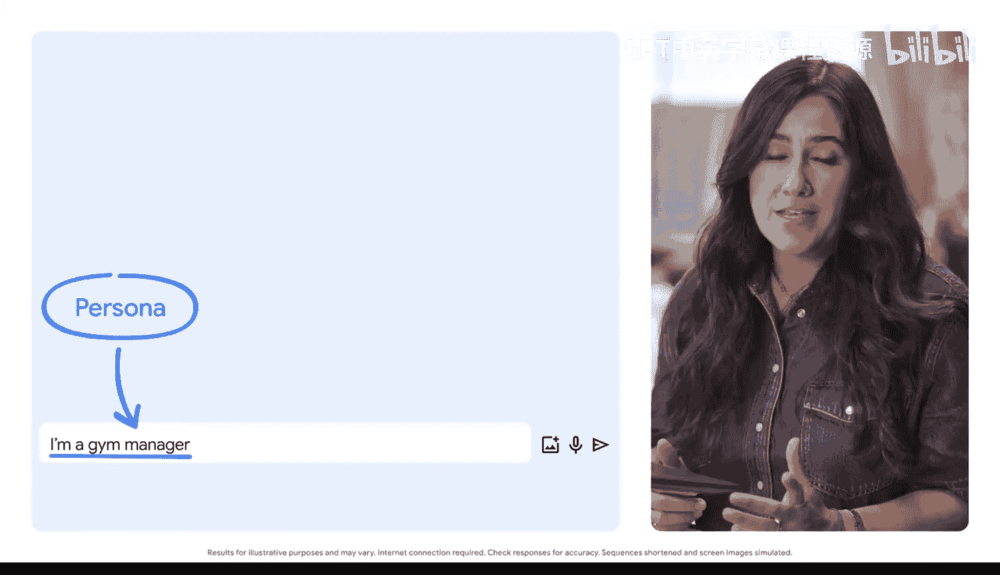

And specify the task。Write an email， informing our staff of the new schedule。 Highlight the fact。

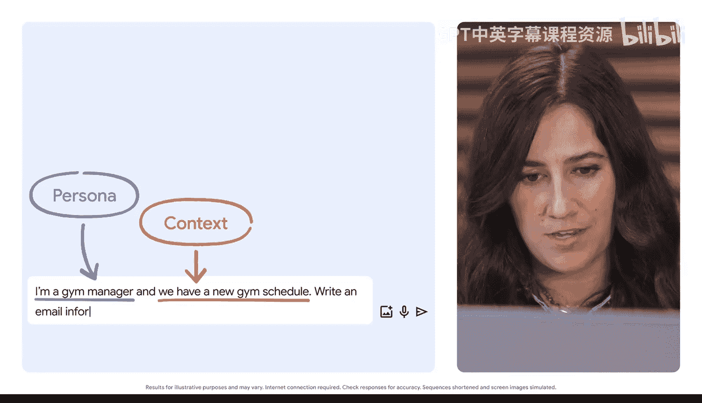

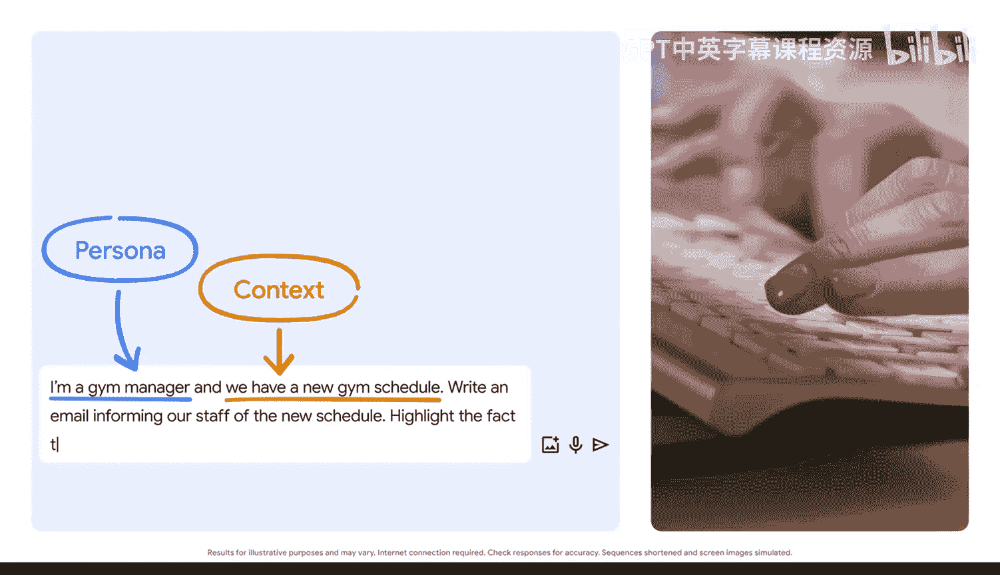

That the Monday， Wednesday， Friday cardio blast class change from 7 AM to 6 AM。😊。

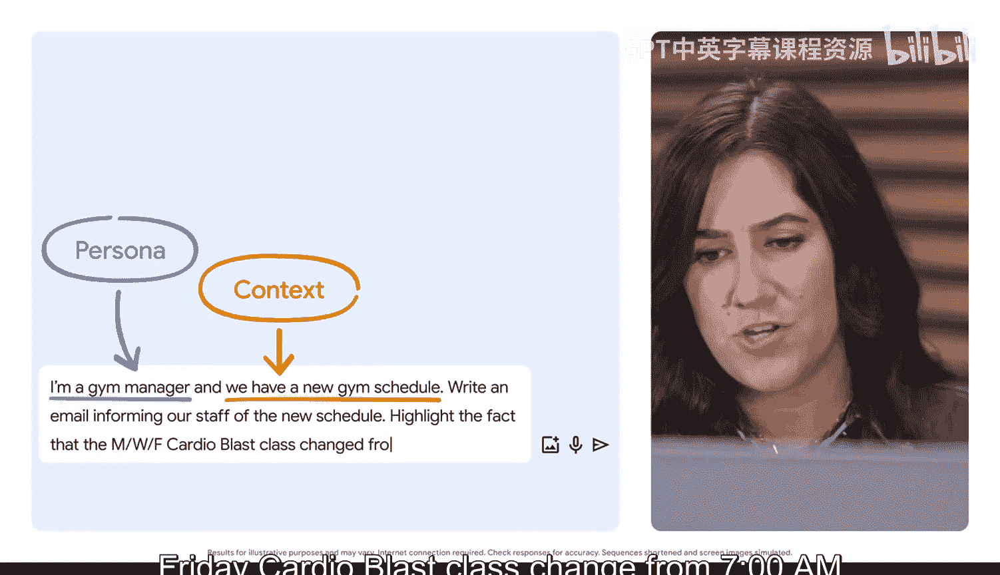

And let's add even more specificity， especially about the content and format of the email。

 which could include language or tone。

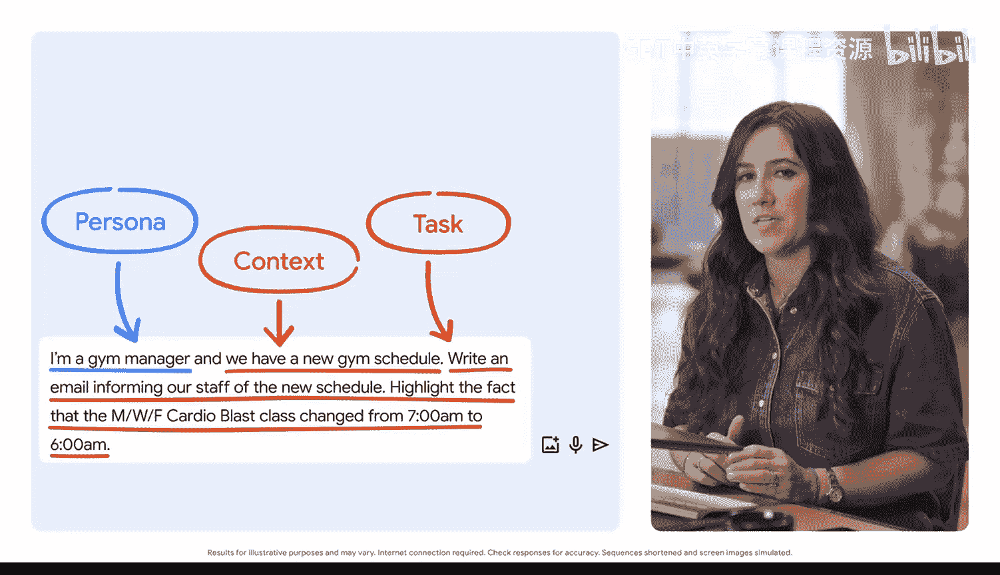

Make the email professional and friendly。😊。

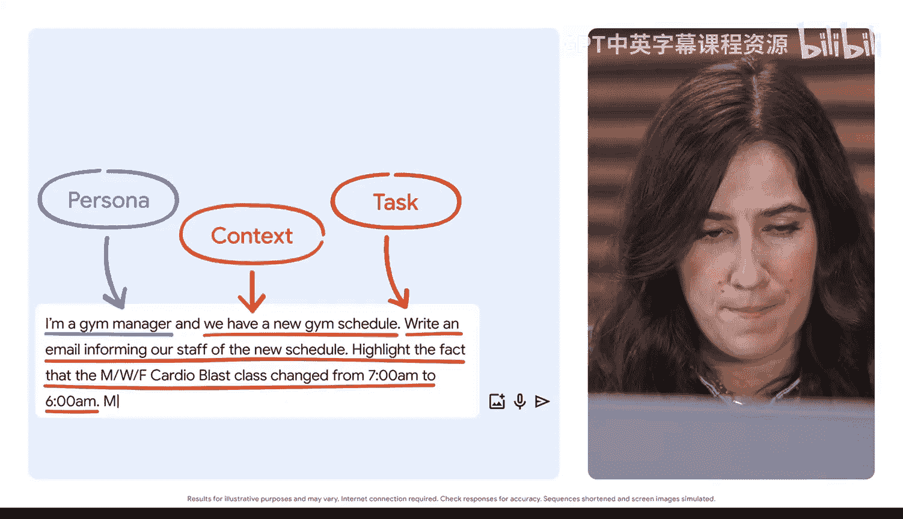

And short， so that the readers can skim it quickly。 And now let's just paste in the new gym schedule。

 Here's the new schedule。

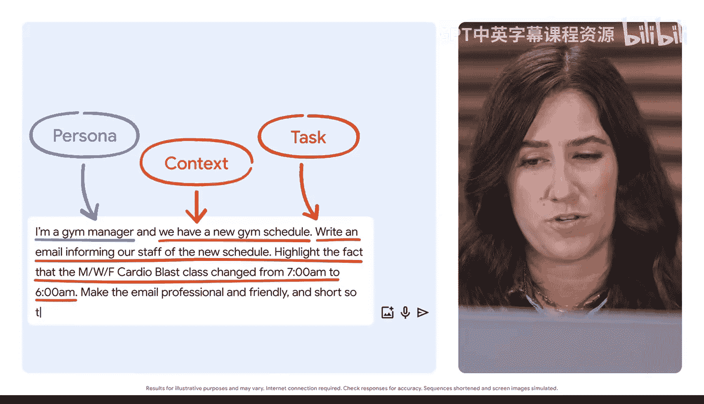

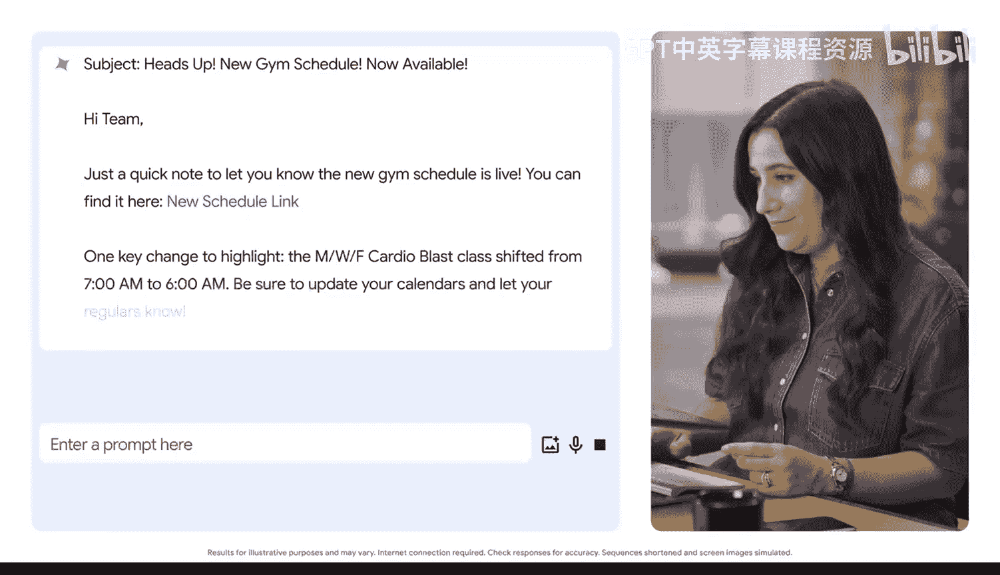

Okay， this is a really great email to send to the staff。

 all the information is there about the schedule changes。 it's short and easy to read。

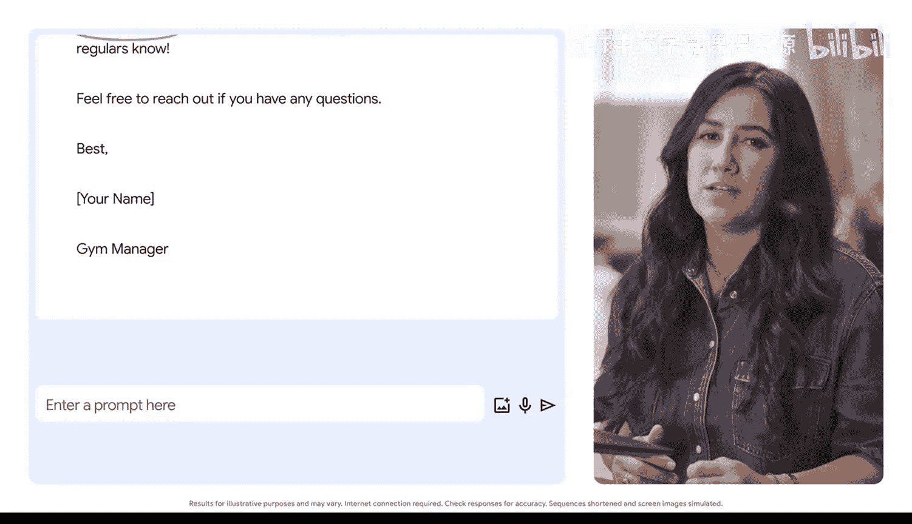

But did you know you can ask Gemini to adjust this same output for a new audience。

 This would be useful if， for example， you wanted your output to be more casual for a small。

 intimate team， more formal for the executives of the team。

 or even for a completely different audience。 Let's try it。We're going to iterate on our prompt。

 asking Gemini to write an email to the gym members in a more casual tone。

 We're asking for a new version here with new specifics and context。😊，Now。

 write a concise consumer facing email with the same information for our gym members and clients。

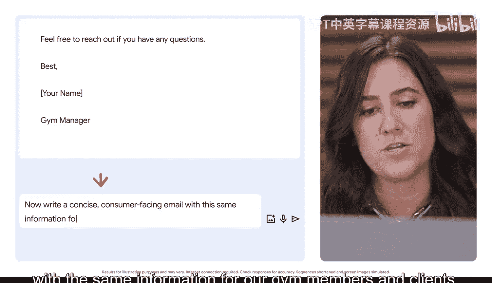

Let's get even more specific。

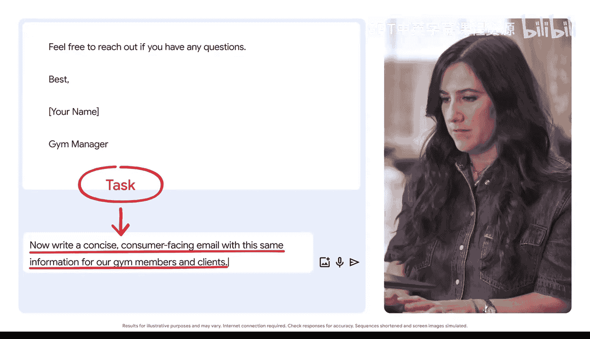

Explain that this new schedule will help us better serve them。

And now let's make sure we're clarifying the new tone。Make the tone fun， friendly and motivating。

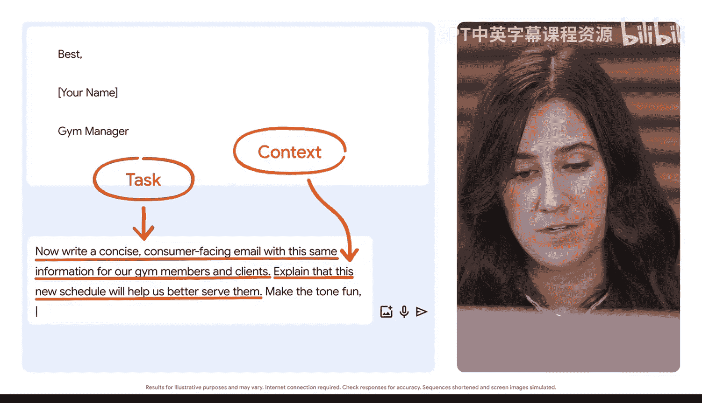

To reflect the gym's energy and enthusiasm for our members' health goals。

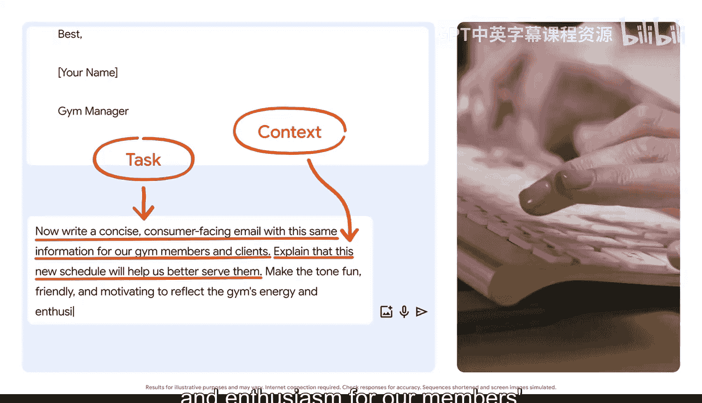

Include a pun out lifting weights。That's more like it。 What a fun email。

 And it still has all the same information about the schedule changes。 With just one extra prompt。

 We completely altered this email for a new audience without losing the important information。

 Can you think of a time when you are having trouble figuring out how to get the tone right and something you've written with some iterations to your task and context。

 you can tweak your writing to land your message how you want it Whenever yourre drafting any sort of communications with the help of a Gen A I tool。

 Make sure the outputs are factual and adjust your prompts so that you receive the information that's most helpful to you。

😊。

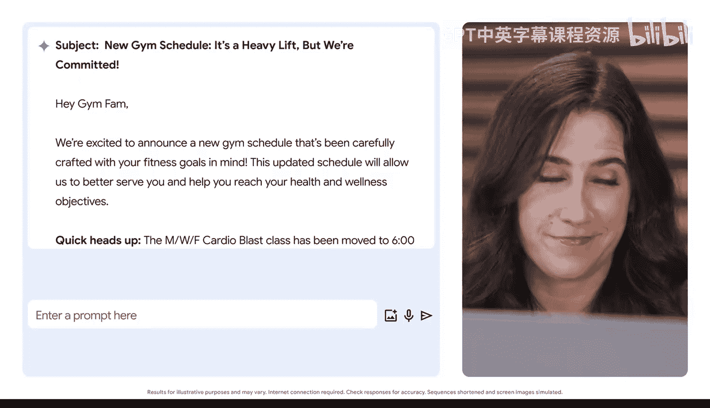

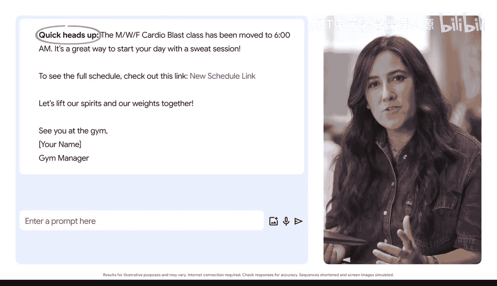

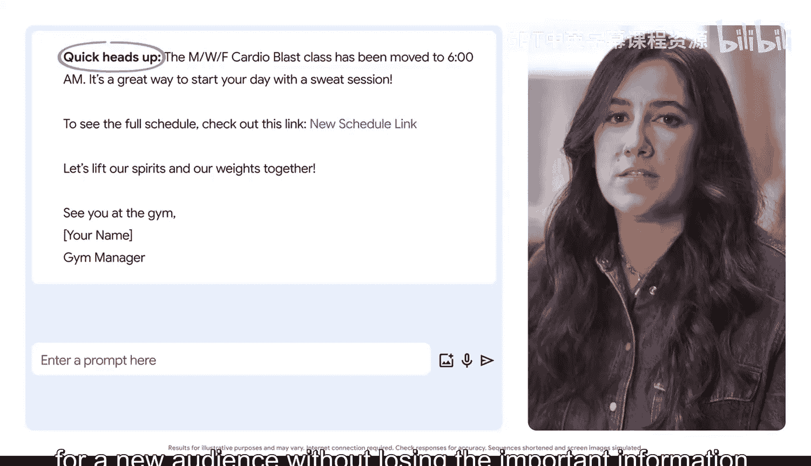

🎼嗯。

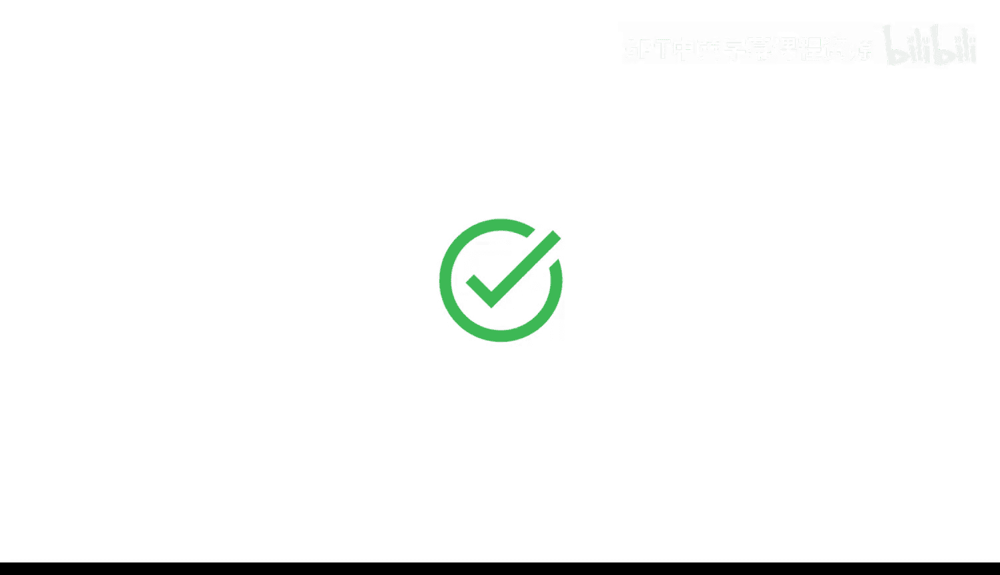