# 谷歌《提示词基础课程｜Google Prompting Essentials》中英字幕（deepseek p17 4_01_01_激发创意灵感.zh_en -BV1zT6eYqEeR_p17-

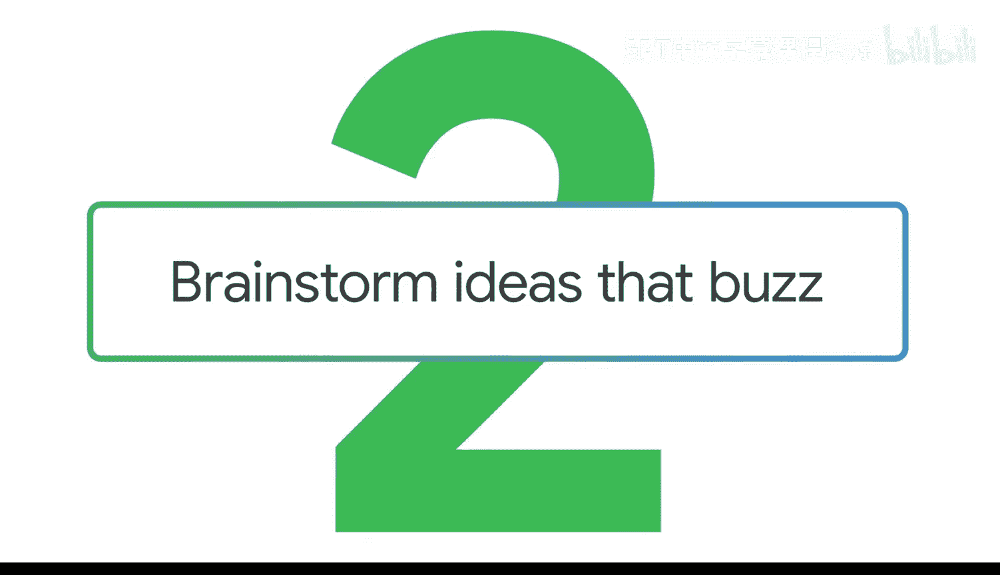

Whenever we hire someone new to join my team， we have a meeting to welcome them。

 What I've started doing is prompting generative AI for suggestions on fun icebreakers that are engaging。

 even over video call。 I can even generate personalized icebreakers by including fun facts about my new team made in the prompt。

 Whether you're leading a team bonding experience or thinking of ideas for a work project。

 You can use gen AI to generate ideas and brainstorm solutions to help you make more informed decisions。

😊，Remember， thoughtfully create really excellent inputs。 You need to add your task。

 context and include relevant references。 Then you need to evaluate and iterate。

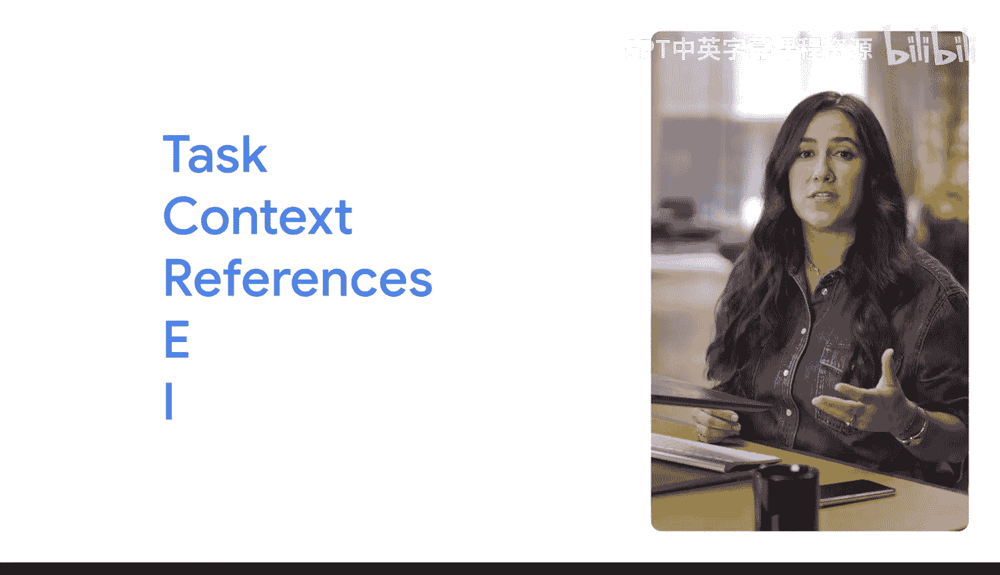

In this lesson， you'll learn how to write prompts to generate ideas with Gemini。 Consider this。

 You need to plan a launch for a new video game。 Gemini can help you with everything from brainstorming sales strategies to managing the launch time line。

 We'll start with the persona and include the context， as well。😊。

I'm a marketer for a well known video game producer known for creating immersive story based online video games and planning the launch of a new medieval fantasy role playing game that follows the path of a young protagonist searching for their missing partner。

 The game's primary audience is young adults。😊。

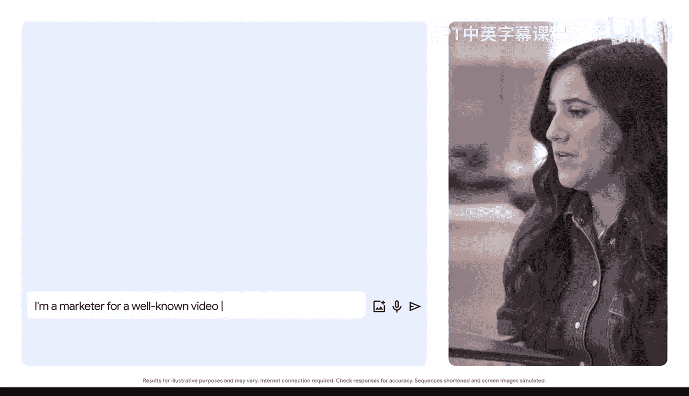

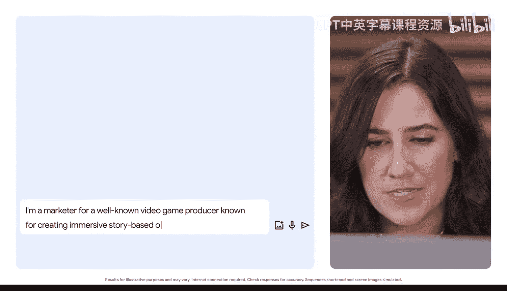

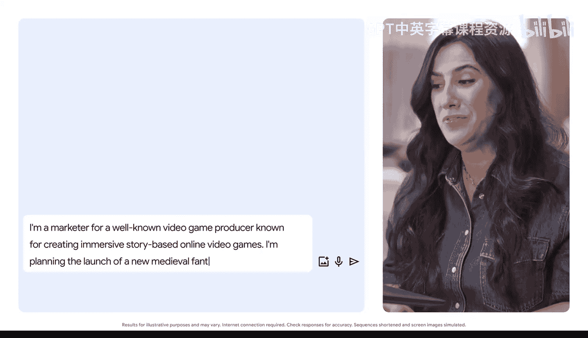

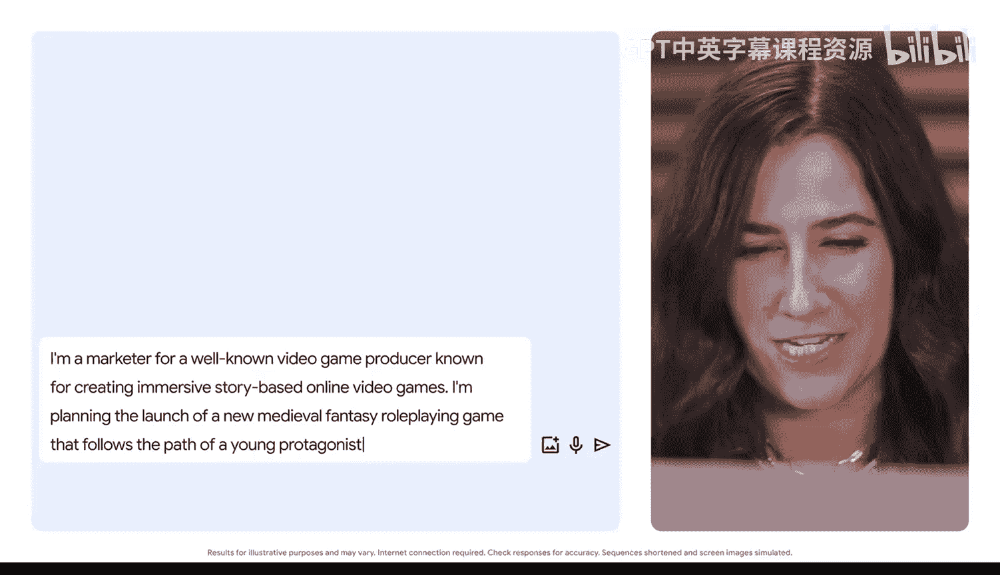

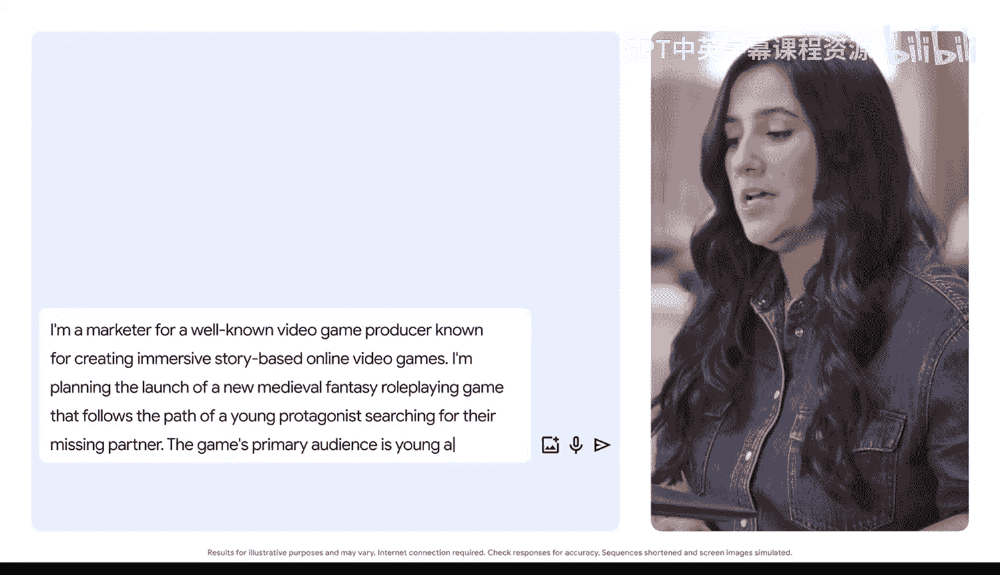

The game is reaching the end stages of development。

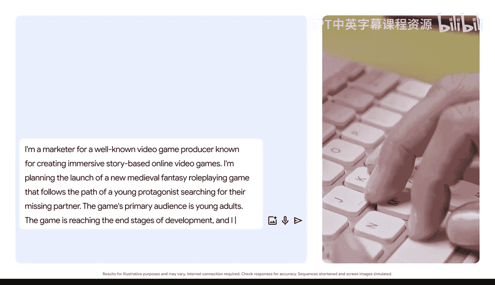

And I need help creating a timeline before it goes live。

Then we'll specify the tasks and include the formats。

 Pro a rough timeline for the year leading up to its launch。 Also。

 provide some pre launch ideas to help generate buzz around the game。

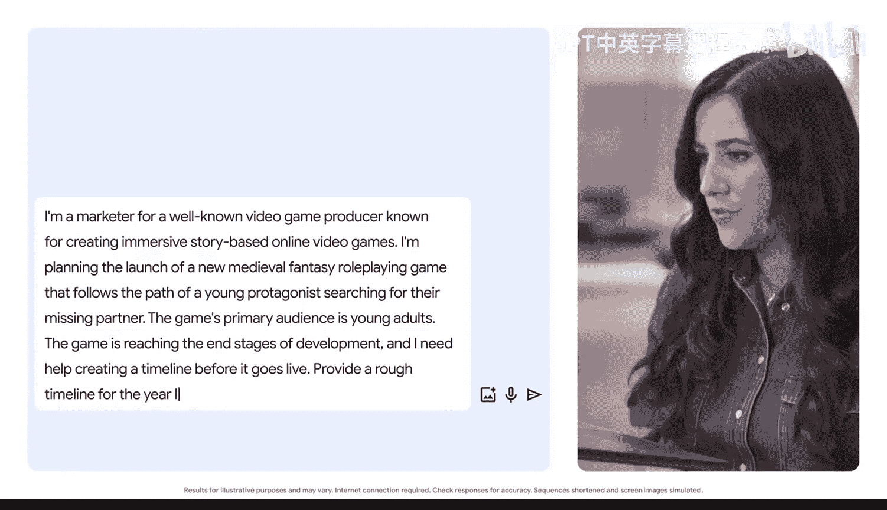

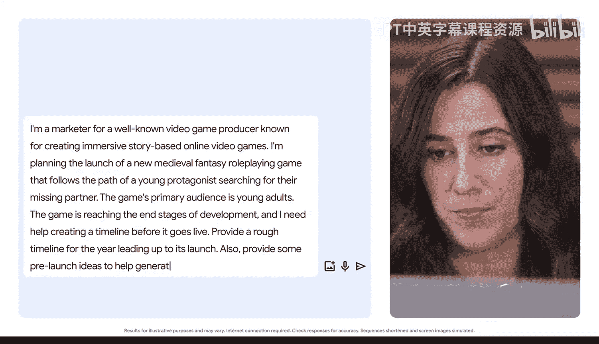

Before we check the output， I want to highlight a few important things about this prompt。

 We've set up the persona。 Your company launches video games。In the context。

 a medieval fantasy role playing game launch。 We've also specified the task。

 create a timeline for the launch and provide pre launch ideas to generate buzzuzz。😊。

With all that in mind， let's review the output。

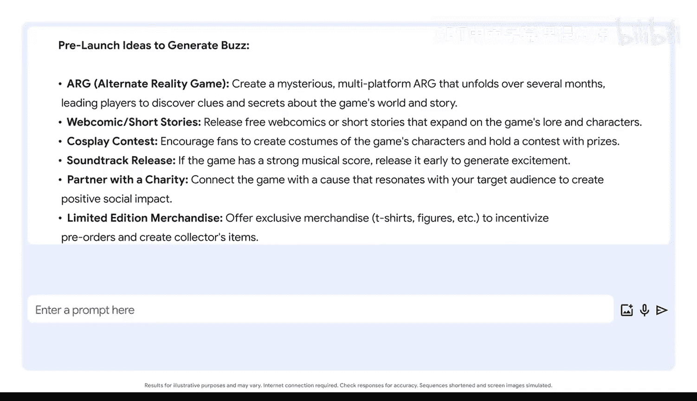

This is a great start。 Sign me up for the contest。Oh these are cool pre launch ideas They could use a little more detail。

 Maybe your team is hoping to promote this game around the world。

 Let's give Gemini more context and ask it to update the launch events with a global audience in mind。

 Since we're already in conversation with Gemini。 we'll follow up on the prompt we just wrote by adding。

😊，Now， provide pre launch ideas that will appeal to a global audience of young adults。

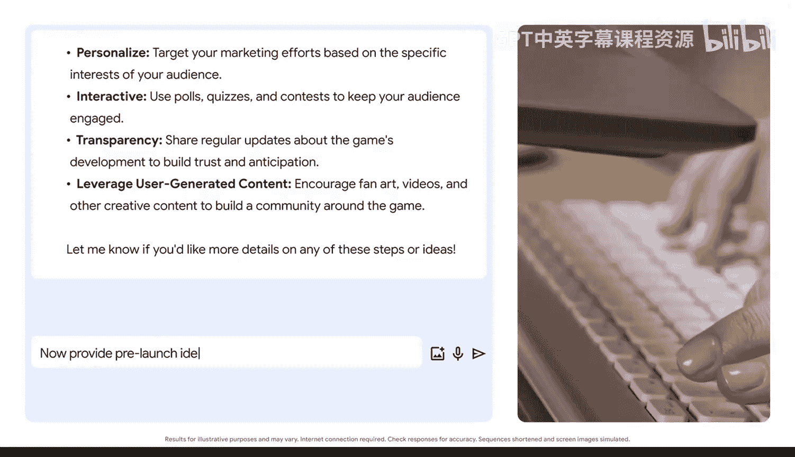

There we go。 These ideas are suited for a global audience， and not to mention， seem really fun。😊。

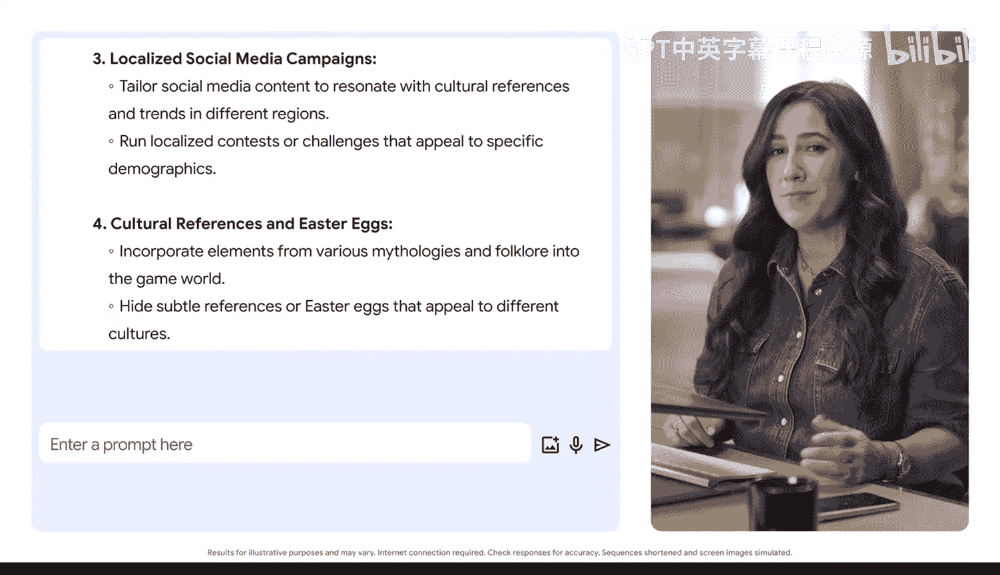

I love the idea to include cultural references in the game to relate to players from around the world。

😊。

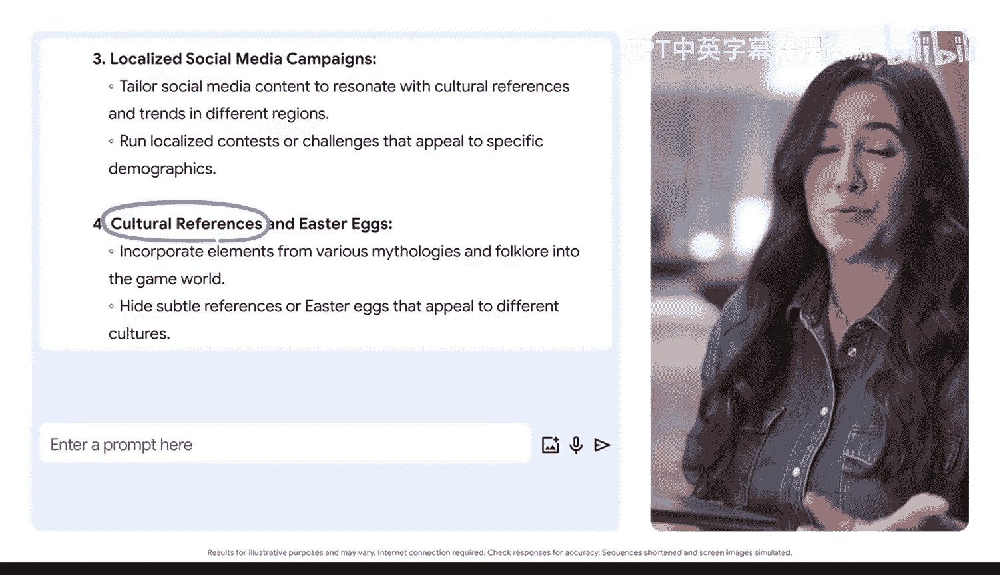

Evaluating and iterating is like having a conversation with the Gen A I tool。

 continually guiding it to generate our desired output。

 We can all use a little help generating new ideas。

 How can Gen A I help you with brainstorming at work。😊，🎼对。

