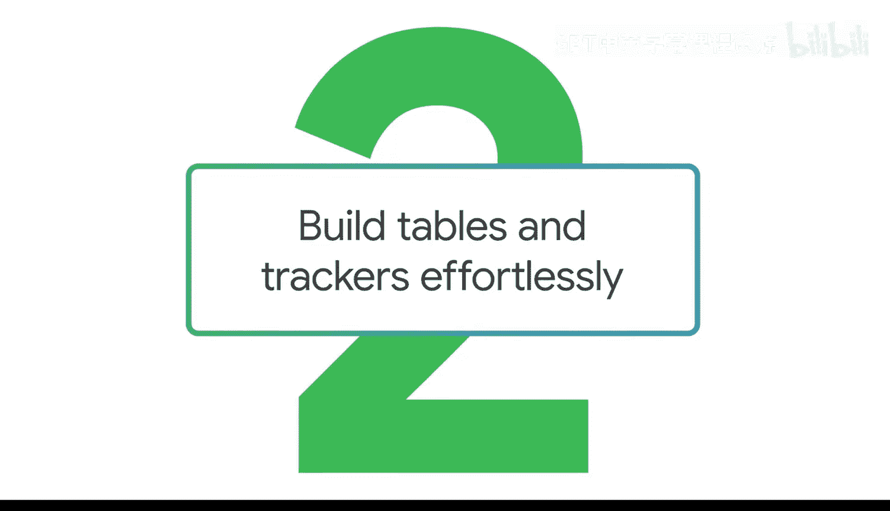
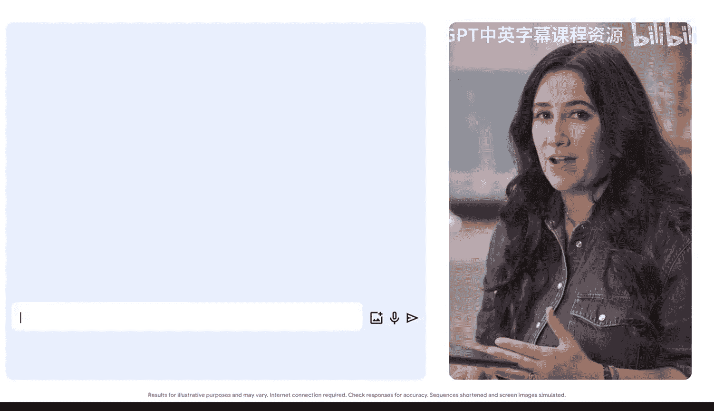
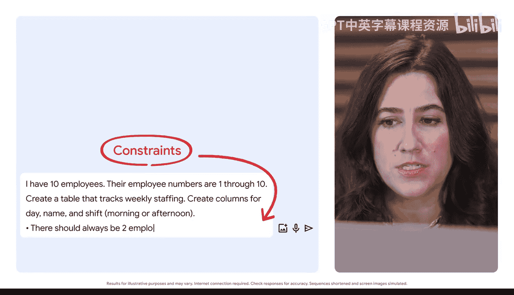
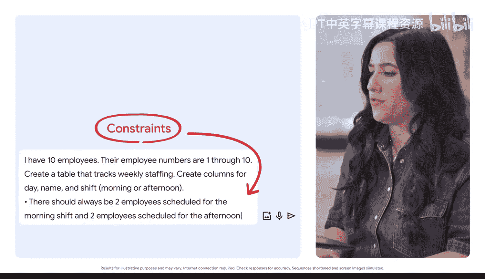
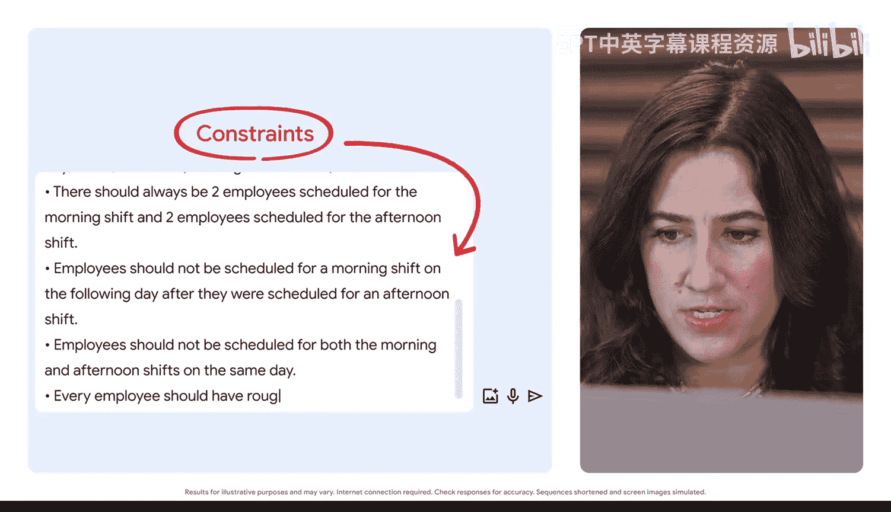
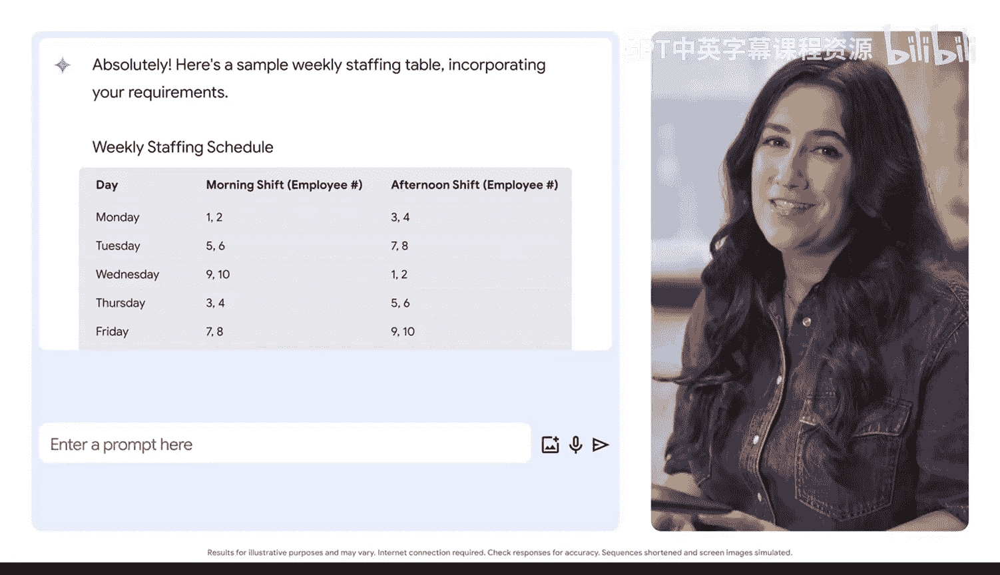
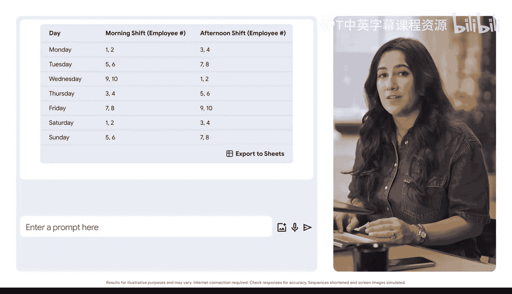

# 谷歌《提示词基础课程｜Google Prompting Essentials》中英字幕（deepseek p18 5_01_02_轻松构建表格与追踪器.zh_en -BV1zT6eYqEeR_p18-

Okay， spreadsheets aren't my favorite thing in the world。 I'm a creative marketer。

 so I try to avoid cells and formulas as much as possible。

 but there are times when I really need to use spreadsheets to create tables or track a project timeline。

 So I've started to use generative AI to help me。 And it's made creating those tables much easier and less time consuming。

 No matter where you work， Being able to easily turn information into an organized plan can be a massive help。

 Think of a schedule or project tracker。😊，These documents are so important because they keep team members aware of their ruless and responsibilities and keep timelines and deliverables on track。

 But building them can be a chore。 Let's explore how Jen A I can help you speed that process along。

Let's try this example， you need to create a schedule to plan your employee staffing each week and want to prompt Gemini to create a table。

Here's our task， format and context。

I have 10 employees。Their employee numbers are one through 10。

 create a table that tracks weekly staffing。Create columns for day。

 name and shift morning or afternoon。We also added constraints。

There should always be two employees scheduled for the morning shift and two employees scheduled for the afternoon shift。

 Employ should not be scheduled for a morning shift on the following day after they were scheduled for an afternoon shift。

 Employ should not be scheduled for both the morning and afternoon shifts on the same day。

 Every employees should have roughly the same number of total shifts per week。

In just a few seconds， Gemini created a staffing schedule in a format that's easy to track。

 The output includes the constraints we added when prompting。

 like making sure no one has to work a double shift。 Even better。

 we can export the schedule to Google sheets to continue working on it。 After logging in。

 we can prompt Gemini in sheets to summarize our schedule。

 create a new schedule or even create formulas to quickly analyze the information。😊。

But remember to avoid entering any sensitive information that you wouldn't want a tool reviewer to have access to。

 In this case， we wouldn't want to enter any specific information about employees。

 That's why we use anonymous employee numbers。 Always consult your organization's policies regarding sensitive data and Gen Ai use before leveraging a Gen AI tool for work。

