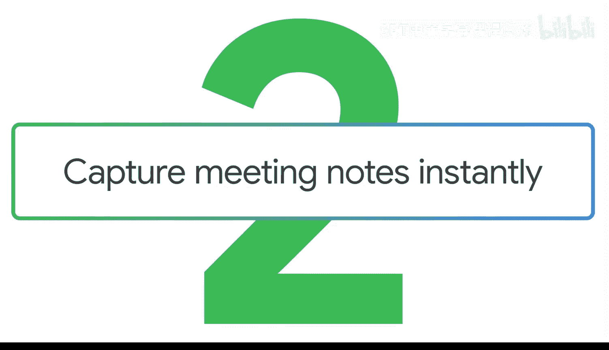
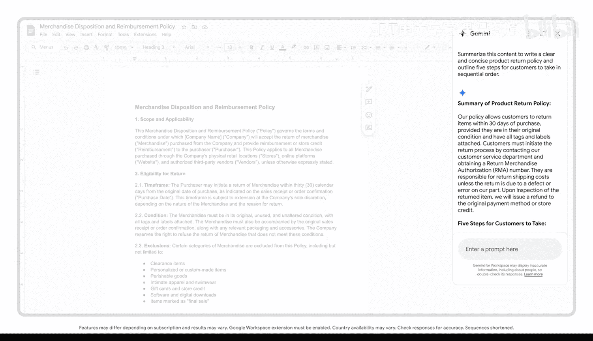

# 谷歌《提示词基础课程｜Google Prompting Essentials》中英字幕（deepseek p19 6_01_01_即时记录会议笔记.zh_en -BV1zT6eYqEeR_p19-

🎼。

My team and I work in Google Docs on a daily basis。 Sometimes when I'm editing。

 I'll realize the writing could be improved， but I'm not sure how to approach it。

 Instead of staring blankly at my screen， I can prompt Gemini in docs to pull out what I need to suggest something new to do that。

 Start by logging into docs。 You'll need a Google account for this。Let's try an example。

You receive customer feedback that your company's return policy is too long and confusing。

 You can past the return policy into a dock， then prompt Geminite。 From there。

 you can enter the following prompt。 Let's specify the task and context。Summarize this content。

To write a clear and concise product return policy。

And outline five steps for customers to take in sequential order。Now。

 you have a solid return policy to reference when assisting customers。

 as well as a list of ways customers can begin their returns。

 There's even more you can do to save time and boost productivity with Gemini and docs。

 Some days are just so packed with meetings and people and action items in those meetings that it can be hard to keep track of who said what or what you're responsible for。

 Think about a long meeting you had recently。 And just how much there was to cover。

 You might want a transcript。 right， You can create one right in Google meet from there。

 you can turn to Gemini and docs to help you keep things organized by creating meeting minutes。

 outlines a bulleted list and more to illustrate how it works。

 We' use a transcript generated by Gen Ai and open up docs。 Now。

 let's prompt Gemini making sure to ask for exactly what you need using our prompt framework。

 thoughtfully create really excellent inputs。 First， we'll add the task。

 create meeting minutes for this meeting。😊。

Then， specify the format。Section the meeting minutes by speaker。

And create a bulleted summary of key points made by that speaker。If applicable。

 highlight action items for each speaker。The meeting notes might be more useful if formatted in a clearer way。

 with more defined roles and responsibilities from the meeting。Let's iterate on our prompt。

 to achieve that。Will use the same task。Create meeting minutes for this meeting。

 but we'll change the format and get more specific with what exactly it is we want from the output。

Create sections based on key points extracted from the minutes。

Attribute each key point to a speaker and then assign action items to the speaker。

Who is most appropriate to complete them。Much better。 The action items are clearly displayed。

 and you have the most important takeaways from each attendee。 Now。

 you can use these notes to align with your colleagues on a project。

 sharere updates to keep stakeholders informed， help your teammates complete the responsibilities and monitor the progress of deliverables。

🎼。

